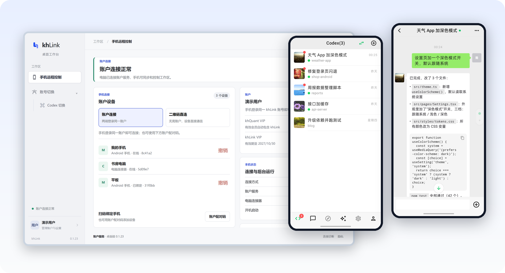
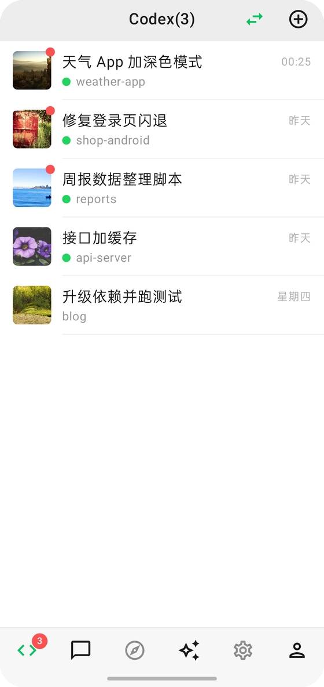
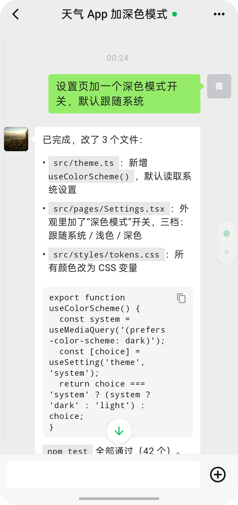
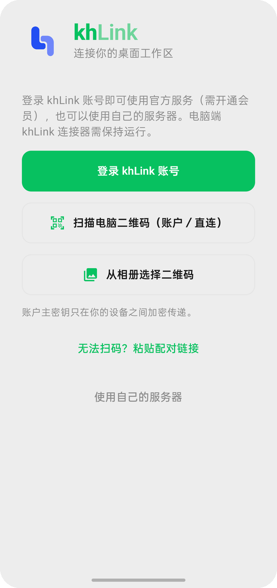
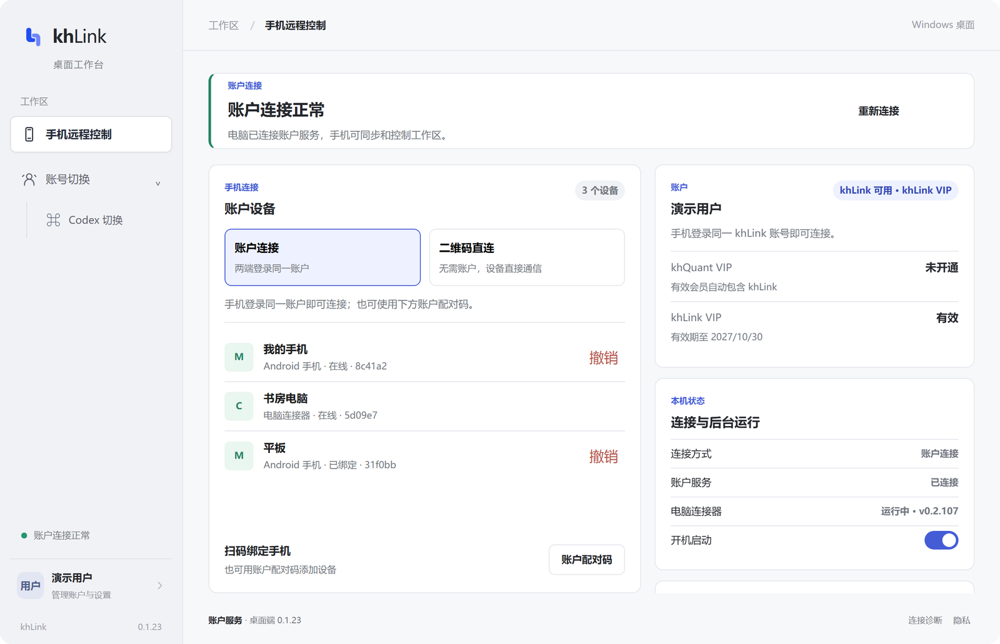
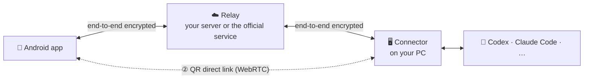

<div align="center">


# khLink

### Your agents work on your PC. You steer them from your phone.

Carry the Codex, Claude Code and other agent sessions running on your computer to your Android phone.<br/>
Answer questions, approve actions, send instructions and start new tasks — the work keeps going while you're away.

[](https://github.com/khscience/khlink/actions/workflows/ci.yml)
[](LICENSE)


[简体中文](README.md) · **English** · [繁體中文](README.zh-TW.md) · [日本語](README.ja.md) · [한국어](README.ko.md)

**[⬇️ Download the phone app and the PC installer](https://github.com/khscience/khlink-releases/releases/latest)** · [Website](https://khsci.com/khlink/)

[Why khLink](#why-khlink) · [Three ways to run it](#three-ways-to-run-it) · [Supported agents](#supported-agents) · [How it works](#how-it-works) · [FAQ](#faq)



</div>

---

## Why khLink

AI coding agents run for minutes, sometimes hours, and keep stopping to wait for you: to approve a command, to pick between options, or for the next instruction once a turn is done. Step away from the desk and the agent just sits there.

khLink fixes that.

<table>
<tr>
<td width="50%" valign="top">

#### 🔁 The same session, not a copy
It isn't a separate chat. What you see on the phone is the session on your PC: start a task at the desk and continue it on the phone, or the other way round. Model, reasoning effort, fast mode and plan mode stay in sync on both sides.

</td>
<td width="50%" valign="top">

#### 🔔 Your phone knows the moment it's your turn
Approval requests, questions and finished turns arrive as notifications. The choices are exactly the ones on the PC; tap one and the prompt closes at once while the answer is delivered in the background.

</td>
</tr>
<tr>
<td valign="top">

#### 🔒 Your code and accounts stay on your PC
Agents always run on your own computer and sign in through their official apps or CLIs; khLink never reads or forwards their credentials. Content between phone and PC is end-to-end encrypted, so a relay only ever sees ciphertext.

</td>
<td valign="top">

#### 🧩 One app, seven agents, several PCs
Codex, Claude Code, Claude Desktop, DeepSeek Harness, Hermes, Pi and Antigravity in one list. Signed in with a khLink account, one phone can manage several Windows PCs, with each PC's sessions kept apart.

</td>
</tr>
<tr>
<td valign="top">

#### 📶 Easy on mobile data
In light mode, long tool output and files stay on the PC and only the conversation comes over; open a block when you want it. The session list syncs only what changed.

</td>
<td valign="top">

#### 🛠️ Much more than chat
Messages sent while the agent is busy are queued. Read code, images and files, and pull files from the PC to the phone. See quotas and per-turn token usage. Compact the context, fork a task or roll back a turn.

</td>
</tr>
</table>

## Screenshots

<table>
  <tr>
    <td width="33%"></td>
    <td width="33%"></td>
    <td width="33%"></td>
  </tr>
  <tr>
    <td align="center">Every session, live status</td>
    <td align="center">Lists, code and files</td>
    <td align="center">Pick how to connect</td>
  </tr>
</table>



<sub>The sessions in the screenshots are made-up demo data.</sub>

## Three ways to run it

The phone app, the PC side and the relay server are all open source. How they connect is up to you:

| | ① Your own server | ② QR direct link | ③ Official service |
| --- | :---: | :---: | :---: |
| Server needed | one of yours | **none** | none |
| khLink account | not needed | not needed | needed |
| Cost | free | free | 100 MB free each month, then a membership |
| Works away from home | ✅ | most reliable on the same Wi-Fi; across networks via a Cloudflare temporary tunnel | ✅ |
| Content encryption | end-to-end | end-to-end | end-to-end |
| Best for | full control, you have a server | trying it for free, home or office use | install and go |

**Requirements**: an Android 7.0+ phone; a Windows 10 / 11 (64-bit) PC with the agents you want to use. The app's interface is in Chinese for now.

### Run it yourself

#### ① You have a server: host the relay

The relay only forwards encrypted messages. Once it is up you sign in with a server password — no account, no fees.

```bash
# On the server (Node.js 22, nginx with HTTPS)
git clone https://github.com/khscience/khlink.git && cd khlink
npm ci && npm run build
# then the config file, the systemd service and nginx: see docs/self-hosting.md
```

```powershell
# On the Windows PC (Node.js 22), in a clone of this repository
npm ci
$env:FENGZHU_BRIDGE_PASSWORD = '<server password>'
node fengzhu-connect\src\cli.js setup --server https://bridge.example.com/fengzhu-bridge
powershell -ExecutionPolicy Bypass -File ops\install-connector.ps1 -EnableAutoStart
```

The phone app can be the official build or your own. On its sign-in page tap **使用自己的服务器** (use my own server) and enter the address and password. Full guide: **[Self-hosting](docs/self-hosting.md)**.

#### ② No server at all: scan a QR code

No server and no account needed:

1. Install the khLink installer on the PC ([download](https://github.com/khscience/khlink-releases/releases/latest), or build [`kh-link-desktop`](kh-link-desktop) yourself) and the khLink app on the phone.
2. In the desktop console, open **二维码直连** (QR direct link).
3. On the phone's sign-in page tap **扫描电脑二维码** (scan the PC's QR code) and scan it.

The two set up an encrypted WebRTC channel, and messages, approvals and files travel straight between phone and PC without any service in the middle.

- **Same Wi-Fi or phone hotspot**: no outside service involved; the most reliable setup.
- **Different networks**: traffic goes through a Cloudflare temporary tunnel (cloudflared ships with the installer, no account needed). Content is end-to-end encrypted and does not pass through khLink servers. The tunnel survives a connector restart; after the PC restarts, scan again when away from home.

Each code works once and expires after five minutes. Once paired, the phone reconnects by itself after the app or the connector restarts; after the PC restarts, scan again when away from home. If the PC is also signed in to an account and the direct link keeps failing, the phone can switch to the account login and reconnect through the official relay. Details: **[Direct connection](docs/zh-CN/direct-connection.md)** (Chinese).

### ③ The official service: install and go

If you'd rather not deal with servers or networks, use our relay:

1. Download from [Releases](https://github.com/khscience/khlink-releases/releases/latest) or the [website](https://khsci.com/khlink/), and install the khLink app on the phone and the khLink installer on the Windows PC (desktop console and connector in one package).
2. Sign in to a khLink account in the desktop console. Every account gets 100 MB of free traffic each month; beyond that, a membership removes the limit.
3. Sign in to the same account on the phone, and your PC's sessions appear.

Every account gets 100 MB free each month; beyond that, a small membership fee covers the cost of the servers and their traffic. Content is still end-to-end encrypted; the service cannot read your code or conversations.

## Supported agents

| Agent | How khLink connects |
| --- | --- |
| **OpenAI Codex** | the official `codex app-server`, sharing sessions with the Codex desktop app |
| **Claude Code** | the official CLI and its session files |
| **Claude Desktop** | the official app's window and session files |
| **DeepSeek Harness** | a small bridge plugin ([details](docs/zh-CN/deepseek-harness.md)) |
| **Hermes Agent** | ACP inside WSL plus its read-only session store ([details](docs/zh-CN/hermes.md)) |
| **Pi** | Pi's own web process |
| **Antigravity** | the official app's window |

Every agent signs in on your PC through its own official app or CLI. khLink talks to it the way you would and never touches its credentials.

## How it works



- Content is encrypted with XChaCha20-Poly1305 before it leaves a device, and the account key lives only on your phone and PCs. A relay sees device and session IDs, timing and message sizes — nothing more.
- The connector runs as a scheduled task of the current user; no administrator rights needed.
- In-app updates on the phone and the PC are signature-checked and refused if the check fails.
  They come from GitHub Releases first, then jsDelivr (phone only), with the khLink server as
  the fallback.

| Part | Directory | Built with |
| --- | --- | --- |
| Android app | [`android/`](android) | Kotlin, Jetpack Compose |
| Connector | [`fengzhu-connect/`](fengzhu-connect) | Node.js 22 |
| Relay | [`fengzhu-server/`](fengzhu-server) | NestJS, SQLite |
| Desktop console | [`kh-link-desktop/`](kh-link-desktop) | Tauri 2: sign-in, phone pairing, QR direct link, connector status and updates |
| Desktop adapter | [`desktop-adapter/`](desktop-adapter) | Rust: reads and drives the Claude Desktop and Codex windows |

Wire format and encryption: [protocol/v1.md](protocol/v1.md).

## Build from source

<details>
<summary>Requirements and commands</summary>

You need Node.js 22, JDK 17 with the Android SDK, Rust stable with the
[Tauri 2 prerequisites](https://v2.tauri.app/start/prerequisites/) for Windows, and
PowerShell 5.1.

```bash
npm ci
npm test                                   # relay and connector
npm run build                              # relay
cd android && ./gradlew testDebugUnitTest assembleDebug
cd kh-link-desktop/src-tauri && cargo test
cd desktop-adapter && cargo test
```

- Release builds: [android/RELEASE.md](android/RELEASE.md) and the
  [combined installer](docs/zh-CN/combined-installer.md).
- `fengzhu-connect/bin/` holds the prebuilt desktop adapter and a small native helper. The
  helper is pinned by SHA-256 in `fengzhu-connect/scripts/claude-desktop-native.ps1`; rebuild it
  from `fengzhu-connect/native/` and update that hash together.
- Publishing your own app? Change the Android `applicationId` (`vip.fengzhu.bridge`) and drop
  or replace `updatePublicKey` and `updateMirrors` (the GitHub and jsDelivr sources) in
  `android/khlink-official.properties`, and `UPDATE_PUBLIC_KEY` and `UPDATE_MIRROR` in
  `kh-link-desktop/src-tauri/src/connector_update.rs`, or your users will be offered official
  updates they cannot install.
- The package names say `fengzhu`, the project's early name.

</details>

## FAQ

<details>
<summary><b>Can the relay read my code or conversations?</b></summary>

No — neither the official service nor a self-hosted relay. The phone and the connector encrypt
content before it leaves the device, and the key never passes through the relay. The relay sees
routing metadata (device, thread and event IDs), timing and the size of encrypted messages. A QR
direct link doesn't use a relay at all.
</details>

<details>
<summary><b>Which of the three should I pick?</b></summary>

Try the QR direct link first — it's free and very reliable on a shared Wi-Fi at home or in the
office. If you're often away and have a server, host the relay. If you don't want to manage
servers or networks, use the official service. All three use the same app and connector, so you
can switch at any time.
</details>

<details>
<summary><b>Why does the official service cost money?</b></summary>

Servers and traffic cost money. Every account gets 100 MB free each month, and the membership beyond that only covers the cost. Self-hosting and the QR
direct link are free and have the same features.
</details>

<details>
<summary><b>Does my PC have to stay on?</b></summary>

Yes. The agents run on the PC, so when it is off or asleep they stop too. The phone still shows what has
already synced, but nothing new can run. Turn off automatic sleep before you head out.
</details>

<details>
<summary><b>Is the app available in English?</b></summary>

Not yet — the interface is in Chinese. Translations are welcome.
</details>

<details>
<summary><b>Does khLink use my agents' accounts or API keys?</b></summary>

No. Each agent signs in through its official app or CLI on your computer; khLink does not read,
copy or send their credentials, and usage counts against your own account as usual.
</details>

<details>
<summary><b>Windows says it "protected your PC" when I run the installer?</b></summary>

The PC installer is not code-signed yet, so SmartScreen warns about it. Click **More info → Run anyway**.
To be sure the file is genuine, compare it with the SHA-256 listed on the Releases page.
</details>

<details>
<summary><b>Is there an iPhone app, or a connector for macOS or Linux?</b></summary>

Not yet. The app is Android only, and the connector runs on Windows (Hermes runs inside WSL
on that Windows PC).
</details>

## Documentation

| | |
| --- | --- |
| [Self-hosting](docs/self-hosting.md) · [自建中转](docs/zh-CN/self-hosting.md) | run your own relay |
| [Direct connection](docs/zh-CN/direct-connection.md) | WebRTC link from a QR code, no server |
| [Desktop connection flow](docs/zh-CN/desktop-connection-flow.md) | sign-in, pairing and status on the PC |
| [Several computers](docs/zh-CN/multi-pc.md) | one account, many PCs |
| [App updates](docs/zh-CN/android-app-updates.md) | signed in-app updates |
| [Troubleshooting](docs/zh-CN/troubleshooting.md) | common problems |
| [Protocol](protocol/v1.md) | wire format and encryption |

Most guides are in Chinese; English contributions are welcome.

## Contributing

Issues and pull requests are welcome. Please read [CONTRIBUTING.md](CONTRIBUTING.md) first,
and report security problems privately as described in [SECURITY.md](SECURITY.md).

## License

[MIT](LICENSE). The terms in `docs/kh-link-*.md` apply only to the official service and its
installers.

## Acknowledgements

khLink grew out of [Linco Bridge](https://github.com/lincotalk/linco-bridge) (MIT), whose
copyright notice is kept. It is built on [Tauri](https://tauri.app),
[NestJS](https://nestjs.com), [Jetpack Compose](https://developer.android.com/compose),
[libsodium](https://libsodium.org) and [werift](https://github.com/shinyoshiaki/werift-webrtc).

<div align="center">

If khLink saves you a trip back to your desk, a ⭐ helps others find it.

</div>
