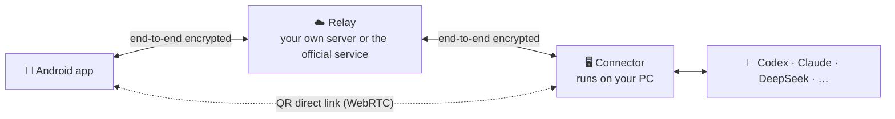

<div align="center">


# khLink

### Your agents work on your PC. You steer them from your phone.

The Codex, Claude Code and other agent sessions running on your computer, brought to your Android phone as they are.<br/>
Approve, answer, send new instructions. You're away from the desk, and the work keeps going.

[](https://github.com/khscience/khlink/actions/workflows/ci.yml)
[](LICENSE)


[简体中文](README.md) · **English** · [繁體中文](README.zh-TW.md) · [日本語](README.ja.md) · [한국어](README.ko.md)

**[⬇️ Download khLink](https://github.com/khscience/khlink-releases/releases/latest)** · [Website](https://khsci.com/khlink/) · [Tutorial](https://khsci.com/khlink/tutorial)


<sub>The accounts and sessions in the screenshots are demo data.</sub>

</div>

---

## Completely free, fully open source

The source of the phone app, the PC side and the relay server is all public (MIT). The three ways to connect have the same features, and none of them costs anything:

- **QR direct link**: the PC shows a QR code, the phone scans it, and you're connected. No account, and nothing goes through khLink servers.
- **Your own server**: deploy the open-source relay on your own machine and sign in with a server password. No account needed.
- **Our server**: sign in to a khLink account and go. Every account gets 300 MB of free traffic each month, and khQuant VIP members have no limit. khLink does not sell memberships.

Whichever you pick, content is end-to-end encrypted; a relay only ever sees ciphertext.

## When an agent stops, it's waiting for you

AI coding agents run for ten minutes or more at a time and keep stopping along the way: to have you approve a command, to have you pick between a few options, or to wait for your next step once they're done. Step away from the PC and the agent just sits there.

| | What the agent is waiting for | What you do on the phone |
| --- | --- | --- |
| **Approve** | to run a command or change files | see exactly what it will do, then allow or deny |
| **Answer** | for you to pick between options | the same choices as on the PC; one tap delivers it |
| **Continue** | a turn is done, next step please | keep talking in the same session, queued or cutting in right away |
| **Look** | you want to see the result now | pull files from the PC to the phone and preview them |

## What it does

**The same session.** Not a separate chat window: a task started on the PC continues on the phone, and one started on the phone continues back at the PC. Model, reasoning effort, fast mode and plan mode stay in sync on both sides.

- **Live status**: running, waiting for you, done — visible at a glance in the list.
- **Queue or send now**: messages sent while the agent is busy are queued automatically, or you can cut into the current turn right away.
- **Approvals and questions**: the phone notifies you when the agent asks for approval, asks a question or wants you to confirm a plan. Multiple-choice and free-form answers both work; plans can be accepted, changed or rejected. When an outcome is uncertain, you're asked to check first, so an instruction never runs twice.
- **Files**: tap a PC file path in the conversation to pull it to the phone and preview it. Markdown and HTML can be viewed rendered or as source, code is highlighted by language, and large files come over in parts. Credential and key directories can't be read.
- **Images and attachments**: send images and files to the agent from the phone.
- **Per-turn usage**: the tokens a turn used appear under the reply, and you can check each agent's quota.
- **Several PCs**: one account can connect several Windows PCs, with sessions kept apart per PC; switch with one tap on the home screen.
- **Light mode**: long tool output and screenshots stay on the PC until you ask for them, which saves mobile data.
- **Four themes**: Default, Codex style, Minimal and Chat app; see the [theme showcase](#four-themes) below.

## Screenshots

<table>
  <tr>
    <td width="33%"></td>
    <td width="33%"></td>
    <td width="33%"></td>
  </tr>
  <tr>
    <td align="center"><b>Sessions</b><br/>Every session with live status; the ones waiting for you come first</td>
    <td align="center"><b>Conversation</b><br/>Code, lists and file paths laid out clearly</td>
    <td align="center"><b>Steps</b><br/>Commands and changed files, a tap away</td>
  </tr>
  <tr>
    <td width="33%"></td>
    <td width="33%"></td>
    <td width="33%"></td>
  </tr>
  <tr>
    <td align="center"><b>Answer questions</b><br/>The same options as on the PC, sent with one tap</td>
    <td align="center"><b>Approve commands</b><br/>See exactly what it will do, then allow or deny</td>
    <td align="center"><b>Run settings</b><br/>Model, reasoning effort and permission mode, synced with the PC</td>
  </tr>
</table>


<p align="center"><sub>The desktop console on the PC: account, data usage, connected devices and agent usage.</sub></p>

## Four themes

Same features, four looks. Pick one in the setup guide of a fresh install, and switch any time under **Settings → Theme**.

<table>
  <tr>
    <th width="25%">Default</th>
    <th width="25%">Codex style</th>
    <th width="25%">Minimal</th>
    <th width="25%">Chat app</th>
  </tr>
  <tr>
    <td></td>
    <td></td>
    <td></td>
    <td></td>
  </tr>
  <tr>
    <td></td>
    <td></td>
    <td></td>
    <td></td>
  </tr>
  <tr>
    <td align="center">Warm white with slate blue and amber accents</td>
    <td align="center">Light workspace, blue messages and compact steps</td>
    <td align="center">Black, white and grey, no cards: flat lists and document-style chats</td>
    <td align="center">Like a familiar chat app: bottom tabs, avatar list, green bubbles</td>
  </tr>
</table>

## Getting started

You need a Windows 10 / 11 (64-bit) PC with the agents you want to use, and an Android 7.0+ phone. The app's interface is in Chinese for now.

1. **Install khLink on the PC**: [download the installer](https://github.com/khscience/khlink-releases/releases/latest); the desktop console and the background connector come in one package.
2. **Install the app on the phone**: download the APK from the same page and confirm the system prompt when installing.
3. **Connect them**: sign in to the same khLink account on both, or scan the QR code on the PC once.

The PC installer is not code-signed yet. If Windows says it "protected your PC", check the file against the SHA-256 on the Releases page, then click **More info → Run anyway**. Step-by-step details are in the [tutorial](https://khsci.com/khlink/tutorial).

## Three ways to connect

Try the QR direct link first for free. If you're often away and have a server of your own, host the relay. If you'd rather not deal with servers or networks, use the official service. All three use the same app and the same connector, and you can switch at any time.

| | QR direct link | Your own server | Official service |
| --- | :---: | :---: | :---: |
| Cost | free | free | free, 300 MB of traffic a month |
| Server needed | none | one of yours | none |
| khLink account needed | no | no | yes |
| Works away from home | ✅ via a Cloudflare temporary tunnel | ✅ | ✅ |
| Multiple devices | one phone to one PC | several phones | several phones and PCs |
| After a restart | reconnects after the app or connector restarts; after the PC restarts, scan again when away from home | reconnects automatically | reconnects automatically |
| Content encryption | end-to-end | end-to-end | end-to-end |
| Best for | trying it at no cost, mostly at home or the office | you have a server and want full control | install and go |

### QR direct link

1. Install khLink on the PC and the phone.
2. Open the desktop console on the PC and click **二维码直连** (QR direct link).
3. On the phone's sign-in page tap **扫描电脑二维码** (scan the PC's QR code).

The two set up an encrypted channel over WebRTC, and messages, approvals and files travel straight between phone and PC. On the same Wi-Fi or phone hotspot they connect peer to peer, which is the most reliable; on different networks traffic goes through a Cloudflare temporary tunnel (cloudflared ships with the installer, no account needed). Each QR code works once and is valid for five minutes. Details: **[Direct connection](docs/zh-CN/direct-connection.md)**.

### Your own server

The relay only forwards encrypted messages, and you sign in with a server password — no account needed. You need a server with a public address and HTTPS set up.

```bash
# On the server (Node.js 22, nginx with HTTPS)
git clone https://github.com/khscience/khlink.git && cd khlink
npm ci && npm run build
# then the config file, the systemd service and nginx: see docs/zh-CN/self-hosting.md
```

```powershell
# On the Windows PC (Node.js 22), in a clone of this repository
npm ci
$env:FENGZHU_BRIDGE_PASSWORD = '<server password>'
node fengzhu-connect\src\cli.js setup --server https://bridge.example.com/fengzhu-bridge
powershell -ExecutionPolicy Bypass -File ops\install-connector.ps1 -EnableAutoStart
```

On the phone's sign-in page tap **使用自己的服务器** (use my own server) and enter the address and password. Full guide: **[Self-hosting](docs/zh-CN/self-hosting.md)**.

### Our server

Sign in to the same khLink account in the desktop console and on the phone, and your PC's sessions appear. One account can connect several phones and several PCs.

Every account gets 300 MB of free traffic each month (per calendar month in Beijing time; only uploads and downloads through the official server count, heartbeats don't). The app reminds you at 80% and when it's used up. After that you can still sign in and view what's already on the phone, but remote actions are paused until the 1st of next month. khQuant VIP members have no limit.

## Supported agents

| Agent | How khLink connects to it |
| --- | --- |
| **OpenAI Codex** | the official `codex app-server`, sharing sessions with the Codex desktop app |
| **Claude Code** | the official CLI and its session files |
| **Claude Desktop** | the official app's window and session files |
| **DeepSeek Harness** | a small bridge plugin, used only to find the local endpoint it opens ([details](docs/zh-CN/deepseek-harness.md)) |
| **Hermes Agent** | ACP inside WSL on the PC, plus its read-only session store ([details](docs/zh-CN/hermes.md)) |
| **Pi** | Pi's own web service (PI WEB) |
| **Antigravity** | the official app's window |

Every agent runs on your PC and signs in through its own official app or CLI. khLink deals with it the same way you do and never touches its credentials. Agents that aren't installed are skipped; install one later and it's picked up within a minute.

## Security

- **End-to-end encryption**: content is encrypted with XChaCha20-Poly1305 before it leaves a device, and the account key lives only on your phone and PCs.
- **The relay sees only routing information**: device and session IDs, timing and message sizes. A QR direct link doesn't go through a relay at all.
- **Hands off your agent accounts**: khLink doesn't read, copy or send agent credentials, and usage counts against your own account.
- **Signed updates**: update packages for the phone and the PC are signature-checked and not installed if the check fails.

## How it works



The connector runs in the background as a scheduled task of the current user; no administrator rights needed. Updates come from GitHub Releases first, the phone also tries jsDelivr, and the khLink server is the fallback when neither is reachable.

| Part | Directory | Built with |
| --- | --- | --- |
| Android app | [`android/`](android) | Kotlin, Jetpack Compose |
| Connector | [`fengzhu-connect/`](fengzhu-connect) | Node.js 22 |
| Relay | [`fengzhu-server/`](fengzhu-server) | NestJS, SQLite |
| Desktop console | [`kh-link-desktop/`](kh-link-desktop) | Tauri 2: sign-in, phone pairing, QR direct link, connector status and updates |
| Desktop adapter | [`desktop-adapter/`](desktop-adapter) | Rust: reads and drives the Claude Desktop and Codex windows |

Wire format and encryption: [protocol/v1.md](protocol/v1.md).

## FAQ

<details>
<summary><b>Does khLink cost money?</b></summary>

The software is free and the source is public under the MIT license. The QR direct link and your own server cost nothing. The official server is free too: 300 MB of traffic per account each month, and khQuant VIP members have no limit. khLink does not sell memberships, and all three ways have the same features.
</details>

<details>
<summary><b>Is 300 MB of free traffic enough? What happens when it runs out?</b></summary>

For sending instructions and reading replies, 300 MB a month is usually enough; syncing very long conversations or transferring files often uses it up faster. The **我** (Me) page in the app shows how much you've used this month, and you're reminded at 80% and when it's used up. After that you can still sign in and view what's already on the phone; only remote actions are paused until the 1st of next month (Beijing time). The QR direct link and your own server are not affected.
</details>

<details>
<summary><b>Does my PC have to stay on?</b></summary>

Yes. The agents run on the PC, so when it's off or asleep they stop too; the phone can still show what has already synced. Turn off automatic sleep before you head out.
</details>

<details>
<summary><b>Can I use several phones and several PCs together?</b></summary>

With the official service, yes: phones and PCs signed in to the same account can all be online at once, and the phone switches between PCs. A self-hosted server supports several phones signed in at once. The QR direct link is currently one phone to one PC.
</details>

<details>
<summary><b>Can the relay see my code and conversations?</b></summary>

No. The phone and the PC encrypt content before it leaves the device, and the key never passes through the relay. What the relay can see is device, session and event IDs, timing and the size of encrypted messages. A QR direct link doesn't go through a relay at all.
</details>

<details>
<summary><b>Does khLink use my agents' accounts or API keys?</b></summary>

No. Each agent signs in on your PC through its official app or CLI; khLink doesn't read, copy or send their credentials, and usage counts against your own account.
</details>

<details>
<summary><b>Do I have to install Codex on the PC?</b></summary>

No. You can use only other agents such as Claude, DeepSeek or Hermes, and khLink skips Codex. Install Codex later and it's picked up within a minute, no restart needed.
</details>

<details>
<summary><b>Is there an iPhone app? Does the PC side support macOS?</b></summary>

Not yet. The app is Android only, and the PC side supports Windows only (Hermes runs in WSL on that PC).
</details>

More answers in the [tutorial](https://khsci.com/khlink/tutorial) and [Troubleshooting](docs/zh-CN/troubleshooting.md).

## Build from source

<details>
<summary>Requirements and commands</summary>

You need Node.js 22, JDK 17 with the Android SDK, Rust stable with the [Tauri 2 prerequisites for Windows](https://v2.tauri.app/start/prerequisites/), and PowerShell 5.1.

```bash
npm ci
npm test                                   # relay and connector
npm run build                              # build the relay
cd android && ./gradlew testDebugUnitTest assembleDebug
cd kh-link-desktop/src-tauri && cargo test
cd desktop-adapter && cargo test
```

- Release builds: see [android/RELEASE.md](android/RELEASE.md) and the [combined installer](docs/zh-CN/combined-installer.md).
- `fengzhu-connect/bin/` holds the prebuilt desktop adapter and a small native helper library. The helper's SHA-256 is checked in `fengzhu-connect/scripts/claude-desktop-native.ps1`; if you rebuild it from `fengzhu-connect/native/`, update that hash too.
- Publishing your own app? Change the Android `applicationId` (`vip.fengzhu.bridge`), drop or replace `updatePublicKey` and `updateMirrors` in `android/khlink-official.properties`, and on the desktop side change `UPDATE_PUBLIC_KEY` and `UPDATE_MIRROR` in `kh-link-desktop/src-tauri/src/connector_update.rs`, or your users will be offered official updates they can't install.
- The `fengzhu` in the package names is the project's early name.

</details>

## Documentation

| | |
| --- | --- |
| [Direct connection](docs/zh-CN/direct-connection.md) (Chinese) | WebRTC direct link without a server |
| [Self-hosting](docs/zh-CN/self-hosting.md) (Chinese) | deploy your own relay server |
| [Desktop connection flow](docs/zh-CN/desktop-connection-flow.md) (Chinese) | sign-in, pairing and status on the PC |
| [One account, several PCs](docs/zh-CN/multi-pc.md) (Chinese) | connect several PCs to the same account |
| [Phone updates](docs/zh-CN/android-app-updates.md) (Chinese) | signature-checked in-app updates |
| [Troubleshooting](docs/zh-CN/troubleshooting.md) (Chinese) | fixing common problems |
| [Protocol](protocol/v1.md) | wire format and encryption |

## Contributing

Issues and PRs are welcome; please read [CONTRIBUTING.md](CONTRIBUTING.md) first. Report security problems privately as described in [SECURITY.md](SECURITY.md).

## License

[MIT](LICENSE). The terms in `docs/kh-link-*.md` apply only to the official service and the official installers.

## Acknowledgements

khLink grew out of [Linco Bridge](https://github.com/lincotalk/linco-bridge) (MIT), whose copyright notice is kept. It is built on [Tauri](https://tauri.app), [NestJS](https://nestjs.com), [Jetpack Compose](https://developer.android.com/compose), [libsodium](https://libsodium.org) and [werift](https://github.com/shinyoshiaki/werift-webrtc).

<div align="center">

If khLink saves you a few trips back to your desk, a ⭐ helps more people find it.

</div>
