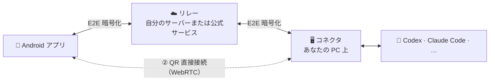

<div align="center">


# khLink

### エージェントは PC で働き、指示はスマホから

PC で動いている Codex や Claude Code などのエージェントのセッションを、そのまま Android スマホへ。<br/>
質問への回答、操作の承認、新しい指示、新しいタスク。PC の前にいなくても作業は止まりません。

[](https://github.com/khscience/khlink/actions/workflows/ci.yml)
[](LICENSE)


[简体中文](README.md) · [English](README.en.md) · [繁體中文](README.zh-TW.md) · **日本語** · [한국어](README.ko.md)

**[⬇️ スマホアプリと PC インストーラーをダウンロード](https://github.com/khscience/khlink-releases/releases/latest)** · [公式サイト](https://khsci.com/khlink/)

[khLink を使う理由](#khlink-を使う理由) · [3 つの使い方](#3-つの使い方) · [対応エージェント](#対応エージェント) · [仕組み](#仕組み) · [よくある質問](#よくある質問)


</div>

---

## khLink を使う理由

AI コーディングエージェントは数十分、ときには数時間動き続け、そのあいだ何度もあなたを待ちます。コマンドの承認、いくつかの案からの選択、そして 1 ターン終わった後の次の指示。PC から離れると、エージェントはただ待つしかありません。

khLink はこの問題を解決します。

<table>
<tr>
<td width="50%" valign="top">

#### 🔁 PC のセッションそのもの
別のチャットではありません。スマホに表示されるのは PC 上のセッションそのものです。PC で始めたタスクをスマホで続け、スマホで始めたタスクを PC に戻って続けられます。モデル、推論の強さ、高速モード、プランモードは両方で同期されます。

</td>
<td width="50%" valign="top">

#### 🔔 あなたの番になればすぐ通知
承認の依頼、質問、ターンの完了はスマホに通知されます。選択肢は PC とまったく同じ。タップするとすぐに閉じ、回答はバックグラウンドで届きます。

</td>
</tr>
<tr>
<td valign="top">

#### 🔒 コードもアカウントも PC から出ない
エージェントは常にあなたの PC で動き、公式アプリや CLI でサインインします。khLink は認証情報を読み取ることも転送することもありません。スマホと PC の間の内容はエンドツーエンドで暗号化され、リレーには暗号文しか見えません。

</td>
<td valign="top">

#### 🧩 1 つのアプリで 7 種類のエージェント、複数の PC
Codex、Claude Code、Claude Desktop、DeepSeek Harness、Hermes、Pi、Antigravity を 1 つのリストで。khLink アカウントでサインインすれば、1 台のスマホで複数の Windows PC を管理でき、セッションは PC ごとに分かれます。

</td>
</tr>
<tr>
<td valign="top">

#### 📶 モバイル通信量を節約
ライトモードでは、長いツール出力やファイルは PC に残し、会話だけを転送します。見たい部分は開いたときに取得します。セッション一覧も変更分だけを同期します。

</td>
<td valign="top">

#### 🛠️ チャット以上のことができる
エージェントが作業中に送ったメッセージは自動でキューに入ります。コード、画像、ファイルを閲覧し、PC のファイルをスマホに取り込めます。利用枠やターンごとのトークン使用量を確認し、コンテキストの整理、タスクの分岐、1 ターンの巻き戻しもできます。

</td>
</tr>
</table>

## スクリーンショット

<table>
  <tr>
    <td width="33%"></td>
    <td width="33%"></td>
    <td width="33%"></td>
  </tr>
  <tr>
    <td align="center">全セッションとリアルタイムの状態</td>
    <td align="center">リスト、コード、ファイル</td>
    <td align="center">3 つの接続方法から選択</td>
  </tr>
</table>


<sub>スクリーンショットのセッションは架空のデモデータです。</sub>

## 3 つの使い方

khLink のスマホアプリ、PC 側、リレーサーバーはすべてオープンソースです。どうつなぐかはあなた次第です。

| | ① 自分のサーバー | ② QR コードで直接接続 | ③ 公式サービス |
| --- | :---: | :---: | :---: |
| サーバー | 自分で 1 台 | **不要** | 不要 |
| khLink アカウント | 不要 | 不要 | 必要 |
| 費用 | 無料 | 無料 | 毎月 100 MB まで無料、超えたら会員 |
| 外出先でも使える | ✅ | 同じ Wi-Fi が最も安定、別のネットワークは Cloudflare の一時トンネル経由 | ✅ |
| 内容の暗号化 | エンドツーエンド | エンドツーエンド | エンドツーエンド |
| 向いている人 | サーバーがあり、すべて自分で管理したい | 無料で試したい、自宅やオフィスで使う | インストールしてすぐ使いたい |

**動作環境**：Android 7.0 以上のスマホ。使いたいエージェントを入れた Windows 10 / 11（64 ビット）の PC。アプリの画面は現在中国語のみです。

### 自分で運用する

#### ① サーバーがある場合：リレーを立てる

リレーは暗号化されたメッセージを中継するだけです。立ち上げたらサーバーパスワードでサインインします。アカウントも費用も不要です。

```bash
# サーバーで（Node.js 22、HTTPS 設定済みの nginx）
git clone https://github.com/khscience/khlink.git && cd khlink
npm ci && npm run build
# 続いて設定ファイル、systemd サービス、nginx を設定：docs/self-hosting.md を参照
```

```powershell
# Windows PC で（Node.js 22）、このリポジトリのクローン内で
npm ci
$env:FENGZHU_BRIDGE_PASSWORD = '<サーバーパスワード>'
node fengzhu-connect\src\cli.js setup --server https://bridge.example.com/fengzhu-bridge
powershell -ExecutionPolicy Bypass -File ops\install-connector.ps1 -EnableAutoStart
```

スマホアプリは公式ビルドでも自分でビルドしたものでも構いません。サインイン画面で **使用自己的服务器**（自分のサーバーを使う）をタップし、アドレスとパスワードを入力すれば接続できます。詳しくは **[セルフホスト](docs/self-hosting.md)**（英語）を参照してください。

#### ② サーバーがない場合：QR コードで直接接続

サーバーもアカウント登録も不要です。

1. PC に khLink インストーラー（[ダウンロード](https://github.com/khscience/khlink-releases/releases/latest)、または [`kh-link-desktop`](kh-link-desktop) を自分でビルド）を、スマホに khLink アプリを入れます。
2. PC のデスクトップコンソールで **二维码直连**（QR 直接接続）を開きます。
3. スマホのサインイン画面で **扫描电脑二维码**（PC の QR コードを読み取る）をタップし、読み取れば接続完了です。

両者は WebRTC で暗号化チャネルを作り、メッセージ、承認、ファイルはスマホと PC の間で直接やり取りされます。途中にサービスは入りません。

- **同じ Wi-Fi またはテザリング**：外部サービスは一切不要で、最も安定します。
- **別のネットワーク**：Cloudflare の一時トンネルを経由します（cloudflared はインストーラーに同梱、アカウント不要）。内容はエンドツーエンドで暗号化され、khLink のサーバーを通りません。コネクタを再起動してもトンネルは変わりません。PC を再起動したら、外出先では読み取り直してください。

QR コードは 1 回限りで、5 分間有効です。一度ペアリングすれば、アプリやコネクタを再起動しても自動で再接続します。PC を再起動したら、外出先では新しいコードを読み取ってください。PC もアカウントにサインインしていれば、直接接続がつながらないときにスマホをアカウントのサインインに切り替え、公式サーバー経由で再接続できます。詳しくは **[直接接続](docs/zh-CN/direct-connection.md)**（中国語）を参照してください。

### ③ 公式サービス：インストールしてすぐ使う

サーバーやネットワークに手間をかけたくなければ、私たちのリレーを使えます。

1. [Releases](https://github.com/khscience/khlink-releases/releases/latest) または[公式サイト](https://khsci.com/khlink/)からダウンロードし、スマホに khLink アプリ、Windows PC に khLink インストーラー（デスクトップコンソールとコネクタを同梱）を入れます。
2. デスクトップコンソールで khLink アカウントにサインインします。各アカウントに毎月 100 MB の無料枠があり、超えたら会員になると無制限になります。
3. スマホで同じアカウントにサインインすると、PC のセッションが表示されます。

毎月 100 MB までは無料で、それを超える分の少額の会費はサーバーと通信のコストをまかなうためだけのものです。内容は同じくエンドツーエンドで暗号化され、サービス側からコードや会話は見えません。

## 対応エージェント

| エージェント | khLink の接続方法 |
| --- | --- |
| **OpenAI Codex** | 公式 `codex app-server`。Codex デスクトップアプリとセッションを共有 |
| **Claude Code** | 公式 CLI とそのセッションファイル |
| **Claude Desktop** | 公式アプリのウィンドウとセッションファイル |
| **DeepSeek Harness** | 小さなブリッジプラグイン（[詳細](docs/zh-CN/deepseek-harness.md)） |
| **Hermes Agent** | WSL 内の ACP と読み取り専用のセッションストア（[詳細](docs/zh-CN/hermes.md)） |
| **Pi** | Pi 自身の Web プロセス |
| **Antigravity** | 公式アプリのウィンドウ |

どのエージェントも、あなたの PC 上で公式アプリや CLI を使ってサインインします。khLink はあなたと同じ方法でエージェントとやり取りし、認証情報には触れません。

## 仕組み



- 内容はデバイスを出る前に XChaCha20-Poly1305 で暗号化され、アカウント鍵はあなたのスマホと PC にしかありません。リレーに見えるのはデバイスとセッションの ID、時刻、メッセージのサイズだけです。
- コネクタは現在のユーザーのタスクスケジューラで動き、管理者権限は不要です。
- スマホと PC のアプリ内アップデートはどちらも署名を検証し、検証に失敗したものはインストールしません。更新はまず GitHub Releases から取得し、スマホは jsDelivr も試し、どちらにもつながらないときは khLink サーバーを使います。

| 構成要素 | ディレクトリ | 技術 |
| --- | --- | --- |
| Android アプリ | [`android/`](android) | Kotlin、Jetpack Compose |
| コネクタ | [`fengzhu-connect/`](fengzhu-connect) | Node.js 22 |
| リレー | [`fengzhu-server/`](fengzhu-server) | NestJS、SQLite |
| デスクトップコンソール | [`kh-link-desktop/`](kh-link-desktop) | Tauri 2：サインイン、スマホのペアリング、QR 直接接続、コネクタの状態と更新 |
| デスクトップアダプター | [`desktop-adapter/`](desktop-adapter) | Rust：Claude Desktop と Codex のウィンドウを読み取り・操作 |

通信フォーマットと暗号化の詳細は [protocol/v1.md](protocol/v1.md) を参照してください。

## ソースからビルド

<details>
<summary>必要な環境とコマンド</summary>

Node.js 22、JDK 17 と Android SDK、Rust stable と [Tauri 2 の Windows 向け前提条件](https://v2.tauri.app/start/prerequisites/)、PowerShell 5.1 が必要です。

```bash
npm ci
npm test                                   # リレーとコネクタ
npm run build                              # リレーのビルド
cd android && ./gradlew testDebugUnitTest assembleDebug
cd kh-link-desktop/src-tauri && cargo test
cd desktop-adapter && cargo test
```

- リリースビルド：[android/RELEASE.md](android/RELEASE.md) と[統合インストーラー](docs/zh-CN/combined-installer.md)を参照。
- `fengzhu-connect/bin/` にはビルド済みのデスクトップアダプターと小さなネイティブヘルパーがあります。ヘルパーの SHA-256 は `fengzhu-connect/scripts/claude-desktop-native.ps1` で検証しているため、`fengzhu-connect/native/` から再ビルドしたらこのハッシュも更新してください。
- 独自のアプリを配布する場合は、Android の `applicationId`（`vip.fengzhu.bridge`）を変更し、`android/khlink-official.properties` の `updatePublicKey` と `updateMirrors`（GitHub と jsDelivr の配布元）、デスクトップ版は `kh-link-desktop/src-tauri/src/connector_update.rs` の `UPDATE_PUBLIC_KEY` と `UPDATE_MIRROR` を削除または置き換えてください。そうしないと、利用者にインストールできない公式アップデートが届きます。
- パッケージ名の `fengzhu` はプロジェクト初期の名前です。

</details>

## よくある質問

<details>
<summary><b>リレーにコードや会話は見えますか？</b></summary>

見えません。公式サービスでもセルフホストのリレーでも同じです。スマホとコネクタは内容がデバイスを出る前に暗号化し、鍵はリレーを通りません。リレーに見えるのはルーティング情報（デバイス、セッション、イベントの ID）、時刻、暗号化メッセージのサイズです。QR 直接接続ではリレー自体を使いません。
</details>

<details>
<summary><b>3 つのうちどれを選べばいいですか？</b></summary>

まずは無料の QR 直接接続を試してください。自宅やオフィスの同じ Wi-Fi ならとても安定します。外出先でよく使い、サーバーを持っているならリレーをセルフホストしましょう。サーバーやネットワークを管理したくなければ公式サービスがおすすめです。どれも同じアプリとコネクタを使うので、いつでも切り替えられます。
</details>

<details>
<summary><b>公式サービスはなぜ有料なのですか？</b></summary>

リレーサーバーと通信にはコストがかかります。各アカウントに毎月 100 MB の無料枠があり、それを超える分の会費はそのコストをまかなうためだけのものです。セルフホストと QR 直接接続は無料で、機能も同じです。
</details>

<details>
<summary><b>PC はずっと起動しておく必要がありますか？</b></summary>

はい。エージェントは PC 上で動くため、PC の電源が切れたりスリープしたりすると止まります。同期済みの履歴はスマホで見られますが、作業を進めることはできません。外出前に自動スリープをオフにしてください。
</details>

<details>
<summary><b>khLink はエージェントのアカウントや API キーを使いますか？</b></summary>

使いません。各エージェントはあなたの PC 上で公式アプリや CLI からサインインします。khLink はその認証情報を読み取らず、コピーも送信もしません。利用量はいつもどおりあなた自身のアカウントに計上されます。
</details>

<details>
<summary><b>インストール時に「Windows によって PC が保護されました」と表示されます</b></summary>

PC インストーラーにはまだコード署名がないため、SmartScreen がこう警告します。「詳細情報 → 実行」をクリックしてください。念のため、Releases ページに記載された SHA-256 でダウンロードしたファイルを確認できます。
</details>

<details>
<summary><b>iPhone 版や、macOS・Linux 用のコネクタはありますか？</b></summary>

まだありません。アプリは Android のみ、コネクタは Windows のみ対応です（Hermes はその Windows PC の WSL 内で動きます）。
</details>

## ドキュメント

| | |
| --- | --- |
| [セルフホスト](docs/self-hosting.md) | 自分のリレーを運用する（英語） |
| [直接接続](docs/zh-CN/direct-connection.md) | サーバー不要の WebRTC 接続 |
| [デスクトップの接続フロー](docs/zh-CN/desktop-connection-flow.md) | PC でのサインイン、ペアリング、状態 |
| [複数の PC](docs/zh-CN/multi-pc.md) | 1 つのアカウントで複数の PC |
| [アプリの更新](docs/zh-CN/android-app-updates.md) | 署名付きのアプリ内アップデート |
| [トラブルシューティング](docs/zh-CN/troubleshooting.md) | よくある問題 |
| [プロトコル](protocol/v1.md) | 通信フォーマットと暗号化 |

ほとんどのガイドは中国語です。翻訳への貢献を歓迎します。

## コントリビュート

Issue やプルリクエストを歓迎します。まず [CONTRIBUTING.md](CONTRIBUTING.md) をお読みください。セキュリティ上の問題は [SECURITY.md](SECURITY.md) に従って非公開で報告してください。

## ライセンス

[MIT](LICENSE)。`docs/kh-link-*.md` の規約は公式サービスと公式インストーラーにのみ適用されます。

## 謝辞

khLink は [Linco Bridge](https://github.com/lincotalk/linco-bridge)（MIT）から発展したもので、その著作権表示を保持しています。[Tauri](https://tauri.app)、[NestJS](https://nestjs.com)、[Jetpack Compose](https://developer.android.com/compose)、[libsodium](https://libsodium.org)、[werift](https://github.com/shinyoshiaki/werift-webrtc) を使って構築されています。

<div align="center">

khLink のおかげで PC の前に戻る回数が減ったら、⭐ で応援してください。

</div>
