<div align="center">


# khLink

### エージェントは PC で働き、指示はスマホから。

PC で動いている Codex や Claude Code などのエージェントのセッションを、そのまま Android スマホへ。<br/>
承認、回答、新しい指示。PC の前にいなくても、作業は止まりません。

[](https://github.com/khscience/khlink/actions/workflows/ci.yml)
[](LICENSE)


[简体中文](README.md) · [English](README.en.md) · [繁體中文](README.zh-TW.md) · **日本語** · [한국어](README.ko.md)

**[⬇️ khLink をダウンロード](https://github.com/khscience/khlink-releases/releases/latest)** · [公式サイト](https://khsci.com/khlink/) · [使い方ガイド](https://khsci.com/khlink/tutorial)

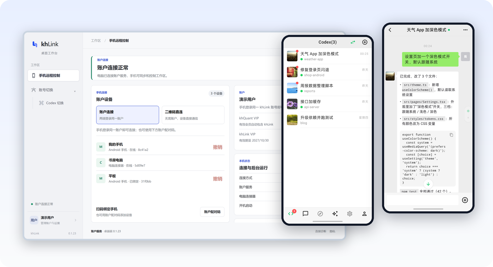

<sub>スクリーンショットのアカウントとセッションはデモ用のデータです。</sub>

</div>

---

## 完全無料、完全オープンソース

スマホアプリ、PC 側、リレーサーバーのソースコードはすべて公開しています（MIT）。3 つの接続方法は機能が同じで、どれも無料です。

- **QR コードで直接接続**：PC に表示される QR コードをスマホで読み取るだけ。アカウント不要で、khLink のサーバーも通りません。
- **自分のサーバーに立てる**：オープンソースのリレーを自分のマシンに立て、サーバーパスワードでサインインします。アカウントは不要です。
- **公式サーバーを使う**：khLink アカウントでサインインすれば、インストールしてすぐ使えます。各アカウントに毎月 300 MB の無料通信量があり、khQuant VIP 会員は無制限です。khLink は会員を販売していません。

どの方法でも内容はエンドツーエンドで暗号化され、リレーサーバーには暗号文しか見えません。

## エージェントが止まったら、それはあなた待ち

AI コーディングエージェントは一度動くと十数分かかり、途中で何度も止まります。コマンドの承認、いくつかの案からの選択、あるいは作業を終えて次の指示待ち。PC から離れると、エージェントはただ待つしかありません。

| | エージェントが待っているもの | スマホでやること |
| --- | --- | --- |
| **承認** | コマンドの実行、ファイルの変更 | 何をするのか確認して、許可または拒否 |
| **回答** | いくつかの案からの選択 | 選択肢は PC と同じ。タップすればすぐ届く |
| **続行** | 1 ターン終わって次の指示待ち | 同じセッションで続けて話す。キューに入れるか、すぐ割り込む |
| **確認** | 結果をすぐ見たい | PC のファイルをスマホに取り込んでプレビュー |

## できること

**同じひとつのセッション。** 別のチャットを開くのではありません。PC で始めたタスクをスマホで続け、スマホで始めたタスクを PC に戻って続けられます。モデル、推論の強さ、高速モード、プランモードは両方で同期されます。

- **リアルタイムの状態**：実行中、対応待ち、完了が一覧でひと目でわかります。
- **キューと即時送信**：エージェントが作業中に送ったメッセージは自動でキューに入ります。今のターンにすぐ割り込むこともできます。
- **承認と質問**：承認の依頼、質問、プランの確認があるとスマホに通知が届きます。選択式でも自由回答でも答えられ、プランは承認・修正・却下できます。結果がはっきりしないときはまず確認を促し、同じ指示を二度実行することはありません。
- **ファイル**：会話に出てくる PC のファイルパスをタップすると、スマホに取り込んでプレビューできます。Markdown と HTML は表示もソースも見られ、コードは言語ごとに色分けされ、大きなファイルは分割して取得します。ログイン情報や鍵のディレクトリは読み取れません。
- **画像と添付ファイル**：スマホからエージェントに画像やファイルを送れます。
- **ターンごとの消費量**：返信の下にそのターンで使ったトークン数を表示し、各エージェントの利用枠も確認できます。
- **複数の PC**：1 つのアカウントに複数の Windows PC をつなげます。セッションは PC ごとに分かれ、ホーム画面からワンタップで切り替えられます。
- **ライトモード**：長いツール出力やスクリーンショットは PC に残し、見たいときだけ取得します。モバイル通信量を節約できます。
- **4 つのテーマ**：デフォルト、Codex 風、ミニマル、チャットアプリ風。下の[テーマ紹介](#4-つのテーマ)を見てください。

## スクリーンショット

<table>
  <tr>
    <td width="33%">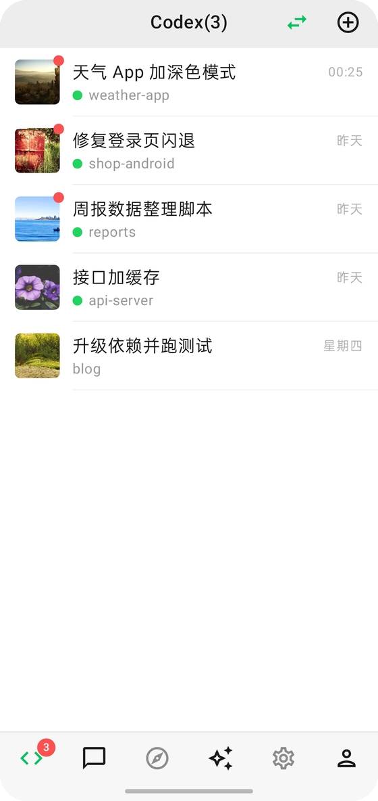</td>
    <td width="33%">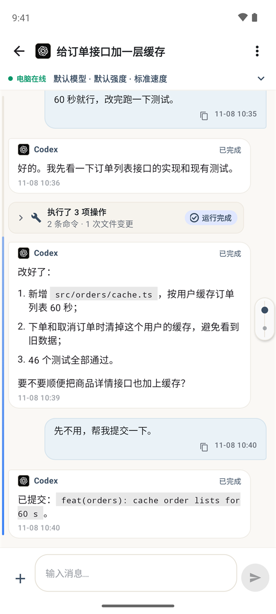</td>
    <td width="33%">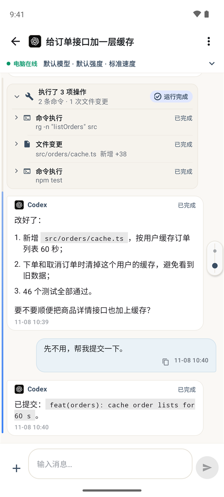</td>
  </tr>
  <tr>
    <td align="center"><b>セッション一覧</b><br/>全セッションとリアルタイムの状態。対応待ちが上に並びます</td>
    <td align="center"><b>会話</b><br/>コード、リスト、ファイルパスも見やすく</td>
    <td align="center"><b>操作の記録</b><br/>実行したコマンドや変更したファイルをタップで確認</td>
  </tr>
  <tr>
    <td width="33%">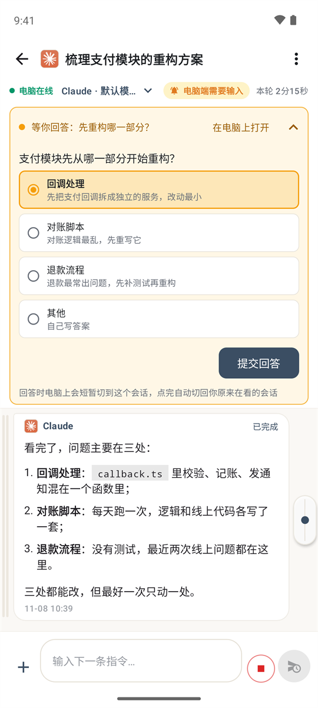</td>
    <td width="33%">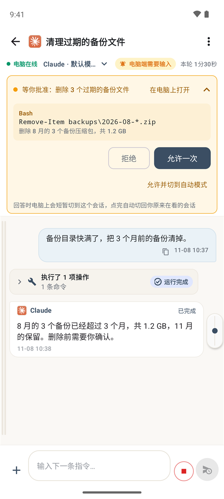</td>
    <td width="33%">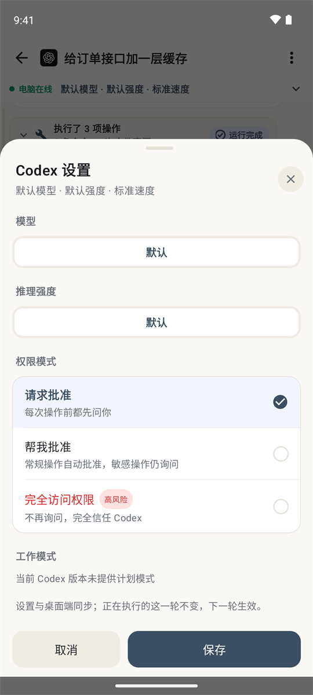</td>
  </tr>
  <tr>
    <td align="center"><b>質問に答える</b><br/>PC と同じ選択肢を、タップひとつで送信</td>
    <td align="center"><b>コマンドを承認</b><br/>何をするか確かめてから、許可か拒否</td>
    <td align="center"><b>実行設定</b><br/>モデル、推論の強さ、権限モードを PC と同期</td>
  </tr>
</table>

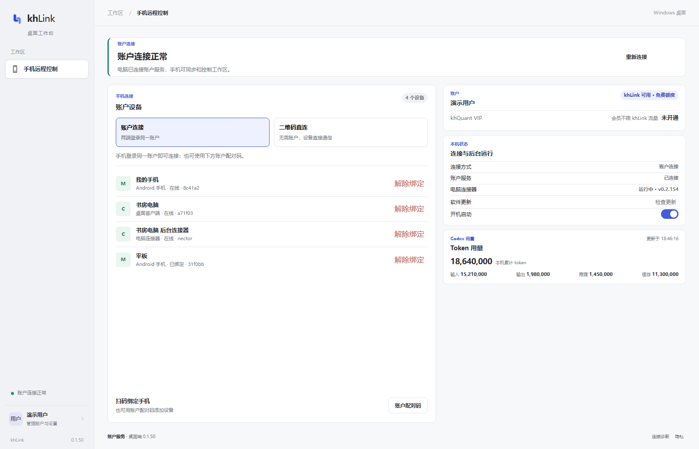

<p align="center"><sub>PC のデスクトップコンソール：アカウント、通信量、接続中のデバイス、エージェントの使用量。</sub></p>

## 4 つのテーマ

機能は同じで、見た目が 4 種類。アプリを入れた直後のガイドで選べて、あとから **設定 → テーマ** でいつでも変えられます。

<table>
  <tr>
    <th width="25%">デフォルト</th>
    <th width="25%">Codex 風</th>
    <th width="25%">ミニマル</th>
    <th width="25%">チャットアプリ風</th>
  </tr>
  <tr>
    <td>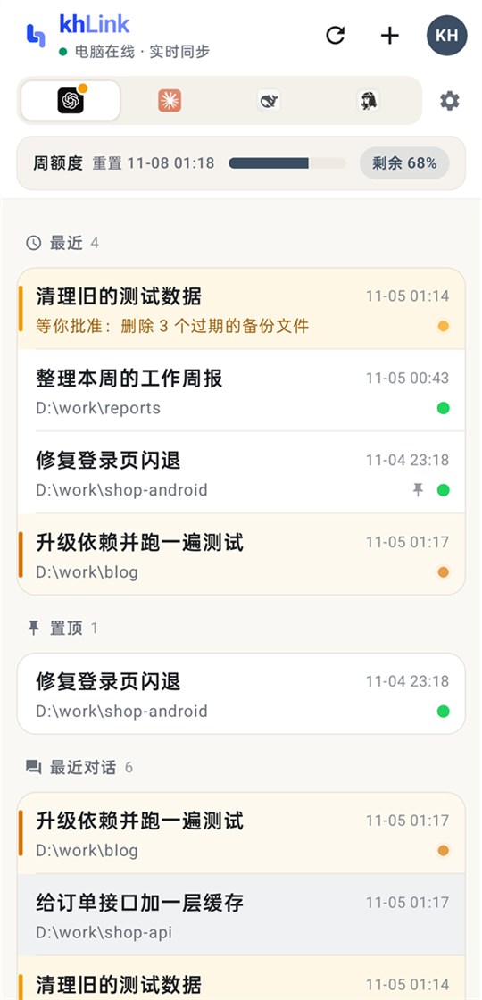</td>
    <td>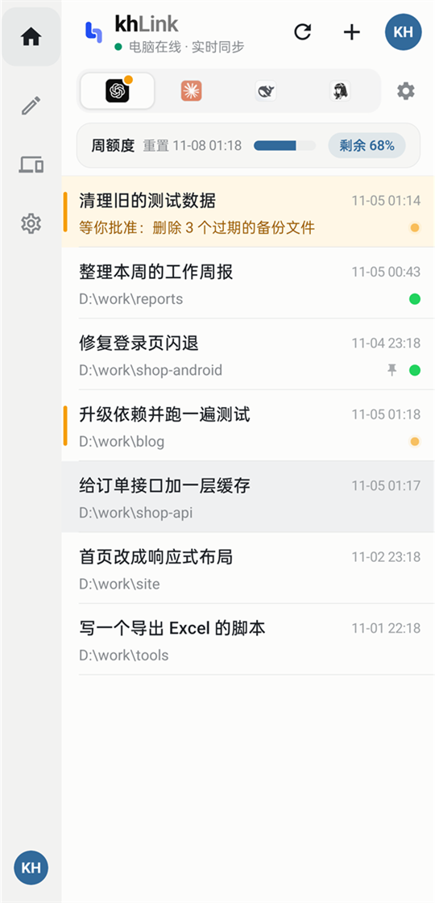</td>
    <td>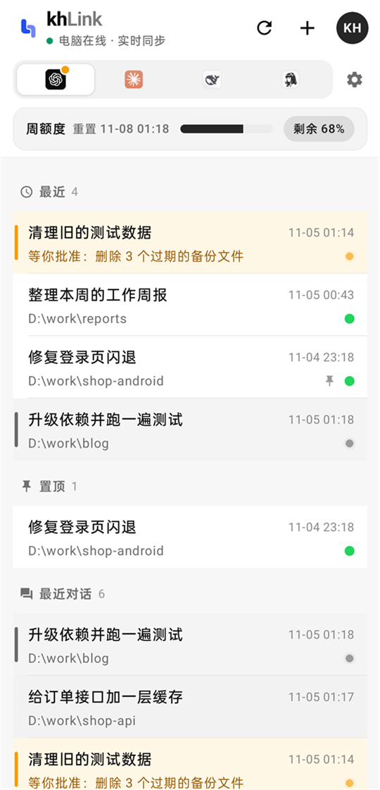</td>
    <td>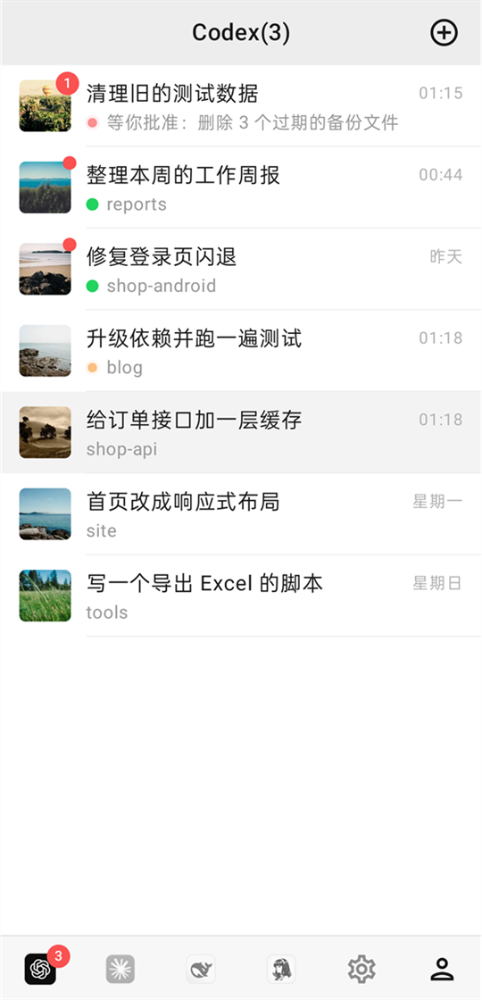</td>
  </tr>
  <tr>
    <td>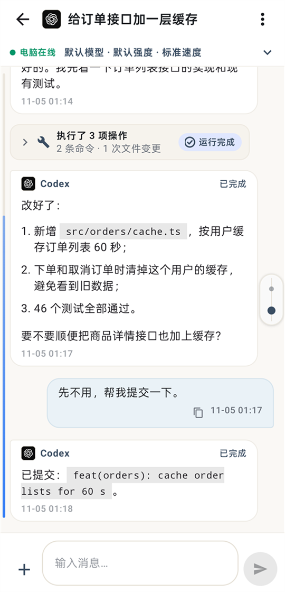</td>
    <td>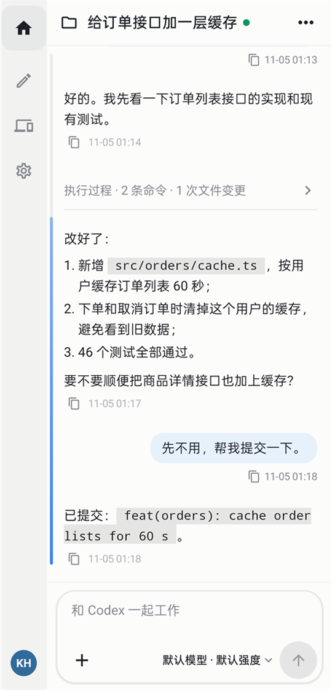</td>
    <td>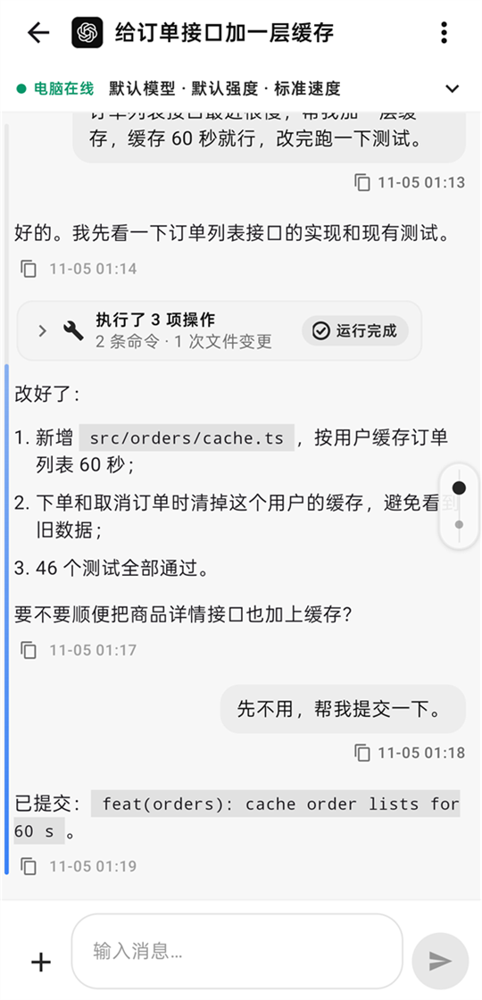</td>
    <td>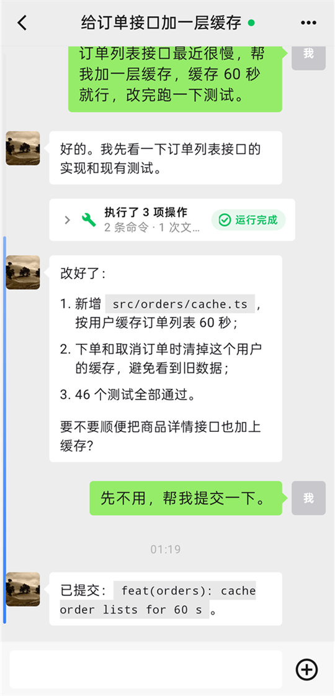</td>
  </tr>
  <tr>
    <td align="center">温かみのある白に、ブルーグレーとアンバーの差し色</td>
    <td align="center">明るいワークスペース、青いメッセージ、コンパクトな操作の記録</td>
    <td align="center">白黒グレーだけ、カードなし：フラットな一覧とドキュメント風の会話</td>
    <td align="center">おなじみのチャットアプリ風：下部ナビ、アイコン付き一覧、緑の吹き出し</td>
  </tr>
</table>

## はじめかた

使いたいエージェントを入れた Windows 10 / 11（64 ビット）の PC と、Android 7.0 以上のスマホが必要です。

1. **PC に khLink を入れる**：[インストーラーをダウンロード](https://github.com/khscience/khlink-releases/releases/latest)します。デスクトップコンソールとバックグラウンドのコネクタが 1 つのパッケージに入っています。
2. **スマホにアプリを入れる**：同じページから APK をダウンロードし、インストール時のシステムの確認はご自身で許可してください。
3. **つなぐ**：両方で同じ khLink アカウントにサインインするか、PC に表示される QR コードを一度読み取ります。

PC のインストーラーにはまだコード署名がありません。「Windows によって PC が保護されました」と表示されたら、Releases ページの SHA-256 でファイルを確認してから「詳細情報 → 実行」をクリックしてください。詳しい手順は[使い方ガイド](https://khsci.com/khlink/tutorial)を参照してください。

## 3 つの接続方法

まずは QR コードの直接接続で無料で試してください。外出先でよく使い、自分のサーバーを持っているならリレーをセルフホスト。サーバーやネットワークを管理したくなければ公式サービスを。どれも同じアプリ、同じコネクタなので、いつでも切り替えられます。

| | QR 直接接続 | 自分のサーバー | 公式サービス |
| --- | :---: | :---: | :---: |
| 費用 | 無料 | 無料 | 無料、毎月 300 MB |
| サーバー | 不要 | 自分で 1 台 | 不要 |
| khLink アカウント | 不要 | 不要 | 必要 |
| 外出先でも使える | ✅ Cloudflare の一時トンネル経由 | ✅ | ✅ |
| 複数のデバイス | スマホ 1 台と PC 1 台 | 複数のスマホ | 複数のスマホ、複数の PC |
| 再起動後 | アプリやコネクタの再起動は自動で再接続。PC を再起動したら外出先では読み取り直し | 自動で再接続 | 自動で再接続 |
| 内容の暗号化 | エンドツーエンド | エンドツーエンド | エンドツーエンド |
| 向いている人 | 費用ゼロで試したい、主に自宅やオフィスで使う | サーバーがあり、すべて自分で管理したい | インストールしてすぐ使いたい |

### QR コードで直接接続

1. PC とスマホに khLink を入れます。
2. PC でデスクトップコンソールを開き、**二维码直连**（QR 直接接続）をクリックします。
3. スマホのサインイン画面で **扫描电脑二维码**（PC の QR コードを読み取る）をタップします。

両者は WebRTC で暗号化チャネルを作り、メッセージ、承認、ファイルはスマホと PC の間で直接やり取りされます。同じ Wi-Fi やテザリングならピアツーピアで直接つながり、最も安定します。別のネットワークでは Cloudflare の一時トンネルを経由します（cloudflared はインストーラーに同梱、アカウント不要）。QR コードは 1 回限りで、5 分間有効です。詳しくは **[直接接続](docs/zh-CN/direct-connection.md)**（中国語）を参照してください。

### 自分のサーバーに立てる

リレーサーバーは暗号化されたメッセージを中継するだけで、サーバーパスワードでサインインします。アカウントは不要です。パブリックなアドレスがあり、HTTPS を設定したサーバーが必要です。

```bash
# サーバーで（Node.js 22、HTTPS 設定済みの nginx）
git clone https://github.com/khscience/khlink.git && cd khlink
npm ci && npm run build
# 続いて設定ファイル、systemd サービス、nginx を設定：docs/zh-CN/self-hosting.md を参照
```

```powershell
# Windows PC で（Node.js 22）、このリポジトリのクローン内で
npm ci
$env:FENGZHU_BRIDGE_PASSWORD = '<サーバーパスワード>'
node fengzhu-connect\src\cli.js setup --server https://bridge.example.com/fengzhu-bridge
powershell -ExecutionPolicy Bypass -File ops\install-connector.ps1 -EnableAutoStart
```

スマホのサインイン画面で **使用自己的服务器**（自分のサーバーを使う）をタップし、アドレスとパスワードを入力します。全手順は **[セルフホスト](docs/zh-CN/self-hosting.md)**（中国語）を参照してください。

### 公式サーバーを使う

デスクトップコンソールとスマホで同じ khLink アカウントにサインインすると、PC のセッションが表示されます。1 つのアカウントに複数のスマホと複数の PC をつなげます。

各アカウントに毎月 300 MB の無料通信量があります（北京時間の暦月単位。公式サーバーを通るアップロードとダウンロードだけを数え、ハートビートは含みません）。80% に達したときと使い切ったときにアプリが通知します。使い切ってもサインインやスマホにある内容の閲覧はでき、リモート操作だけが翌月 1 日まで止まります。khQuant VIP 会員は無制限です。

## 対応エージェント

| エージェント | khLink の接続方法 |
| --- | --- |
| **OpenAI Codex** | 公式 `codex app-server`。Codex デスクトップアプリとセッションを共有 |
| **Claude Code** | 公式 CLI とそのセッションファイル |
| **Claude Desktop** | 公式アプリのウィンドウとセッションファイル |
| **DeepSeek Harness** | ローカルで開いているインターフェースを見つけるためだけの小さなブリッジプラグイン（[説明](docs/zh-CN/deepseek-harness.md)） |
| **Hermes Agent** | PC の WSL 内の ACP と読み取り専用のセッションストア（[説明](docs/zh-CN/hermes.md)） |
| **Pi** | Pi 自身の Web サービス（PI WEB） |
| **Antigravity** | 公式アプリのウィンドウ |

どのエージェントも、あなたの PC 上で公式アプリや CLI を使ってサインインします。khLink はあなたと同じ方法でエージェントとやり取りし、認証情報には触れません。入っていないエージェントはスキップされ、あとからインストールすれば 1 分以内に自動でつながります。

## セキュリティ

- **エンドツーエンド暗号化**：内容はデバイスを出る前に XChaCha20-Poly1305 で暗号化され、アカウント鍵はあなたのスマホと PC にしかありません。
- **リレーに見えるのはルーティング情報だけ**：デバイスとセッションの ID、時刻、メッセージのサイズです。QR 直接接続はリレーをまったく通りません。
- **エージェントのアカウントに触れない**：エージェントの認証情報を読み取らず、コピーも送信もしません。利用量はあなた自身のアカウントに計上されます。
- **アップデートは署名を検証**：スマホと PC の更新パッケージはどちらも署名を検証し、検証に失敗したものはインストールしません。

## 仕組み

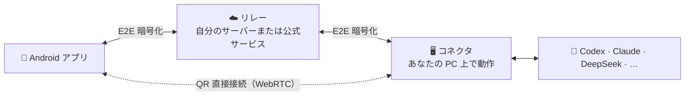

コネクタは現在のユーザーのタスクスケジューラでバックグラウンド実行され、管理者権限は不要です。アップデートはまず GitHub Releases から取得し、スマホは jsDelivr も試し、どちらにもつながらないときは khLink サーバーを使います。

| 構成要素 | ディレクトリ | 技術 |
| --- | --- | --- |
| Android アプリ | [`android/`](android) | Kotlin、Jetpack Compose |
| コネクタ | [`fengzhu-connect/`](fengzhu-connect) | Node.js 22 |
| リレー | [`fengzhu-server/`](fengzhu-server) | NestJS、SQLite |
| デスクトップコンソール | [`kh-link-desktop/`](kh-link-desktop) | Tauri 2：サインイン、スマホのペアリング、QR 直接接続、コネクタの状態と更新 |
| デスクトップアダプター | [`desktop-adapter/`](desktop-adapter) | Rust：Claude Desktop と Codex のウィンドウを読み取り・操作 |

通信フォーマットと暗号化の詳細は [protocol/v1.md](protocol/v1.md) を参照してください。

## よくある質問

<details>
<summary><b>khLink は有料ですか？</b></summary>

ソフトウェアは無料で、ソースコードは MIT ライセンスで公開しています。QR 直接接続と自分のサーバーへのセルフホストは無料です。公式サーバーも無料で、各アカウント毎月 300 MB まで使え、khQuant VIP 会員は無制限です。khLink は会員を販売しておらず、3 つの方法の機能は同じです。
</details>

<details>
<summary><b>無料の 300 MB で足りますか？使い切るとどうなりますか？</b></summary>

指示を送って返信を見る程度なら、ふつうは月 300 MB で足ります。長い会話を頻繁に同期したりファイルを送ったりすると早く減ります。アプリの「我」（マイページ）で今月の使用量を確認でき、80% に達したときと使い切ったときに通知します。使い切ってもサインインやスマホにある内容の閲覧はでき、リモート操作だけが翌月 1 日（北京時間）まで止まります。QR 直接接続と自分のサーバーには影響しません。
</details>

<details>
<summary><b>PC はずっと起動しておく必要がありますか？</b></summary>

はい。エージェントは PC 上で動くため、PC の電源が切れたりスリープしたりすると止まります。同期済みの履歴はスマホで見られます。外出前に自動スリープをオフにしておいてください。
</details>

<details>
<summary><b>複数のスマホや PC で同時に使えますか？</b></summary>

公式サービスなら使えます。同じアカウントでサインインしたスマホと PC はすべて同時にオンラインになり、スマホでは PC ごとに切り替えます。自分のサーバーは複数のスマホの同時サインインに対応しています。QR 直接接続は現在、スマホ 1 台と PC 1 台の組み合わせです。
</details>

<details>
<summary><b>リレーにコードや会話は見えますか？</b></summary>

見えません。スマホと PC は内容がデバイスを出る前に暗号化し、鍵はリレーを通りません。リレーに見えるのはデバイス、セッション、イベントの ID、時刻、暗号化メッセージのサイズです。QR 直接接続はリレーをまったく通りません。
</details>

<details>
<summary><b>khLink はエージェントのアカウントや API キーを使いますか？</b></summary>

使いません。各エージェントはあなたの PC 上で公式アプリや CLI からサインインします。khLink はその認証情報を読み取らず、コピーも送信もしません。利用量はあなた自身のアカウントに計上されます。
</details>

<details>
<summary><b>PC に Codex は必須ですか？</b></summary>

必須ではありません。Claude、DeepSeek、Hermes など他のエージェントだけでも使え、khLink は Codex をスキップします。あとから Codex を入れれば、再起動しなくても 1 分以内に自動でつながります。
</details>

<details>
<summary><b>iPhone 版はありますか？PC は macOS に対応していますか？</b></summary>

まだありません。アプリは Android のみ、PC 側は Windows のみ対応です（Hermes はその PC の WSL 内で動きます）。
</details>

そのほかの質問は[使い方ガイド](https://khsci.com/khlink/tutorial)と[トラブルシューティング](docs/zh-CN/troubleshooting.md)を参照してください。

## ソースからビルド

<details>
<summary>必要な環境とコマンド</summary>

Node.js 22、JDK 17 と Android SDK、Rust stable と [Tauri 2 の Windows 向け前提条件](https://v2.tauri.app/start/prerequisites/)、PowerShell 5.1 が必要です。

```bash
npm ci
npm test                                   # リレーとコネクタ
npm run build                              # リレーのビルド
cd android && ./gradlew testDebugUnitTest assembleDebug
cd kh-link-desktop/src-tauri && cargo test
cd desktop-adapter && cargo test
```

- リリースビルド：[android/RELEASE.md](android/RELEASE.md) と[統合インストーラー](docs/zh-CN/combined-installer.md)を参照。
- `fengzhu-connect/bin/` にはビルド済みのデスクトップアダプターと小さなネイティブヘルパーがあります。ヘルパーの SHA-256 は `fengzhu-connect/scripts/claude-desktop-native.ps1` で検証しているため、`fengzhu-connect/native/` から再ビルドしたらこのハッシュも更新してください。
- 独自のアプリを配布する場合は、Android の `applicationId`（`vip.fengzhu.bridge`）を変更し、`android/khlink-official.properties` の `updatePublicKey` と `updateMirrors` を削除または置き換えてください。デスクトップ版は `kh-link-desktop/src-tauri/src/connector_update.rs` の `UPDATE_PUBLIC_KEY` と `UPDATE_MIRROR` を変更します。そうしないと、利用者にインストールできない公式アップデートが届きます。
- パッケージ名の `fengzhu` はプロジェクト初期の名前です。

</details>

## ドキュメント

ドキュメントは中国語です。

| | |
| --- | --- |
| [QR 直接接続](docs/zh-CN/direct-connection.md) | サーバー不要の WebRTC 直接接続 |
| [セルフホスト](docs/zh-CN/self-hosting.md) | 自分のリレーサーバーを立てる |
| [デスクトップの接続フロー](docs/zh-CN/desktop-connection-flow.md) | PC でのサインイン、ペアリング、状態 |
| [1 つのアカウントで複数の PC](docs/zh-CN/multi-pc.md) | 複数の PC を同じアカウントにつなぐ |
| [アプリの更新](docs/zh-CN/android-app-updates.md) | 署名を検証するアプリ内アップデート |
| [トラブルシューティング](docs/zh-CN/troubleshooting.md) | よくある問題への対処 |
| [プロトコル](protocol/v1.md) | 通信フォーマットと暗号化 |

## コントリビュート

Issue やプルリクエストを歓迎します。まず [CONTRIBUTING.md](CONTRIBUTING.md) をお読みください。セキュリティ上の問題は [SECURITY.md](SECURITY.md) に従って非公開で報告してください。

## ライセンス

[MIT](LICENSE)。`docs/kh-link-*.md` の規約は公式サービスと公式インストーラーにのみ適用されます。

## 謝辞

khLink は [Tauri](https://tauri.app)、[NestJS](https://nestjs.com)、[Jetpack Compose](https://developer.android.com/compose)、[libsodium](https://libsodium.org)、[werift](https://github.com/shinyoshiaki/werift-webrtc) を使って構築されています。

<div align="center">

khLink のおかげで PC の前に戻る回数が減ったら、⭐ を付けてもっと多くの人に届けてください。

</div>
