<div align="center">


# khLink

### 에이전트는 PC에서 일하고, 지시는 휴대폰에서.

PC에서 실행 중인 Codex, Claude Code 등 에이전트 세션을 그대로 Android 휴대폰으로 가져옵니다.<br/>
승인하고, 답하고, 새 지시를 보내세요. 자리를 비워도 일은 멈추지 않습니다.

[](https://github.com/khscience/khlink/actions/workflows/ci.yml)
[](LICENSE)


[简体中文](README.md) · [English](README.en.md) · [繁體中文](README.zh-TW.md) · [日本語](README.ja.md) · **한국어**

**[⬇️ khLink 다운로드](https://github.com/khscience/khlink-releases/releases/latest)** · [공식 사이트](https://khsci.com/khlink/) · [사용 가이드](https://khsci.com/khlink/tutorial)

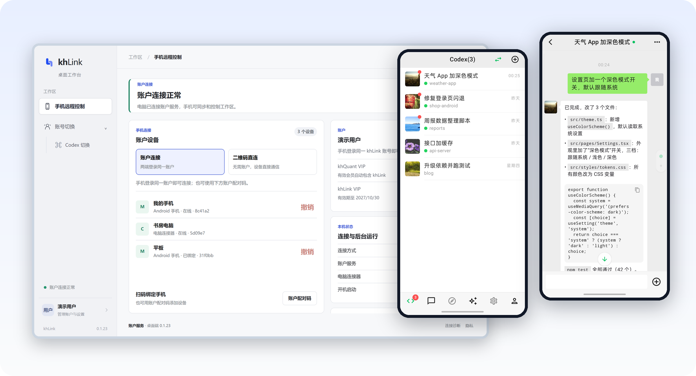

<sub>스크린샷 속 계정과 세션은 데모 데이터입니다.</sub>

</div>

---

## 완전 무료, 완전 오픈 소스

휴대폰 앱, PC 측, 릴레이 서버의 소스 코드는 모두 공개되어 있습니다(MIT). 세 가지 연결 방식은 기능이 같고 모두 무료입니다.

- **QR 코드 직접 연결**: PC에 뜬 QR 코드를 휴대폰으로 스캔하면 바로 연결됩니다. 계정이 필요 없고 khLink 서버도 거치지 않습니다.
- **내 서버에 배포**: 오픈 소스 릴레이를 내 서버에 배포하고 서버 비밀번호로 로그인합니다. 계정이 필요 없습니다.
- **공식 서버 사용**: khLink 계정으로 로그인하면 설치 후 바로 쓸 수 있습니다. 계정마다 매월 300 MB 무료 트래픽이 있고, khQuant VIP 회원은 무제한입니다. khLink는 회원권을 판매하지 않습니다.

어떤 방식이든 내용은 종단 간 암호화되며, 릴레이 서버에는 암호문만 보입니다.

## 에이전트가 멈췄다면, 당신을 기다리는 중

AI 코딩 에이전트는 한 번 돌면 십여 분씩 걸리고, 중간중간 멈춥니다. 명령 실행을 승인해 달라거나, 여러 방안 중 하나를 골라 달라거나, 작업을 끝내고 다음 지시를 기다리거나. 자리를 비우면 에이전트는 그저 기다릴 수밖에 없습니다.

| | 에이전트가 기다리는 것 | 휴대폰에서 할 일 |
| --- | --- | --- |
| **승인** | 명령 실행, 파일 수정 | 무엇을 하려는지 확인하고 허용 또는 거부 |
| **답변** | 여러 방안 중 선택 | 선택지는 PC와 같고, 탭하면 바로 전달 |
| **계속** | 한 턴을 마치고 다음 지시 대기 | 같은 세션에서 이어서 말하기. 대기열에 넣거나 바로 끼어들기 |
| **확인** | 결과를 바로 보고 싶을 때 | PC의 파일을 휴대폰으로 가져와 미리 보기 |

## 할 수 있는 일

**같은 하나의 세션.** 새 채팅 창을 따로 여는 것이 아닙니다. PC에서 시작한 작업을 휴대폰에서 이어 가고, 휴대폰에서 시작한 작업을 PC로 돌아와 계속할 수 있습니다. 모델, 추론 강도, 빠른 모드, 계획 모드가 양쪽에서 동기화됩니다.

- **실시간 상태**: 실행 중, 처리 대기, 완료를 목록에서 한눈에 봅니다.
- **대기열과 즉시 전송**: 에이전트가 작업 중일 때 보낸 메시지는 자동으로 대기열에 들어가고, 지금 턴에 바로 끼워 넣을 수도 있습니다.
- **승인과 질문**: 승인 요청, 질문, 계획 확인이 있으면 휴대폰으로 알림이 옵니다. 객관식이든 자유 답변이든 가능하고, 계획은 수락·수정·거절할 수 있습니다. 결과가 불확실하면 먼저 확인하도록 알려 주며, 같은 지시를 두 번 실행하지 않습니다.
- **파일**: 대화 속 PC 파일 경로를 탭하면 휴대폰으로 가져와 미리 볼 수 있습니다. Markdown과 HTML은 렌더링된 화면과 소스를 모두 볼 수 있고, 코드는 언어별로 색이 입혀지며, 큰 파일은 나눠서 가져옵니다. 로그인 정보와 키 디렉터리는 읽을 수 없습니다.
- **이미지와 첨부 파일**: 휴대폰에서 에이전트에게 이미지와 파일을 보낼 수 있습니다.
- **턴별 사용량**: 답변 아래에 이번 턴에 쓴 토큰을 표시하고, 각 에이전트의 사용 한도도 볼 수 있습니다.
- **여러 대의 PC**: 계정 하나에 Windows PC 여러 대를 연결할 수 있습니다. 세션은 PC별로 나뉘고, 홈 화면에서 한 번에 전환합니다.
- **라이트 모드**: 긴 도구 출력과 스크린샷은 PC에 두고 보고 싶을 때만 가져와서 모바일 데이터를 아낍니다.
- **네 가지 테마**: 기본, Codex 스타일, 미니멀, 메신저 스타일. 아래 [테마 소개](#네-가지-테마)를 참고하세요.

## 스크린샷

<table>
  <tr>
    <td width="33%">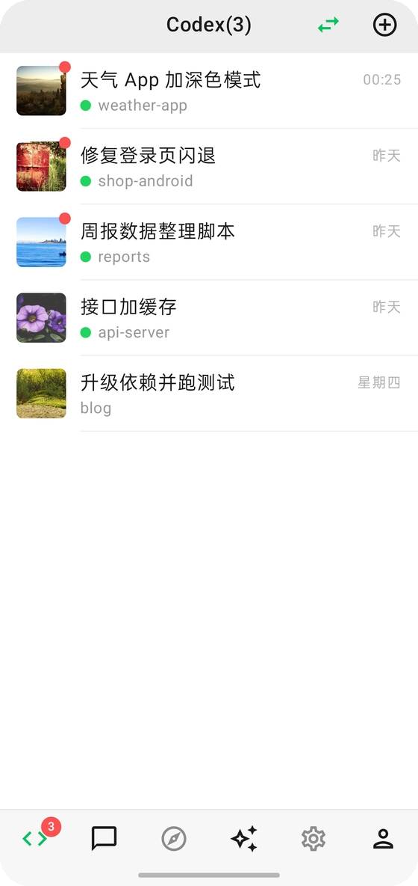</td>
    <td width="33%">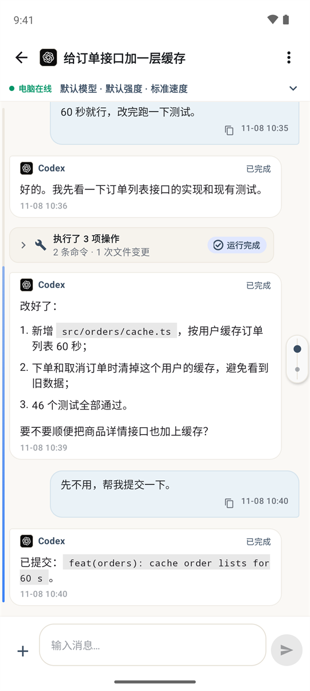</td>
    <td width="33%">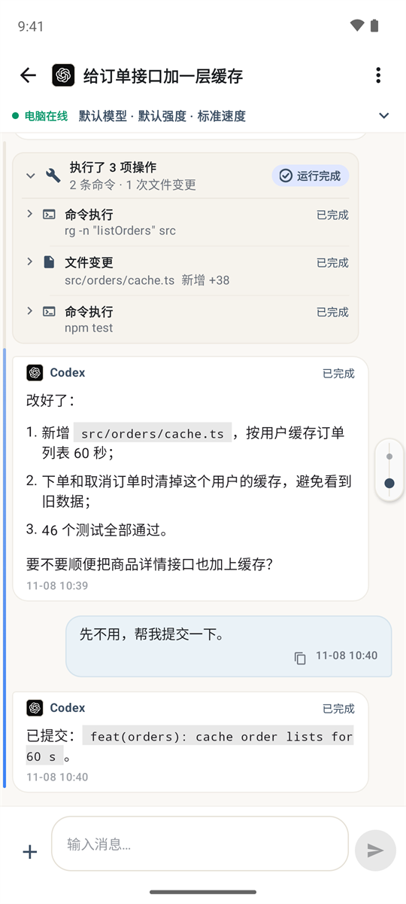</td>
  </tr>
  <tr>
    <td align="center"><b>세션 목록</b><br/>모든 세션과 실시간 상태, 처리할 것이 위에 표시</td>
    <td align="center"><b>대화</b><br/>코드, 목록, 파일 경로도 깔끔하게</td>
    <td align="center"><b>작업 과정</b><br/>실행한 명령과 바뀐 파일을 펼쳐서 확인</td>
  </tr>
  <tr>
    <td width="33%">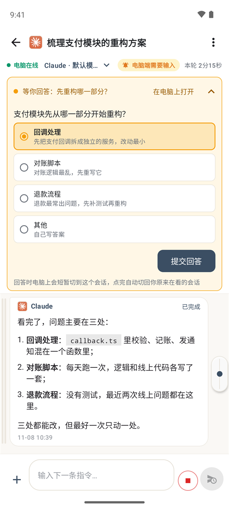</td>
    <td width="33%">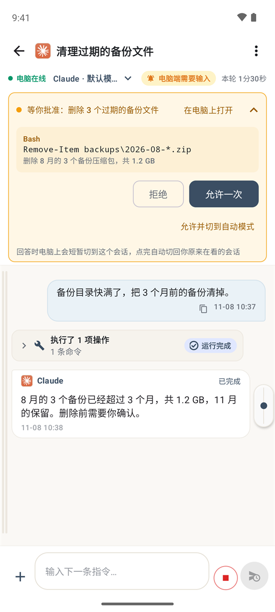</td>
    <td width="33%">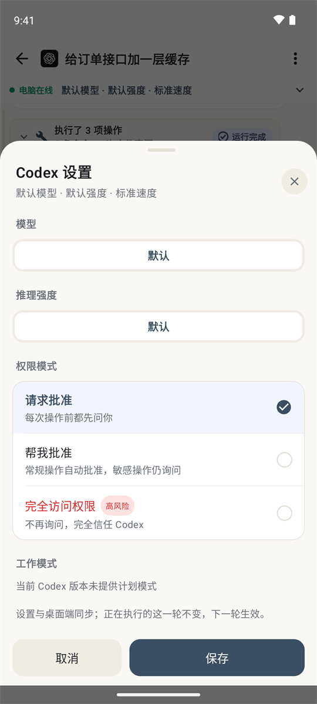</td>
  </tr>
  <tr>
    <td align="center"><b>질문에 답하기</b><br/>PC와 같은 선택지를 한 번 탭해서 전송</td>
    <td align="center"><b>명령 승인</b><br/>무엇을 할지 확인하고 허용 또는 거부</td>
    <td align="center"><b>실행 설정</b><br/>모델, 추론 강도, 권한 모드를 PC와 동기화</td>
  </tr>
</table>

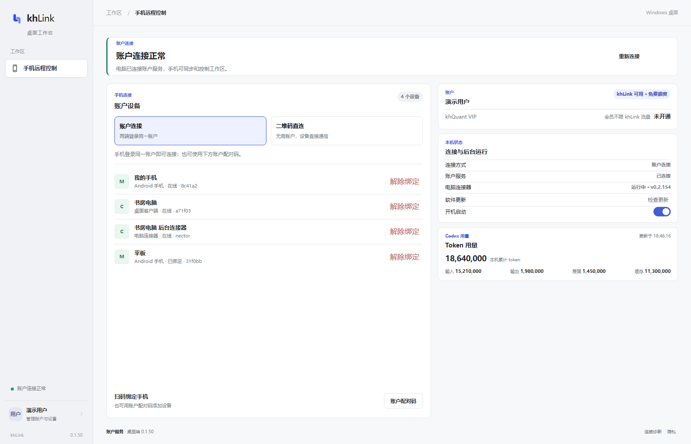

<p align="center"><sub>PC의 데스크톱 콘솔: 계정, 데이터 사용량, 연결된 기기와 에이전트 사용량.</sub></p>

## 네 가지 테마

기능은 같고 모양만 네 가지입니다. 앱을 처음 설치할 때 안내 화면에서 고르고, 나중에 **설정 → 테마**에서 언제든 바꿀 수 있습니다.

<table>
  <tr>
    <th width="25%">기본</th>
    <th width="25%">Codex 스타일</th>
    <th width="25%">미니멀</th>
    <th width="25%">메신저 스타일</th>
  </tr>
  <tr>
    <td>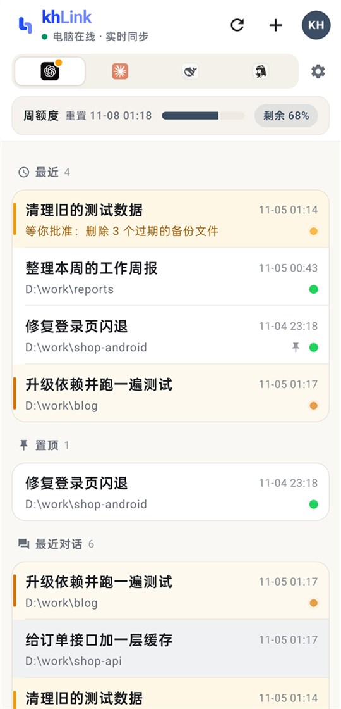</td>
    <td>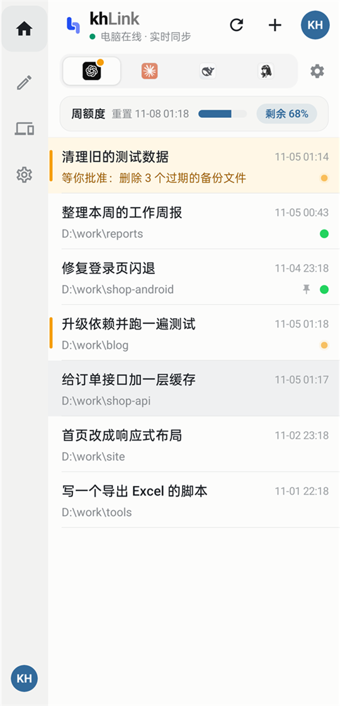</td>
    <td>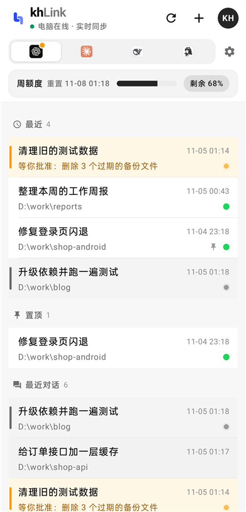</td>
    <td>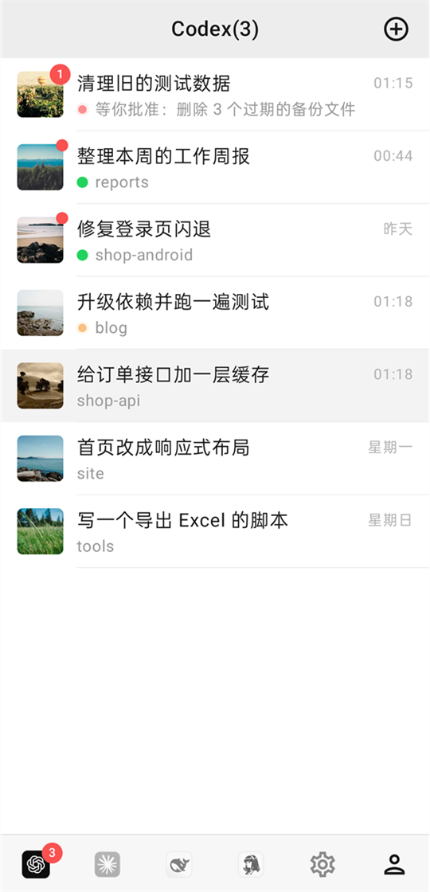</td>
  </tr>
  <tr>
    <td>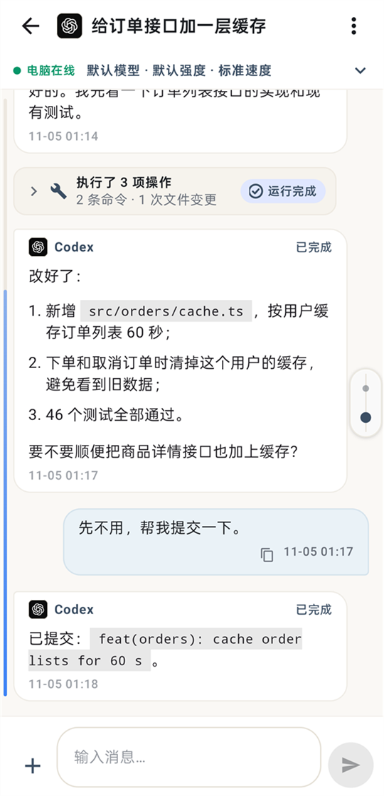</td>
    <td>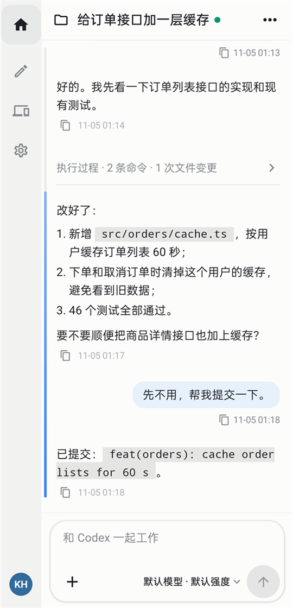</td>
    <td>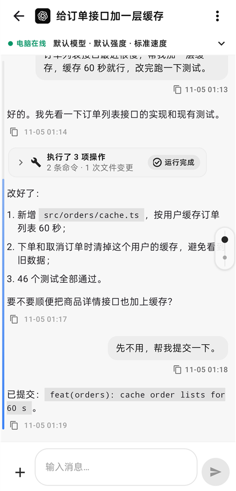</td>
    <td>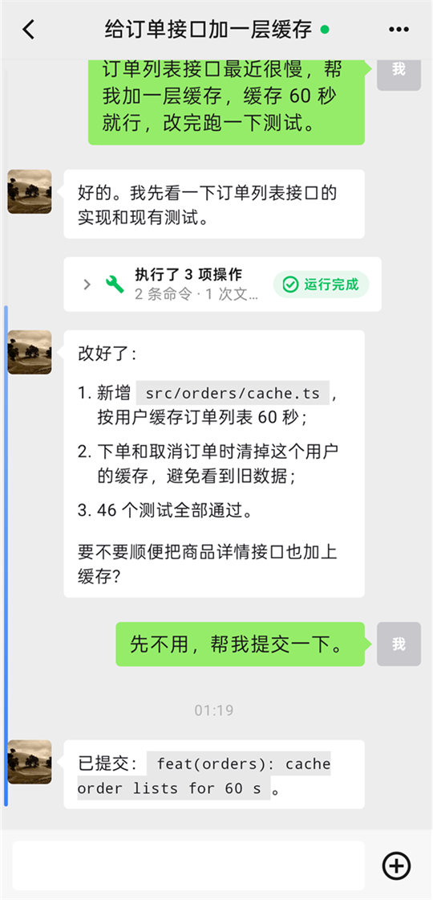</td>
  </tr>
  <tr>
    <td align="center">따뜻한 흰 바탕에 블루그레이와 앰버 포인트</td>
    <td align="center">밝은 작업 공간, 파란 메시지, 간결한 작업 과정</td>
    <td align="center">흑백과 회색, 카드 없음: 평평한 목록과 문서형 대화</td>
    <td align="center">익숙한 메신저처럼: 하단 탭, 프로필 목록, 초록 말풍선</td>
  </tr>
</table>

## 시작하기

사용할 에이전트가 설치된 Windows 10 / 11(64비트) PC와 Android 7.0 이상 휴대폰이 필요합니다.

1. **PC에 khLink 설치**: [설치 파일을 내려받으세요](https://github.com/khscience/khlink-releases/releases/latest). 데스크톱 콘솔과 백그라운드 커넥터가 한 패키지에 들어 있습니다.
2. **휴대폰에 앱 설치**: 같은 페이지에서 APK를 내려받고, 설치할 때 나오는 시스템 확인은 직접 허용해 주세요.
3. **연결**: 양쪽에서 같은 khLink 계정으로 로그인하거나, PC에 뜬 QR 코드를 한 번 스캔합니다.

PC 설치 파일에는 아직 코드 서명이 없습니다. "Windows의 PC 보호" 경고가 나오면 Releases 페이지의 SHA-256으로 파일을 확인한 뒤 "추가 정보 → 실행"을 클릭하세요. 자세한 단계는 [사용 가이드](https://khsci.com/khlink/tutorial)를 참고하세요.

## 세 가지 연결 방식

먼저 QR 코드 직접 연결로 무료로 써 보세요. 외부에서 자주 쓰고 서버가 있다면 릴레이를 직접 운영하고, 서버와 네트워크를 신경 쓰고 싶지 않다면 공식 서비스를 쓰면 됩니다. 세 가지 모두 같은 앱, 같은 커넥터이므로 언제든 바꿀 수 있습니다.

| | QR 직접 연결 | 내 서버 | 공식 서비스 |
| --- | :---: | :---: | :---: |
| 비용 | 무료 | 무료 | 무료, 매월 300 MB |
| 서버 | 필요 없음 | 직접 1대 | 필요 없음 |
| khLink 계정 | 필요 없음 | 필요 없음 | 필요 |
| 외부에서도 사용 | ✅ Cloudflare 임시 터널 경유 | ✅ | ✅ |
| 여러 기기 | 휴대폰 1대와 PC 1대 | 휴대폰 여러 대 | 휴대폰 여러 대, PC 여러 대 |
| 재시작 후 | 앱과 커넥터는 재시작해도 자동 재연결. PC를 재부팅하면 외부에서는 다시 스캔 | 자동 재연결 | 자동 재연결 |
| 내용 암호화 | 종단 간 | 종단 간 | 종단 간 |
| 적합한 경우 | 비용 없이 써 보고 싶고 주로 집·사무실에서 쓸 때 | 서버가 있고 모든 것을 직접 관리하고 싶을 때 | 설치하고 바로 쓰고 싶을 때 |

### QR 코드 직접 연결

1. PC와 휴대폰에 khLink를 설치합니다.
2. PC에서 데스크톱 콘솔을 열고 **二维码直连**(QR 직접 연결)을 클릭합니다.
3. 휴대폰 로그인 화면에서 **扫描电脑二维码**(PC QR 코드 스캔)를 누릅니다.

양쪽은 WebRTC로 암호화 채널을 만들고, 메시지와 승인, 파일이 휴대폰과 PC 사이에서 직접 오갑니다. 같은 Wi-Fi나 휴대폰 핫스팟에서는 P2P로 직접 연결되어 가장 안정적입니다. 서로 다른 네트워크에서는 Cloudflare 임시 터널을 거칩니다(cloudflared는 설치 파일에 포함, 계정 불필요). 각 QR 코드는 한 번만 쓸 수 있고 5분간 유효합니다. 자세한 내용은 **[직접 연결](docs/zh-CN/direct-connection.md)**(중국어)을 참고하세요.

### 내 서버에 배포

릴레이 서버는 암호화된 메시지를 전달하기만 하며, 서버 비밀번호로 로그인합니다. 계정은 필요 없습니다. 공인 주소가 있고 HTTPS가 설정된 서버가 필요합니다.

```bash
# 서버에서 (Node.js 22, HTTPS가 설정된 nginx)
git clone https://github.com/khscience/khlink.git && cd khlink
npm ci && npm run build
# 이어서 설정 파일, systemd 서비스, nginx 설정: docs/zh-CN/self-hosting.md 참고
```

```powershell
# Windows PC에서 (Node.js 22), 이 저장소의 클론 안에서
npm ci
$env:FENGZHU_BRIDGE_PASSWORD = '<서버 비밀번호>'
node fengzhu-connect\src\cli.js setup --server https://bridge.example.com/fengzhu-bridge
powershell -ExecutionPolicy Bypass -File ops\install-connector.ps1 -EnableAutoStart
```

휴대폰 로그인 화면에서 **使用自己的服务器**(내 서버 사용)를 누르고 주소와 비밀번호를 입력합니다. 전체 단계는 **[셀프 호스팅](docs/zh-CN/self-hosting.md)**(중국어)을 참고하세요.

### 공식 서버 사용

데스크톱 콘솔과 휴대폰에서 같은 khLink 계정으로 로그인하면 PC의 세션이 나타납니다. 계정 하나에 휴대폰 여러 대와 PC 여러 대를 연결할 수 있습니다.

계정마다 매월 300 MB 무료 트래픽이 있습니다(베이징 시간 기준 달력상의 한 달 단위. 공식 서버를 거치는 업로드와 다운로드만 계산하며, 하트비트는 제외). 80%를 쓰면, 그리고 다 쓰면 앱이 알려 줍니다. 다 쓴 뒤에도 로그인하고 휴대폰에 이미 있는 내용은 볼 수 있지만, 원격 작업은 다음 달 1일까지 멈춥니다. khQuant VIP 회원은 무제한입니다.

## 지원 에이전트

| 에이전트 | khLink 연결 방식 |
| --- | --- |
| **OpenAI Codex** | 공식 `codex app-server`, Codex 데스크톱 앱과 세션 공유 |
| **Claude Code** | 공식 CLI와 그 세션 파일 |
| **Claude Desktop** | 공식 앱의 창과 세션 파일 |
| **DeepSeek Harness** | 로컬에서 연 인터페이스를 찾는 데만 쓰는 작은 브리지 플러그인([설명](docs/zh-CN/deepseek-harness.md)) |
| **Hermes Agent** | PC의 WSL 안 ACP와 읽기 전용 세션 저장소([설명](docs/zh-CN/hermes.md)) |
| **Pi** | Pi 자체 웹 서비스(PI WEB) |
| **Antigravity** | 공식 앱의 창 |

모든 에이전트는 당신의 PC에서 자체 공식 앱이나 CLI로 로그인합니다. khLink는 당신과 같은 방식으로 에이전트와 상호 작용하며 자격 증명에는 손대지 않습니다. 설치되지 않은 에이전트는 건너뛰고, 나중에 설치하면 1분 안에 자동으로 연결됩니다.

## 보안

- **종단 간 암호화**: 내용은 기기를 떠나기 전에 XChaCha20-Poly1305로 암호화되며, 계정 키는 당신의 휴대폰과 PC에만 있습니다.
- **릴레이에는 라우팅 정보만**: 기기·세션 ID, 시각, 메시지 크기만 보입니다. QR 직접 연결은 릴레이를 전혀 거치지 않습니다.
- **에이전트 계정에 손대지 않음**: 에이전트의 자격 증명을 읽거나 복사하거나 전송하지 않으며, 사용량은 당신의 계정에 집계됩니다.
- **업데이트 서명 검증**: 휴대폰과 PC의 업데이트 패키지는 모두 서명을 검증하며, 검증에 실패하면 설치하지 않습니다.

## 작동 방식

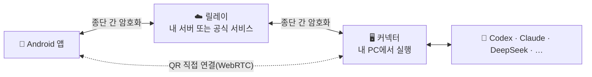

커넥터는 현재 사용자의 예약 작업으로 백그라운드에서 실행되며 관리자 권한이 필요 없습니다. 업데이트는 먼저 GitHub Releases에서 받고, 휴대폰은 jsDelivr도 시도하며, 둘 다 연결되지 않으면 khLink 서버를 사용합니다.

| 구성 요소 | 디렉터리 | 기술 |
| --- | --- | --- |
| Android 앱 | [`android/`](android) | Kotlin, Jetpack Compose |
| 커넥터 | [`fengzhu-connect/`](fengzhu-connect) | Node.js 22 |
| 릴레이 | [`fengzhu-server/`](fengzhu-server) | NestJS, SQLite |
| 데스크톱 콘솔 | [`kh-link-desktop/`](kh-link-desktop) | Tauri 2: 로그인, 휴대폰 페어링, QR 직접 연결, 커넥터 상태와 업데이트 |
| 데스크톱 어댑터 | [`desktop-adapter/`](desktop-adapter) | Rust: Claude Desktop과 Codex 창을 읽고 조작 |

통신 형식과 암호화에 대한 자세한 내용은 [protocol/v1.md](protocol/v1.md)를 참고하세요.

## 자주 묻는 질문

<details>
<summary><b>khLink는 유료인가요?</b></summary>

소프트웨어는 무료이고 소스 코드는 MIT 라이선스로 공개되어 있습니다. QR 직접 연결과 내 서버 배포는 무료입니다. 공식 서버도 무료로, 계정마다 매월 300 MB를 쓸 수 있고 khQuant VIP 회원은 무제한입니다. khLink는 회원권을 판매하지 않으며, 세 가지 방식의 기능은 같습니다.
</details>

<details>
<summary><b>무료 300 MB로 충분한가요? 다 쓰면 어떻게 되나요?</b></summary>

지시를 보내고 답변을 보는 정도라면 보통 한 달 300 MB로 충분합니다. 긴 대화를 자주 동기화하거나 파일을 주고받으면 더 빨리 줄어듭니다. 앱의 "我"(내 정보) 화면에서 이번 달 사용량을 볼 수 있고, 80%를 쓸 때와 다 쓸 때 알려 줍니다. 다 쓴 뒤에도 로그인하고 휴대폰에 이미 있는 내용은 볼 수 있으며, 원격 작업만 다음 달 1일(베이징 시간)까지 멈춥니다. QR 직접 연결과 내 서버에는 영향이 없습니다.
</details>

<details>
<summary><b>PC를 계속 켜 두어야 하나요?</b></summary>

네. 에이전트는 PC에서 실행되므로 PC가 꺼지거나 절전 모드에 들어가면 멈춥니다. 이미 동기화된 기록은 휴대폰에서 볼 수 있습니다. 외출 전에 자동 절전을 꺼 두세요.
</details>

<details>
<summary><b>휴대폰 여러 대, PC 여러 대를 함께 쓸 수 있나요?</b></summary>

공식 서비스라면 가능합니다. 같은 계정으로 로그인한 휴대폰과 PC가 모두 동시에 온라인 상태가 되고, 휴대폰에서 PC별로 전환합니다. 내 서버는 휴대폰 여러 대의 동시 로그인을 지원합니다. QR 직접 연결은 현재 휴대폰 1대와 PC 1대만 연결됩니다.
</details>

<details>
<summary><b>릴레이가 내 코드나 대화를 볼 수 있나요?</b></summary>

볼 수 없습니다. 휴대폰과 PC는 내용이 기기를 떠나기 전에 암호화하며, 키는 릴레이를 거치지 않습니다. 릴레이가 볼 수 있는 것은 기기, 세션, 이벤트의 ID, 시각, 암호화된 메시지의 크기입니다. QR 직접 연결은 릴레이를 전혀 거치지 않습니다.
</details>

<details>
<summary><b>khLink가 내 에이전트 계정이나 API 키를 사용하나요?</b></summary>

아니요. 각 에이전트는 당신의 PC에서 공식 앱이나 CLI로 로그인합니다. khLink는 그 자격 증명을 읽거나 복사하거나 전송하지 않으며, 사용량은 당신의 계정에 집계됩니다.
</details>

<details>
<summary><b>PC에 Codex가 꼭 있어야 하나요?</b></summary>

아니요. Claude, DeepSeek, Hermes 같은 다른 에이전트만 써도 되고, khLink는 Codex를 건너뜁니다. 나중에 Codex를 설치하면 재시작하지 않아도 1분 안에 자동으로 연결됩니다.
</details>

<details>
<summary><b>iPhone 버전이 있나요? PC는 macOS를 지원하나요?</b></summary>

아직 없습니다. 앱은 Android 전용이고 PC 측은 Windows만 지원합니다(Hermes는 그 PC의 WSL 안에서 실행됩니다).
</details>

그 밖의 질문은 [사용 가이드](https://khsci.com/khlink/tutorial)와 [문제 해결](docs/zh-CN/troubleshooting.md)을 참고하세요.

## 소스에서 빌드

<details>
<summary>필요한 환경과 명령</summary>

Node.js 22, JDK 17과 Android SDK, Rust stable과 [Tauri 2의 Windows 사전 요구 사항](https://v2.tauri.app/start/prerequisites/), PowerShell 5.1이 필요합니다.

```bash
npm ci
npm test                                   # 릴레이와 커넥터
npm run build                              # 릴레이 빌드
cd android && ./gradlew testDebugUnitTest assembleDebug
cd kh-link-desktop/src-tauri && cargo test
cd desktop-adapter && cargo test
```

- 릴리스 빌드: [android/RELEASE.md](android/RELEASE.md)와 [통합 설치 파일](docs/zh-CN/combined-installer.md) 참고.
- `fengzhu-connect/bin/`에는 미리 빌드된 데스크톱 어댑터와 작은 네이티브 헬퍼가 있습니다. 헬퍼의 SHA-256은 `fengzhu-connect/scripts/claude-desktop-native.ps1`에서 검증하므로, `fengzhu-connect/native/`에서 다시 빌드했다면 이 해시도 함께 갱신하세요.
- 자체 앱을 배포하려면 Android `applicationId`(`vip.fengzhu.bridge`)를 바꾸고 `android/khlink-official.properties`의 `updatePublicKey`와 `updateMirrors`를 삭제하거나 교체하세요. 데스크톱은 `kh-link-desktop/src-tauri/src/connector_update.rs`의 `UPDATE_PUBLIC_KEY`와 `UPDATE_MIRROR`를 바꿉니다. 그렇지 않으면 사용자에게 설치할 수 없는 공식 업데이트가 전달됩니다.
- 패키지 이름의 `fengzhu`는 프로젝트 초기 이름입니다.

</details>

## 문서

문서는 중국어로 되어 있습니다.

| | |
| --- | --- |
| [QR 직접 연결](docs/zh-CN/direct-connection.md) | 서버 없는 WebRTC 직접 연결 |
| [셀프 호스팅](docs/zh-CN/self-hosting.md) | 내 릴레이 서버 배포하기 |
| [데스크톱 연결 흐름](docs/zh-CN/desktop-connection-flow.md) | PC에서의 로그인, 페어링, 상태 |
| [계정 하나로 여러 PC](docs/zh-CN/multi-pc.md) | 여러 PC를 같은 계정에 연결 |
| [앱 업데이트](docs/zh-CN/android-app-updates.md) | 서명을 검증하는 앱 내 업데이트 |
| [문제 해결](docs/zh-CN/troubleshooting.md) | 자주 겪는 문제 해결 |
| [프로토콜](protocol/v1.md) | 통신 형식과 암호화 |

## 기여하기

이슈와 풀 리퀘스트를 환영합니다. 먼저 [CONTRIBUTING.md](CONTRIBUTING.md)를 읽어 주세요. 보안 문제는 [SECURITY.md](SECURITY.md)에 따라 비공개로 제보해 주세요.

## 라이선스

[MIT](LICENSE). `docs/kh-link-*.md`의 약관은 공식 서비스와 공식 설치 파일에만 적용됩니다.

## 감사의 말

khLink는 [Tauri](https://tauri.app), [NestJS](https://nestjs.com), [Jetpack Compose](https://developer.android.com/compose), [libsodium](https://libsodium.org), [werift](https://github.com/shinyoshiaki/werift-webrtc)로 만들어졌습니다.

<div align="center">

khLink 덕분에 PC 앞으로 돌아가는 일이 줄었다면 ⭐를 눌러 더 많은 사람에게 알려 주세요.

</div>
