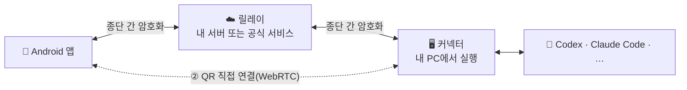

<div align="center">


# khLink

### 에이전트는 PC에서 일하고, 지시는 휴대폰에서

PC에서 실행 중인 Codex, Claude Code 등 에이전트 세션을 그대로 Android 휴대폰으로 가져옵니다.<br/>
질문에 답하고, 작업을 승인하고, 새 지시를 보내고, 새 작업을 시작하세요. 자리를 비워도 일은 멈추지 않습니다.

[](https://github.com/khscience/khlink/actions/workflows/ci.yml)
[](LICENSE)


[简体中文](README.md) · [English](README.en.md) · [繁體中文](README.zh-TW.md) · [日本語](README.ja.md) · **한국어**

**[⬇️ 휴대폰 앱과 PC 설치 파일 다운로드](https://github.com/khscience/khlink-releases/releases/latest)** · [공식 사이트](https://khsci.com/khlink/)

[왜 khLink인가](#왜-khlink인가) · [세 가지 사용 방법](#세-가지-사용-방법) · [지원 에이전트](#지원-에이전트) · [작동 방식](#작동-방식) · [자주 묻는 질문](#자주-묻는-질문)


</div>

---

## 왜 khLink인가

AI 코딩 에이전트는 수십 분, 때로는 몇 시간씩 실행되며 그동안 수시로 멈춰 당신을 기다립니다. 명령 승인, 여러 방안 중 선택, 한 턴이 끝난 뒤의 다음 지시. 자리를 비우면 에이전트는 그저 기다릴 수밖에 없습니다.

khLink가 이 문제를 해결합니다.

<table>
<tr>
<td width="50%" valign="top">

#### 🔁 PC의 그 세션 그대로
별도의 채팅이 아닙니다. 휴대폰에 보이는 것은 PC의 바로 그 세션입니다. PC에서 시작한 작업을 휴대폰에서 이어 가고, 휴대폰에서 시작한 작업을 PC로 돌아와 계속할 수 있습니다. 모델, 추론 강도, 빠른 모드, 계획 모드가 양쪽에서 동기화됩니다.

</td>
<td width="50%" valign="top">

#### 🔔 당신 차례가 되면 바로 알림
승인 요청, 질문, 턴 완료가 휴대폰 알림으로 옵니다. 선택지는 PC와 똑같고, 탭하면 바로 닫히며 답변은 백그라운드에서 전달됩니다.

</td>
</tr>
<tr>
<td valign="top">

#### 🔒 코드와 계정은 PC를 떠나지 않음
에이전트는 항상 당신의 PC에서 실행되고 자체 공식 앱이나 CLI로 로그인합니다. khLink는 어떤 자격 증명도 읽거나 전달하지 않습니다. 휴대폰과 PC 사이의 내용은 종단 간 암호화되어 릴레이에는 암호문만 보입니다.

</td>
<td valign="top">

#### 🧩 앱 하나로 7가지 에이전트, 여러 대의 PC
Codex, Claude Code, Claude Desktop, DeepSeek Harness, Hermes, Pi, Antigravity를 한 목록에서. khLink 계정으로 로그인하면 휴대폰 하나로 여러 대의 Windows PC를 관리할 수 있고, 세션은 PC별로 구분됩니다.

</td>
</tr>
<tr>
<td valign="top">

#### 📶 모바일 데이터 절약
라이트 모드에서는 긴 도구 출력과 파일은 PC에 두고 대화만 전송합니다. 보고 싶은 부분은 열 때 가져옵니다. 세션 목록도 바뀐 부분만 동기화합니다.

</td>
<td valign="top">

#### 🛠️ 채팅 그 이상
에이전트가 작업 중일 때 보낸 메시지는 자동으로 대기열에 들어갑니다. 코드, 이미지, 파일을 보고 PC의 파일을 휴대폰으로 가져올 수 있습니다. 사용 한도와 턴별 토큰 사용량을 확인하고, 컨텍스트 정리, 작업 분기, 한 턴 되돌리기도 가능합니다.

</td>
</tr>
</table>

## 스크린샷

<table>
  <tr>
    <td width="33%"></td>
    <td width="33%"></td>
    <td width="33%"></td>
  </tr>
  <tr>
    <td align="center">모든 세션과 실시간 상태</td>
    <td align="center">목록, 코드, 파일</td>
    <td align="center">세 가지 연결 방식 중 선택</td>
  </tr>
</table>


<sub>스크린샷 속 세션은 가상의 데모 데이터입니다.</sub>

## 세 가지 사용 방법

khLink의 휴대폰 앱, PC 측, 릴레이 서버는 모두 오픈 소스입니다. 어떻게 연결할지는 당신이 정합니다.

| | ① 내 서버 | ② QR 코드 직접 연결 | ③ 공식 서비스 |
| --- | :---: | :---: | :---: |
| 서버 | 직접 1대 | **필요 없음** | 필요 없음 |
| khLink 계정 | 필요 없음 | 필요 없음 | 필요 |
| 비용 | 무료 | 무료 | 매월 100 MB 무료, 초과 시 회원 |
| 외부에서도 사용 | ✅ | 같은 Wi-Fi가 가장 안정적, 다른 네트워크는 Cloudflare 임시 터널 경유 | ✅ |
| 내용 암호화 | 종단 간 | 종단 간 | 종단 간 |
| 적합한 경우 | 서버가 있고 모든 것을 직접 관리하고 싶을 때 | 무료로 써 보고 싶거나 집·사무실에서 주로 쓸 때 | 설치하고 바로 쓰고 싶을 때 |

**요구 사항**: Android 7.0 이상 휴대폰, 사용할 에이전트가 설치된 Windows 10 / 11(64비트) PC. 앱 화면은 현재 중국어로만 제공됩니다.

### 직접 운영하기

#### ① 서버가 있다면: 릴레이 배포

릴레이는 암호화된 메시지를 전달하기만 합니다. 배포 후에는 서버 비밀번호로 로그인하며, 계정도 비용도 필요 없습니다.

```bash
# 서버에서 (Node.js 22, HTTPS가 설정된 nginx)
git clone https://github.com/khscience/khlink.git && cd khlink
npm ci && npm run build
# 이어서 설정 파일, systemd 서비스, nginx 설정: docs/self-hosting.md 참고
```

```powershell
# Windows PC에서 (Node.js 22), 이 저장소의 클론 안에서
npm ci
$env:FENGZHU_BRIDGE_PASSWORD = '<서버 비밀번호>'
node fengzhu-connect\src\cli.js setup --server https://bridge.example.com/fengzhu-bridge
powershell -ExecutionPolicy Bypass -File ops\install-connector.ps1 -EnableAutoStart
```

휴대폰 앱은 공식 빌드든 직접 빌드한 것이든 상관없습니다. 로그인 화면에서 **使用自己的服务器**(내 서버 사용)를 누르고 주소와 비밀번호를 입력하면 연결됩니다. 자세한 내용은 **[셀프 호스팅](docs/self-hosting.md)**(영어)을 참고하세요.

#### ② 서버가 없다면: QR 코드 직접 연결

서버도, 계정 가입도 필요 없습니다.

1. PC에 khLink 설치 파일([다운로드](https://github.com/khscience/khlink-releases/releases/latest), 또는 [`kh-link-desktop`](kh-link-desktop)을 직접 빌드)을, 휴대폰에 khLink 앱을 설치합니다.
2. PC의 데스크톱 콘솔에서 **二维码直连**(QR 직접 연결)을 엽니다.
3. 휴대폰 로그인 화면에서 **扫描电脑二维码**(PC QR 코드 스캔)를 누르고 스캔하면 연결됩니다.

양쪽은 WebRTC로 암호화 채널을 만들고, 메시지와 승인, 파일이 중간 서비스 없이 휴대폰과 PC 사이에서 직접 오갑니다.

- **같은 Wi-Fi 또는 휴대폰 핫스팟**: 외부 서비스가 전혀 필요 없으며 가장 안정적입니다.
- **서로 다른 네트워크**: Cloudflare 임시 터널을 거칩니다(cloudflared는 설치 파일에 포함, 계정 불필요). 내용은 종단 간 암호화되며 khLink 서버를 거치지 않습니다. 커넥터를 재시작해도 터널은 그대로이고, PC를 재부팅하면 외부에서는 다시 스캔해야 합니다.

각 QR 코드는 한 번만 쓸 수 있고 5분간 유효합니다. 한 번 페어링하면 앱이나 커넥터를 재시작해도 자동으로 다시 연결됩니다. PC를 재부팅하면 외부에서는 새 코드를 스캔하세요. PC도 계정에 로그인해 두었다면, 직접 연결이 계속 실패할 때 휴대폰에서 계정 로그인으로 바꿔 공식 서버를 통해 다시 연결할 수 있습니다. 자세한 내용은 **[직접 연결](docs/zh-CN/direct-connection.md)**(중국어)을 참고하세요.

### ③ 공식 서비스: 설치하고 바로 사용

서버나 네트워크를 신경 쓰고 싶지 않다면 저희 릴레이를 사용하세요.

1. [Releases](https://github.com/khscience/khlink-releases/releases/latest) 또는 [공식 사이트](https://khsci.com/khlink/)에서 내려받아 휴대폰에 khLink 앱, Windows PC에 khLink 설치 파일(데스크톱 콘솔과 커넥터 포함)을 설치합니다.
2. 데스크톱 콘솔에서 khLink 계정으로 로그인합니다. 계정마다 매월 100 MB 무료 트래픽이 있고, 초과하면 회원에 가입해 제한 없이 쓸 수 있습니다.
3. 휴대폰에서 같은 계정으로 로그인하면 PC의 세션이 나타납니다.

매월 100 MB까지는 무료이고, 초과분에 대한 소액 회비는 서버와 트래픽 비용을 충당하는 데만 쓰입니다. 내용은 마찬가지로 종단 간 암호화되어 서비스는 당신의 코드와 대화를 볼 수 없습니다.

## 지원 에이전트

| 에이전트 | khLink 연결 방식 |
| --- | --- |
| **OpenAI Codex** | 공식 `codex app-server`, Codex 데스크톱 앱과 세션 공유 |
| **Claude Code** | 공식 CLI와 그 세션 파일 |
| **Claude Desktop** | 공식 앱의 창과 세션 파일 |
| **DeepSeek Harness** | 작은 브리지 플러그인([자세히](docs/zh-CN/deepseek-harness.md)) |
| **Hermes Agent** | WSL 안의 ACP와 읽기 전용 세션 저장소([자세히](docs/zh-CN/hermes.md)) |
| **Pi** | Pi 자체 웹 프로세스 |
| **Antigravity** | 공식 앱의 창 |

모든 에이전트는 당신의 PC에서 자체 공식 앱이나 CLI로 로그인합니다. khLink는 당신과 같은 방식으로 에이전트와 상호 작용하며 자격 증명에는 손대지 않습니다.

## 작동 방식



- 내용은 기기를 떠나기 전에 XChaCha20-Poly1305로 암호화되며, 계정 키는 당신의 휴대폰과 PC에만 있습니다. 릴레이가 볼 수 있는 것은 기기·세션 ID, 시각, 메시지 크기뿐입니다.
- 커넥터는 현재 사용자의 예약 작업으로 실행되며 관리자 권한이 필요 없습니다.
- 휴대폰과 PC의 앱 내 업데이트는 모두 서명을 검증하며, 검증에 실패하면 설치하지 않습니다. 업데이트는 먼저 GitHub Releases에서 받고, 휴대폰은 jsDelivr도 시도하며, 둘 다 연결되지 않으면 khLink 서버를 사용합니다.

| 구성 요소 | 디렉터리 | 기술 |
| --- | --- | --- |
| Android 앱 | [`android/`](android) | Kotlin, Jetpack Compose |
| 커넥터 | [`fengzhu-connect/`](fengzhu-connect) | Node.js 22 |
| 릴레이 | [`fengzhu-server/`](fengzhu-server) | NestJS, SQLite |
| 데스크톱 콘솔 | [`kh-link-desktop/`](kh-link-desktop) | Tauri 2: 로그인, 휴대폰 페어링, QR 직접 연결, 커넥터 상태와 업데이트 |
| 데스크톱 어댑터 | [`desktop-adapter/`](desktop-adapter) | Rust: Claude Desktop과 Codex 창을 읽고 조작 |

통신 형식과 암호화에 대한 자세한 내용은 [protocol/v1.md](protocol/v1.md)를 참고하세요.

## 소스에서 빌드

<details>
<summary>필요한 환경과 명령</summary>

Node.js 22, JDK 17과 Android SDK, Rust stable과 [Tauri 2의 Windows 사전 요구 사항](https://v2.tauri.app/start/prerequisites/), PowerShell 5.1이 필요합니다.

```bash
npm ci
npm test                                   # 릴레이와 커넥터
npm run build                              # 릴레이 빌드
cd android && ./gradlew testDebugUnitTest assembleDebug
cd kh-link-desktop/src-tauri && cargo test
cd desktop-adapter && cargo test
```

- 릴리스 빌드: [android/RELEASE.md](android/RELEASE.md)와 [통합 설치 파일](docs/zh-CN/combined-installer.md) 참고.
- `fengzhu-connect/bin/`에는 미리 빌드된 데스크톱 어댑터와 작은 네이티브 헬퍼가 있습니다. 헬퍼의 SHA-256은 `fengzhu-connect/scripts/claude-desktop-native.ps1`에서 검증하므로, `fengzhu-connect/native/`에서 다시 빌드했다면 이 해시도 함께 갱신하세요.
- 자체 앱을 배포하려면 Android `applicationId`(`vip.fengzhu.bridge`)를 바꾸고 `android/khlink-official.properties`의 `updatePublicKey`와 `updateMirrors`(GitHub·jsDelivr 배포처), 데스크톱은 `kh-link-desktop/src-tauri/src/connector_update.rs`의 `UPDATE_PUBLIC_KEY`와 `UPDATE_MIRROR`를 삭제하거나 교체하세요. 그렇지 않으면 사용자에게 설치할 수 없는 공식 업데이트가 표시됩니다.
- 패키지 이름의 `fengzhu`는 프로젝트 초기 이름입니다.

</details>

## 자주 묻는 질문

<details>
<summary><b>릴레이가 내 코드나 대화를 볼 수 있나요?</b></summary>

볼 수 없습니다. 공식 서비스와 셀프 호스팅 릴레이 모두 마찬가지입니다. 휴대폰과 커넥터는 내용이 기기를 떠나기 전에 암호화하며, 키는 릴레이를 거치지 않습니다. 릴레이가 볼 수 있는 것은 라우팅 정보(기기, 세션, 이벤트 ID), 시각, 암호화된 메시지의 크기입니다. QR 직접 연결은 릴레이를 아예 사용하지 않습니다.
</details>

<details>
<summary><b>세 가지 중 무엇을 골라야 하나요?</b></summary>

먼저 무료인 QR 직접 연결을 써 보세요. 집이나 사무실의 같은 Wi-Fi에서는 매우 안정적입니다. 외부에서 자주 쓰고 서버가 있다면 릴레이를 직접 운영하세요. 서버나 네트워크를 관리하고 싶지 않다면 공식 서비스를 쓰면 됩니다. 세 가지 모두 같은 앱과 커넥터를 쓰므로 언제든 바꿀 수 있습니다.
</details>

<details>
<summary><b>공식 서비스는 왜 유료인가요?</b></summary>

릴레이 서버와 트래픽에는 비용이 듭니다. 계정마다 매월 100 MB 무료 트래픽이 있고, 초과분의 회비는 그 비용을 충당하기 위한 것입니다. 셀프 호스팅과 QR 직접 연결은 무료이며 기능도 같습니다.
</details>

<details>
<summary><b>PC를 계속 켜 두어야 하나요?</b></summary>

네. 에이전트는 PC에서 실행되므로 PC가 꺼지거나 절전 모드에 들어가면 멈춥니다. 이미 동기화된 기록은 휴대폰에서 볼 수 있지만 작업을 이어 갈 수는 없습니다. 외출 전에 자동 절전을 꺼 두세요.
</details>

<details>
<summary><b>khLink가 내 에이전트 계정이나 API 키를 사용하나요?</b></summary>

아니요. 각 에이전트는 당신의 PC에서 공식 앱이나 CLI로 로그인합니다. khLink는 그 자격 증명을 읽거나 복사하거나 전송하지 않으며, 사용량은 평소처럼 당신의 계정에 집계됩니다.
</details>

<details>
<summary><b>설치할 때 "Windows의 PC 보호" 경고가 나옵니다</b></summary>

PC 설치 파일에 아직 코드 서명이 없어서 SmartScreen이 경고합니다. "추가 정보 → 실행"을 클릭하세요. 확인하고 싶다면 Releases 페이지에 적힌 SHA-256으로 내려받은 파일을 대조할 수 있습니다.
</details>

<details>
<summary><b>iPhone 버전이나 macOS·Linux용 커넥터가 있나요?</b></summary>

아직 없습니다. 앱은 Android 전용이고 커넥터는 Windows만 지원합니다(Hermes는 그 Windows PC의 WSL 안에서 실행됩니다).
</details>

## 문서

| | |
| --- | --- |
| [셀프 호스팅](docs/self-hosting.md) | 내 릴레이 운영하기(영어) |
| [직접 연결](docs/zh-CN/direct-connection.md) | 서버 없는 WebRTC 연결 |
| [데스크톱 연결 흐름](docs/zh-CN/desktop-connection-flow.md) | PC에서의 로그인, 페어링, 상태 |
| [여러 대의 PC](docs/zh-CN/multi-pc.md) | 계정 하나로 여러 PC |
| [앱 업데이트](docs/zh-CN/android-app-updates.md) | 서명된 앱 내 업데이트 |
| [문제 해결](docs/zh-CN/troubleshooting.md) | 자주 겪는 문제 |
| [프로토콜](protocol/v1.md) | 통신 형식과 암호화 |

대부분의 가이드는 중국어입니다. 번역 기여를 환영합니다.

## 기여하기

이슈와 풀 리퀘스트를 환영합니다. 먼저 [CONTRIBUTING.md](CONTRIBUTING.md)를 읽어 주세요. 보안 문제는 [SECURITY.md](SECURITY.md)에 따라 비공개로 제보해 주세요.

## 라이선스

[MIT](LICENSE). `docs/kh-link-*.md`의 약관은 공식 서비스와 공식 설치 파일에만 적용됩니다.

## 감사의 말

khLink는 [Linco Bridge](https://github.com/lincotalk/linco-bridge)(MIT)에서 발전했으며 그 저작권 고지를 유지합니다. [Tauri](https://tauri.app), [NestJS](https://nestjs.com), [Jetpack Compose](https://developer.android.com/compose), [libsodium](https://libsodium.org), [werift](https://github.com/shinyoshiaki/werift-webrtc)로 만들어졌습니다.

<div align="center">

khLink 덕분에 PC 앞으로 돌아가는 일이 줄었다면 ⭐로 응원해 주세요.

</div>
