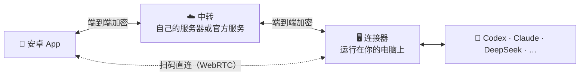

<div align="center">


# khLink

### 智能体在电脑上干活，你在手机上指挥。

电脑上正在跑的 Codex、Claude Code 等智能体会话，原样带到安卓手机上。<br/>
批准、回答、发新指令，人不在电脑前，活也不停。

[](https://github.com/khscience/khlink/actions/workflows/ci.yml)
[](LICENSE)


**简体中文** · [English](README.en.md) · [繁體中文](README.zh-TW.md) · [日本語](README.ja.md) · [한국어](README.ko.md)

**[⬇️ 下载 khLink](https://github.com/khscience/khlink-releases/releases/latest)** · [官网](https://khsci.com/khlink/) · [使用教程](https://khsci.com/khlink/tutorial)


<sub>截图里的账号和会话都是演示数据。</sub>

</div>

---

## 完全免费，完全开源

手机 App、电脑端和中转服务器的源码全部公开（MIT）。三种连接方式功能一样，都不收费：

- **扫码直连**：电脑上出一个二维码，手机扫一下就连上。不要账号，也不经过 khLink 服务器。
- **部署到自己的服务器**：把开源的中转服务部署到你自己的机器上，用服务器密码登录，不需要账号。
- **用我们的服务器**：登录 khLink 账号，装好就用。每个账号每月 300 MB 免费流量，khQuant VIP 会员不限流量。khLink 不卖会员。

不管哪种方式，内容都是端到端加密的，中转服务器只看到密文。

## 智能体一停下来，就在等你

AI 编程智能体一跑就是十几分钟，中间时不时停下来：要你批准一条命令，要你在几个方案里选一个，或者干完了等你下一步。人一离开电脑，它就只能干等着。

| | 智能体在等什么 | 在手机上怎么做 |
| --- | --- | --- |
| **批准** | 要运行命令、改文件 | 看清楚要做什么，再允许或拒绝 |
| **回答** | 让你在几个方案里选 | 选项和电脑上一样，点一下就送达 |
| **继续** | 跑完一轮，等下一步 | 在原来的会话里接着说，排队或立即插一句 |
| **查看** | 结果想马上看一眼 | 把电脑上的文件取到手机，直接预览 |

## 能做什么

**同一条会话。** 不是另起一个聊天窗口：电脑上开的任务，手机上接着聊；手机上开的，回到电脑接着干。模型、思考强度、快速模式和计划模式两边同步。

- **实时状态**：运行中、等你处理、已完成，列表上一眼看到。
- **排队与立即发送**：智能体忙的时候发的话自动排队，也可以立即插进当前这一轮。
- **审批与提问**：请求批准、提出问题、让你确认计划时手机会通知你；选择题和自由回答都行，计划可以接受、修改或拒绝。结果不确定时先提示你核对，不会把一条指令执行两次。
- **文件**：点对话里的电脑文件路径，取回手机预览。Markdown 和 HTML 能直接看也能看源码，代码按语言着色，大文件分段取回。登录凭据和密钥目录读不到。
- **图片与附件**：在手机上给智能体发图片和文件。
- **每轮消耗**：回复下面显示这一轮用掉的 Token，也能看各智能体的额度。
- **多台电脑**：一个账号接几台 Windows 电脑，会话按电脑分开，首页一点就能切换。
- **轻量模式**：大段工具输出和截图留在电脑上，想看再取，手机流量省得住。
- **四种主题**：默认、Codex 风格、极简、聊天软件，见下面的[主题展示](#四种主题)。

## 截图

<table>
  <tr>
    <td width="33%"></td>
    <td width="33%"></td>
    <td width="33%"></td>
  </tr>
  <tr>
    <td align="center"><b>会话列表</b><br/>所有会话和实时状态，等你处理的排在前面</td>
    <td align="center"><b>对话</b><br/>代码、列表、文件路径都排得清楚</td>
    <td align="center"><b>操作过程</b><br/>命令、改动的文件，展开就能看</td>
  </tr>
  <tr>
    <td width="33%"></td>
    <td width="33%"></td>
    <td width="33%"></td>
  </tr>
  <tr>
    <td align="center"><b>回答提问</b><br/>选项和电脑上一样，点一下就送达</td>
    <td align="center"><b>批准命令</b><br/>看清要做什么，再允许或拒绝</td>
    <td align="center"><b>运行设置</b><br/>模型、推理强度和权限模式，与电脑同步</td>
  </tr>
</table>


<p align="center"><sub>电脑上的桌面控制台：账号、流量、已连接的设备和智能体用量。</sub></p>

## 四种主题

同一套功能，四种样子。新装 App 的引导里就能挑，之后在 **设置 → 主题** 随时换。

<table>
  <tr>
    <th width="25%">默认</th>
    <th width="25%">Codex 风格</th>
    <th width="25%">极简</th>
    <th width="25%">聊天软件</th>
  </tr>
  <tr>
    <td></td>
    <td></td>
    <td></td>
    <td></td>
  </tr>
  <tr>
    <td></td>
    <td></td>
    <td></td>
    <td></td>
  </tr>
  <tr>
    <td align="center">暖白底色，蓝灰与琥珀点缀</td>
    <td align="center">浅色工作区、蓝色消息和紧凑的操作过程</td>
    <td align="center">黑白灰，没有卡片：平铺的列表和文档式对话</td>
    <td align="center">像常用的聊天软件：底部导航、头像列表、绿色气泡</td>
  </tr>
</table>

## 开始使用

需要一台 Windows 10 / 11（64 位）电脑，上面装好你要用的智能体；一部安卓 7.0 及以上的手机。

1. **电脑装 khLink**：[下载安装包](https://github.com/khscience/khlink-releases/releases/latest)，桌面控制台和后台连接器在同一个包里。
2. **手机装 App**：从同一页面下载 APK，安装时由你确认系统提示。
3. **连起来**：两端登录同一个 khLink 账号，或者扫一次电脑上的二维码。

电脑安装包暂时没有代码签名，Windows 提示“已保护你的电脑”时，用发布页上的 SHA-256 核对文件后，点“更多信息 → 仍要运行”。详细步骤见[使用教程](https://khsci.com/khlink/tutorial)。

## 三种连接方式

先用扫码直连免费试；经常在外面用、又有自己的服务器，就自建中转；不想管服务器和网络，就用官方服务。三种方式是同一个 App、同一个连接器，随时可以换。

| | 扫码直连 | 自己的服务器 | 官方服务 |
| --- | :---: | :---: | :---: |
| 费用 | 免费 | 免费 | 免费，每月 300 MB 流量 |
| 需要服务器 | 不需要 | 自己的一台 | 不需要 |
| 需要 khLink 账号 | 不需要 | 不需要 | 需要 |
| 在外面也能用 | ✅ 经 Cloudflare 临时通道 | ✅ | ✅ |
| 多台设备 | 一台手机对一台电脑 | 多台手机 | 多台手机、多台电脑 |
| 重启后 | App 和连接器重启自动连回；电脑重启后在外面要重新扫码 | 自动重连 | 自动重连 |
| 内容加密 | 端到端 | 端到端 | 端到端 |
| 适合 | 零成本试用，主要在家里、办公室用 | 有服务器，想完全自己掌控 | 想装好就用 |

### 扫码直连

1. 电脑和手机装好 khLink。
2. 电脑上打开桌面控制台，点 **二维码直连**。
3. 手机登录页点 **扫描电脑二维码**。

两边通过 WebRTC 建立加密通道，消息、批准和文件直接在手机和电脑之间传。同一 Wi-Fi 或手机热点下点对点直连，最稳定；不在同一网络时经 Cloudflare 临时通道转发（安装包已内置 cloudflared，不需要账号）。每个二维码只用一次，五分钟内有效。详见 **[扫码直连](docs/zh-CN/direct-connection.md)**。

### 部署到自己的服务器

中转服务器只负责转发加密后的消息，用服务器密码登录，不需要账号。需要一台有公网地址、配好 HTTPS 的服务器。

```bash
# 在服务器上（Node.js 22，nginx 配好 HTTPS）
git clone https://github.com/khscience/khlink.git && cd khlink
npm ci && npm run build
# 然后写配置、装 systemd 服务、配 nginx，见 docs/zh-CN/self-hosting.md
```

```powershell
# 在 Windows 电脑上（Node.js 22），在本仓库的克隆目录里
npm ci
$env:FENGZHU_BRIDGE_PASSWORD = '<服务器密码>'
node fengzhu-connect\src\cli.js setup --server https://bridge.example.com/fengzhu-bridge
powershell -ExecutionPolicy Bypass -File ops\install-connector.ps1 -EnableAutoStart
```

手机登录页点 **使用自己的服务器**，填地址和密码。完整步骤见 **[自建中转](docs/zh-CN/self-hosting.md)**。

### 用我们的服务器

在桌面控制台和手机上登录同一个 khLink 账号，电脑上的会话就出现了。一个账号可以接多台手机和多台电脑。

每个账号每月 300 MB 免费流量（按北京时间自然月，只算经官方服务器的上传和下载，心跳不计）。用到 80% 和用完时 App 会提醒；用完后仍能登录、查看手机上已有的内容，远程操作暂停到下月 1 日。khQuant VIP 会员不限流量。

## 支持的智能体

| 智能体 | khLink 怎样连接它 |
| --- | --- |
| **OpenAI Codex** | 官方 `codex app-server`，和 Codex 桌面版共享会话 |
| **Claude Code** | 官方命令行和它的会话文件 |
| **Claude 桌面版** | 官方应用的窗口和会话文件 |
| **DeepSeek Harness** | 一个小桥接插件，只用来找到它在本机开的接口（[说明](docs/zh-CN/deepseek-harness.md)） |
| **Hermes Agent** | 电脑 WSL 里的 ACP，加只读的会话库（[说明](docs/zh-CN/hermes.md)） |
| **Pi** | Pi 自己的网页服务（PI WEB） |
| **反重力（Antigravity）** | 官方应用的窗口 |

每个智能体都在你的电脑上，用它自己的官方应用或命令行登录。khLink 用和你一样的方式跟它打交道，不碰它的凭据。没装的智能体会被跳过，以后装上了，一分钟内自动接上。

## 安全

- **端到端加密**：内容离开设备前就用 XChaCha20-Poly1305 加密，账户密钥只在你的手机和电脑上。
- **中转只看到路由信息**：设备和会话编号、时间和消息大小。扫码直连完全不经过中转。
- **不碰智能体的账号**：不读取、不复制、不发送智能体的凭据，用量算在你自己的账号上。
- **更新带签名校验**：手机和电脑的更新包都校验签名，校验不过不会安装。

## 工作原理



连接器以当前用户的计划任务在后台运行，不需要管理员权限。更新先从 GitHub Releases 下载，手机还会试 jsDelivr，都连不上时用 khLink 服务器。

| 组成 | 目录 | 技术 |
| --- | --- | --- |
| 安卓 App | [`android/`](android) | Kotlin、Jetpack Compose |
| 连接器 | [`fengzhu-connect/`](fengzhu-connect) | Node.js 22 |
| 中转 | [`fengzhu-server/`](fengzhu-server) | NestJS、SQLite |
| 桌面控制台 | [`kh-link-desktop/`](kh-link-desktop) | Tauri 2：登录、绑定手机、扫码直连、连接器状态和更新 |
| 桌面适配器 | [`desktop-adapter/`](desktop-adapter) | Rust：读取和操作 Claude 桌面版、Codex 的窗口 |

通信格式和加密细节见 [protocol/v1.md](protocol/v1.md)。

## 常见问题

<details>
<summary><b>khLink 要钱吗？</b></summary>

软件免费，源码按 MIT 协议公开。扫码直连和部署到自己的服务器都不收费。官方服务器也免费，每个账号每月 300 MB 流量，khQuant VIP 会员不限流量。khLink 不卖会员，三种方式功能一样。
</details>

<details>
<summary><b>300 MB 免费流量够用吗？用完了会怎样？</b></summary>

平时发指令、看回复，一个月 300 MB 一般够用；经常同步很长的对话或传文件会用得快一些。App 的“我”页面能看到本月已用多少，用到 80% 和用完时都会提醒。用完后还能登录、查看手机上已有的内容，只是远程操作暂停到下个月 1 日（北京时间）。扫码直连和自建服务器不受影响。
</details>

<details>
<summary><b>电脑要一直开着吗？</b></summary>

要。智能体运行在电脑上，电脑关机或睡眠时它也停了；手机上仍能翻看已经同步过的记录。出门前把电脑设成不自动睡眠就行。
</details>

<details>
<summary><b>能不能几台手机、几台电脑一起用？</b></summary>

用官方服务可以：同一个账号登录的手机和电脑都能同时在线，手机上按电脑切换。自己部署的服务器支持多台手机同时登录。扫码直连目前是一台手机对一台电脑。
</details>

<details>
<summary><b>中转能看到我的代码和对话吗？</b></summary>

不能。手机和电脑在内容离开设备之前就加密了，密钥不经过中转。中转能看到的是设备、会话和事件的编号、时间和加密消息的大小。扫码直连则完全不经过中转。
</details>

<details>
<summary><b>khLink 会用我的智能体账号或 API Key 吗？</b></summary>

不会。每个智能体都在你的电脑上通过官方应用或命令行登录，khLink 不读取、不复制、不发送它们的凭据，用量算在你自己的账号上。
</details>

<details>
<summary><b>电脑上一定要装 Codex 吗？</b></summary>

不用。只用 Claude、DeepSeek、Hermes 等其他智能体也可以，khLink 会跳过 Codex。以后装了 Codex，一分钟内自动接上，不用重启。
</details>

<details>
<summary><b>有 iPhone 版吗？电脑支持 macOS 吗？</b></summary>

暂时没有。App 只有安卓版，电脑端只支持 Windows（Hermes 运行在这台电脑的 WSL 里）。
</details>

更多问题见 [使用教程](https://khsci.com/khlink/tutorial) 和 [排障](docs/zh-CN/troubleshooting.md)。

## 从源码编译

<details>
<summary>需要的环境和命令</summary>

需要 Node.js 22、JDK 17 和 Android SDK、Rust stable 和 [Tauri 2 的 Windows 依赖](https://v2.tauri.app/start/prerequisites/)、PowerShell 5.1。

```bash
npm ci
npm test                                   # 中转和连接器
npm run build                              # 编译中转
cd android && ./gradlew testDebugUnitTest assembleDebug
cd kh-link-desktop/src-tauri && cargo test
cd desktop-adapter && cargo test
```

- 正式包：见 [android/RELEASE.md](android/RELEASE.md) 和[一体化安装包](docs/zh-CN/combined-installer.md)。
- `fengzhu-connect/bin/` 里是预编译的桌面适配器和一个小的原生辅助库。辅助库的 SHA-256 写在 `fengzhu-connect/scripts/claude-desktop-native.ps1` 里校验，从 `fengzhu-connect/native/` 重新编译后要一起更新这个哈希。
- 发布自己的 App？请改掉安卓的 `applicationId`（`vip.fengzhu.bridge`），并删掉或替换 `android/khlink-official.properties` 里的 `updatePublicKey` 和 `updateMirrors`，桌面端改 `kh-link-desktop/src-tauri/src/connector_update.rs` 里的 `UPDATE_PUBLIC_KEY` 和 `UPDATE_MIRROR`，否则用户会收到装不上的官方更新。
- 包名里的 `fengzhu` 是项目早期的名字。

</details>

## 文档

| | |
| --- | --- |
| [扫码直连](docs/zh-CN/direct-connection.md) | 不需要服务器的 WebRTC 直连 |
| [自建中转](docs/zh-CN/self-hosting.md) | 部署自己的中转服务器 |
| [桌面连接流程](docs/zh-CN/desktop-connection-flow.md) | 电脑上的登录、绑定和状态 |
| [一个账号多台电脑](docs/zh-CN/multi-pc.md) | 多台电脑接入同一个账号 |
| [手机更新](docs/zh-CN/android-app-updates.md) | 签名校验的应用内更新 |
| [排障](docs/zh-CN/troubleshooting.md) | 常见问题处理 |
| [协议](protocol/v1.md) | 通信格式和加密 |

## 参与贡献

欢迎提 Issue 和 PR，先看看 [CONTRIBUTING.md](CONTRIBUTING.md)。安全问题请按 [SECURITY.md](SECURITY.md) 私下报告。

## 许可证

[MIT](LICENSE)。`docs/kh-link-*.md` 里的条款只适用于官方服务和官方安装包。

## 致谢

khLink 基于 [Tauri](https://tauri.app)、[NestJS](https://nestjs.com)、[Jetpack Compose](https://developer.android.com/compose)、[libsodium](https://libsodium.org) 和 [werift](https://github.com/shinyoshiaki/werift-webrtc) 构建。

<div align="center">

如果 khLink 让你少跑了几趟电脑前，点个 ⭐ 让更多人看到它。

</div>
