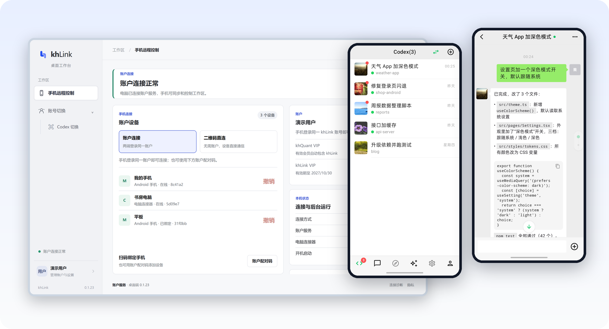
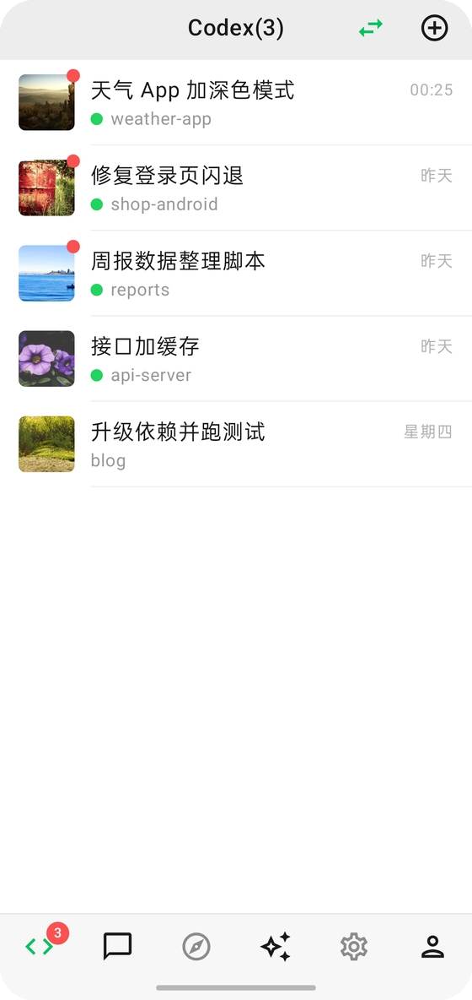
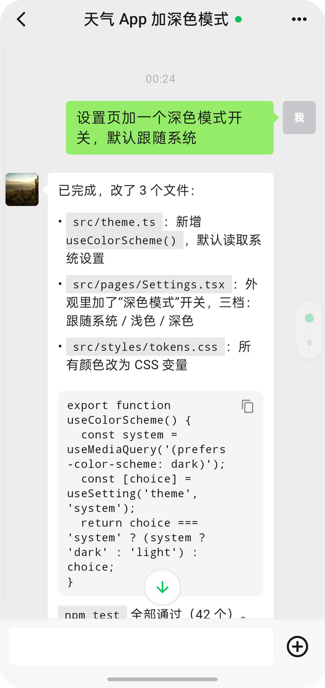
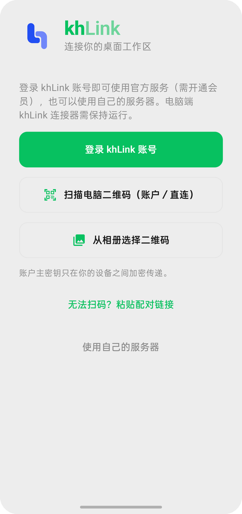
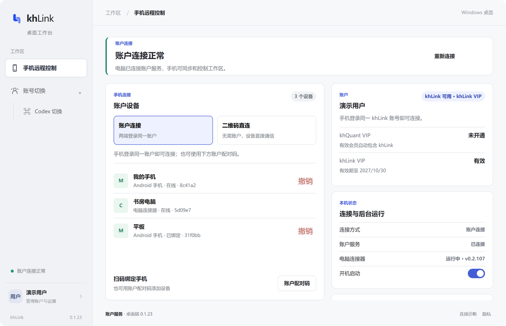
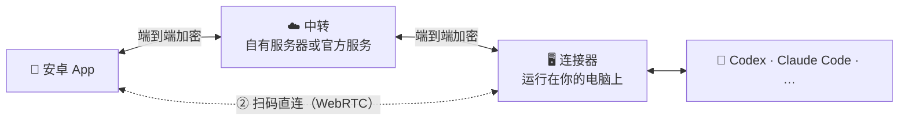

<div align="center">


# khLink

### 智能体在你的电脑上干活，你在手机上指挥它

把电脑上正在跑的 Codex、Claude Code 等智能体会话原样带到安卓手机上。<br/>
回答提问、批准操作、发新指令、开新任务，人不在电脑前，活也不停。

[](https://github.com/khscience/khlink/actions/workflows/ci.yml)
[](LICENSE)


**简体中文** · [English](README.en.md) · [繁體中文](README.zh-TW.md) · [日本語](README.ja.md) · [한국어](README.ko.md)

**[⬇️ 下载手机 App 和电脑安装包](https://github.com/khscience/khlink-releases/releases/latest)** · [官网](https://khsci.com/khlink/)

[为什么用 khLink](#为什么用-khlink) · [三种部署方式](#三种部署方式) · [支持的智能体](#支持的智能体) · [工作原理](#工作原理) · [常见问题](#常见问题)



</div>

---

## 为什么用 khLink

AI 编程智能体一跑就是十几分钟甚至几个小时，中间时不时停下来等你：要你批准一条命令，要你在几个方案里选一个，或者干完了等你下一步指示。人一离开电脑，它就只能干等着。

khLink 解决的就是这件事。

<table>
<tr>
<td width="50%" valign="top">

#### 🔁 就是电脑上的那个会话
不是另起一个聊天窗口。手机上看到的就是电脑上那条会话：在电脑上开的任务，手机上接着聊；在手机上开的任务，回到电脑前接着干。模型、思考强度、快速模式、计划模式在两边同步。

</td>
<td width="50%" valign="top">

#### 🔔 等你的时候，手机马上知道
智能体请求批准、向你提问、跑完一轮，手机都会通知你。选项和电脑上一模一样，点一下就收起，回答在后台送达，不用在电脑前守着。

</td>
</tr>
<tr>
<td valign="top">

#### 🔒 代码和账号都不离开你的电脑
智能体始终运行在你自己的电脑上，用它自己的官方应用或命令行登录，khLink 不读取、不转发任何凭据。手机和电脑之间的内容端到端加密，中转服务器只看到密文。

</td>
<td valign="top">

#### 🧩 一个 App，七种智能体，多台电脑
Codex、Claude Code、Claude Desktop、DeepSeek Harness、Hermes、Pi、Antigravity 放在同一个列表里。用 khLink 账号登录时，一部手机可以同时管多台 Windows 电脑，会话按电脑分开。

</td>
</tr>
<tr>
<td valign="top">

#### 📶 手机流量也省得住
轻量模式下，大段的工具输出和文件留在电脑上，只传对话本身；想看哪段再点开取。会话列表只同步有变化的部分。

</td>
<td valign="top">

#### 🛠️ 手机上能干的远不止聊天
智能体忙的时候发的话自动排队；能看代码、图片、文件，把电脑上的文件取到手机；能看额度和每轮的 Token 消耗；能整理上下文、分叉、回滚一轮。

</td>
</tr>
</table>

## 截图

<table>
  <tr>
    <td width="33%"></td>
    <td width="33%"></td>
    <td width="33%"></td>
  </tr>
  <tr>
    <td align="center">所有会话和实时状态</td>
    <td align="center">列表、代码、文件都能看</td>
    <td align="center">三种连接方式任选</td>
  </tr>
</table>



<sub>截图里的会话都是编的演示数据。</sub>

## 三种部署方式

khLink 的手机 App、电脑端和中转服务器全部开源。怎么连，由你决定：

| | ① 自有服务器 | ② 扫码直连 | ③ 官方服务 |
| --- | :---: | :---: | :---: |
| 需要服务器 | 自己的一台 | **不需要** | 不需要 |
| 需要 khLink 账号 | 不需要 | 不需要 | 需要 |
| 费用 | 免费 | 免费 | 每月 100 MB 免费，超出后开通会员 |
| 在外面也能用 | ✅ | 同一 Wi-Fi 最稳；跨网络经 Cloudflare 临时通道 | ✅ |
| 内容加密 | 端到端 | 端到端 | 端到端 |
| 适合 | 有服务器、想完全自己掌控 | 想零成本试用，或主要在家里、办公室用 | 想装好就用 |

**环境要求**：安卓 7.0 及以上的手机；Windows 10 / 11（64 位）的电脑，上面装好你要用的智能体。

### 自己部署

#### ① 有自己的服务器：部署中转

中转服务器只负责转发加密后的消息。部署好后用一个服务器密码登录，不需要账号，也不收任何费用。

```bash
# 在服务器上（Node.js 22，nginx 配好 HTTPS）
git clone https://github.com/khscience/khlink.git && cd khlink
npm ci && npm run build
# 然后写配置、装 systemd 服务、配 nginx，见 docs/zh-CN/self-hosting.md
```

```powershell
# 在 Windows 电脑上（Node.js 22），在本仓库的克隆目录里
npm ci
$env:FENGZHU_BRIDGE_PASSWORD = '<服务器密码>'
node fengzhu-connect\src\cli.js setup --server https://bridge.example.com/fengzhu-bridge
powershell -ExecutionPolicy Bypass -File ops\install-connector.ps1 -EnableAutoStart
```

手机 App 用官方安装包或自己编译的都行。登录页点 **使用自己的服务器**，填地址和密码就连上了。完整步骤见 **[自建中转](docs/zh-CN/self-hosting.md)**。

#### ② 没有服务器：扫码直连

连服务器都不用，也不用注册账号：

1. 电脑装 khLink 安装包（[下载](https://github.com/khscience/khlink-releases/releases/latest)，或自己编译 [`kh-link-desktop`](kh-link-desktop)），手机装 khLink App。
2. 电脑上打开桌面控制台，点 **二维码直连**。
3. 手机登录页点 **扫描电脑二维码**，扫一下就连上了。

两边通过 WebRTC 建立加密通道，消息、批准和文件都直接在手机和电脑之间传，不经过任何业务服务器。

- **同一个 Wi-Fi 或手机热点**：不需要任何外部服务，最稳定。
- **不在同一个网络**：经 Cloudflare 临时通道转发（安装包已内置 cloudflared，不需要账号），内容端到端加密，不经过 khLink 服务器。连接器重启后通道不变；电脑重启后在外面需要重新扫码。

每个二维码只用一次，五分钟内有效。扫过一次后，App 重开、连接器重启都会自动连回；电脑重启后，在外面需要重新扫码。电脑也登录了账号时，直连连不上，手机可以改用账号登录，经官方服务器连回。详见 **[扫码直连](docs/zh-CN/direct-connection.md)**。

### ③ 官方服务：装好就用

不想折腾服务器和网络，就用我们提供的中转：

1. 从 [Releases](https://github.com/khscience/khlink-releases/releases/latest) 或[官网](https://khsci.com/khlink/)下载，手机装 khLink App，Windows 电脑装 khLink 安装包（桌面控制台和连接器在同一个包里）。
2. 在桌面控制台登录 khLink 账号。每个账号每月有 100 MB 免费流量，超出后开通会员即可不限流量。
3. 手机登录同一个账号，电脑上的会话就出现了。

官方服务每月有 100 MB 免费流量，超出后收少量会员费，用来覆盖服务器和流量的成本。内容同样端到端加密，服务器看不到你的代码和对话。

## 支持的智能体

| 智能体 | khLink 怎样连接它 |
| --- | --- |
| **OpenAI Codex** | 官方 `codex app-server`，和 Codex 桌面版共享会话 |
| **Claude Code** | 官方命令行和它的会话文件 |
| **Claude Desktop** | 官方应用的窗口和会话文件 |
| **DeepSeek Harness** | 一个小桥接插件（[说明](docs/zh-CN/deepseek-harness.md)） |
| **Hermes Agent** | WSL 里的 ACP，加只读会话库（[说明](docs/zh-CN/hermes.md)） |
| **Pi** | Pi 自己的 Web 进程 |
| **Antigravity** | 官方应用的窗口 |

每个智能体都在你的电脑上用它自己的官方应用或命令行登录。khLink 用和你一样的方式跟它打交道，不碰它的凭据。

## 工作原理



- 内容在离开设备之前就用 XChaCha20-Poly1305 加密，账户密钥只在你的手机和电脑上。中转能看到的只有设备和会话编号、时间和消息大小。
- 连接器以当前用户的计划任务运行，不需要管理员权限。
- 手机和电脑的应用内更新都带签名校验，校验不过不会安装。更新先从 GitHub Releases 下载，手机还会试 jsDelivr，都连不上时用 khLink 服务器。

| 组成 | 目录 | 技术 |
| --- | --- | --- |
| 安卓 App | [`android/`](android) | Kotlin、Jetpack Compose |
| 连接器 | [`fengzhu-connect/`](fengzhu-connect) | Node.js 22 |
| 中转 | [`fengzhu-server/`](fengzhu-server) | NestJS、SQLite |
| 桌面控制台 | [`kh-link-desktop/`](kh-link-desktop) | Tauri 2：登录、绑定手机、扫码直连、连接器状态和更新 |
| 桌面适配器 | [`desktop-adapter/`](desktop-adapter) | Rust：读取和操作 Claude Desktop、Codex 的窗口 |

通信格式和加密细节见 [protocol/v1.md](protocol/v1.md)。

## 从源码编译

<details>
<summary>需要的环境和命令</summary>

需要 Node.js 22、JDK 17 和 Android SDK、Rust stable 和 [Tauri 2 的 Windows 依赖](https://v2.tauri.app/start/prerequisites/)、PowerShell 5.1。

```bash
npm ci
npm test                                   # 中转和连接器
npm run build                              # 编译中转
cd android && ./gradlew testDebugUnitTest assembleDebug
cd kh-link-desktop/src-tauri && cargo test
cd desktop-adapter && cargo test
```

- 正式包：见 [android/RELEASE.md](android/RELEASE.md) 和[一体化安装包](docs/zh-CN/combined-installer.md)。
- `fengzhu-connect/bin/` 里是预编译的桌面适配器和一个小的原生辅助库。辅助库的 SHA-256 写在 `fengzhu-connect/scripts/claude-desktop-native.ps1` 里校验，从 `fengzhu-connect/native/` 重新编译后要一起更新这个哈希。
- 发布自己的 App？请改掉安卓的 `applicationId`（`vip.fengzhu.bridge`），并删掉或替换 `android/khlink-official.properties` 里的 `updatePublicKey` 和 `updateMirrors`（GitHub、jsDelivr 下载源），桌面端改 `kh-link-desktop/src-tauri/src/connector_update.rs` 里的 `UPDATE_PUBLIC_KEY` 和 `UPDATE_MIRROR`，否则用户会收到装不上的官方更新。
- 包名里的 `fengzhu` 是项目早期的名字。

</details>

## 常见问题

<details>
<summary><b>中转能看到我的代码和对话吗？</b></summary>

不能，官方服务和自建中转都一样。手机和连接器在内容离开设备之前就加密了，密钥不经过中转。中转能看到的是路由信息（设备、会话和事件的编号）、时间和加密消息的大小。扫码直连则完全不经过中转。
</details>

<details>
<summary><b>三种方式怎么选？</b></summary>

先用扫码直连免费试，在家或办公室同一个 Wi-Fi 下最稳。经常在外面用、又有自己的服务器，就自建中转。不想管服务器和网络，用官方服务。三种方式用的是同一个 App 和同一个连接器，随时可以换。
</details>

<details>
<summary><b>官方服务为什么收费？</b></summary>

中转服务器和流量都有成本。每个账号每月先有 100 MB 免费流量，超出部分的会员费只为覆盖这部分开销；不想付费，自建中转和扫码直连都是免费的，功能一样。
</details>

<details>
<summary><b>电脑要一直开着吗？</b></summary>

要。智能体运行在电脑上，电脑关机或睡眠时它也停了，手机上仍能翻看已经同步过的记录，但没法让它继续干活。出门前把电脑设成不自动睡眠就行。
</details>

<details>
<summary><b>khLink 会用我的智能体账号或 API Key 吗？</b></summary>

不会。每个智能体都在你的电脑上通过官方应用或命令行登录，khLink 不读取、不复制、不发送它们的凭据，用量也算在你自己的账号上。
</details>

<details>
<summary><b>安装时 Windows 提示“已保护你的电脑”？</b></summary>

电脑安装包暂时没有代码签名证书，Windows 会这样提示。点“更多信息 → 仍要运行”即可。不放心的话，可以用 Releases 页面上写的 SHA-256 核对下载的文件。
</details>

<details>
<summary><b>有 iPhone 版吗？连接器支持 macOS 或 Linux 吗？</b></summary>

暂时没有。App 只有安卓版，连接器只支持 Windows（Hermes 运行在这台 Windows 电脑的 WSL 里）。
</details>

## 文档

| | |
| --- | --- |
| [自建中转](docs/zh-CN/self-hosting.md) | 部署自己的中转服务器 |
| [扫码直连](docs/zh-CN/direct-connection.md) | 不需要服务器的 WebRTC 直连 |
| [桌面连接流程](docs/zh-CN/desktop-connection-flow.md) | 电脑上的登录、绑定和状态 |
| [一个账号多台电脑](docs/zh-CN/multi-pc.md) | 多台电脑接入同一个账号 |
| [手机更新](docs/zh-CN/android-app-updates.md) | 签名校验的应用内更新 |
| [排障](docs/zh-CN/troubleshooting.md) | 常见问题处理 |
| [协议](protocol/v1.md) | 通信格式和加密 |

## 参与贡献

欢迎提 Issue 和 PR，先看看 [CONTRIBUTING.md](CONTRIBUTING.md)。安全问题请按 [SECURITY.md](SECURITY.md) 私下报告。

## 许可证

[MIT](LICENSE)。`docs/kh-link-*.md` 里的条款只适用于官方服务和官方安装包。

## 致谢

khLink 由 [Linco Bridge](https://github.com/lincotalk/linco-bridge)（MIT）发展而来，保留了它的版权声明。项目基于 [Tauri](https://tauri.app)、[NestJS](https://nestjs.com)、[Jetpack Compose](https://developer.android.com/compose)、[libsodium](https://libsodium.org) 和 [werift](https://github.com/shinyoshiaki/werift-webrtc) 构建。

<div align="center">

如果 khLink 让你少跑了几趟电脑前，点个 ⭐ 让更多人看到它。

</div>
