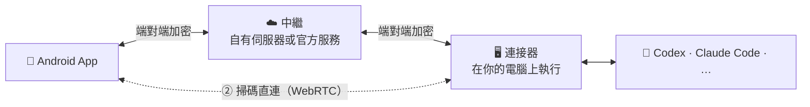

<div align="center">


# khLink

### 智慧代理在你的電腦上工作，你在手機上指揮它

把電腦上正在執行的 Codex、Claude Code 等智慧代理工作階段原封不動帶到 Android 手機上。<br/>
回答提問、核准操作、下新指令、開新任務，人不在電腦前，工作也不停。

[](https://github.com/khscience/khlink/actions/workflows/ci.yml)
[](LICENSE)


[简体中文](README.md) · [English](README.en.md) · **繁體中文** · [日本語](README.ja.md) · [한국어](README.ko.md)

**[⬇️ 下載手機 App 與電腦安裝檔](https://github.com/khscience/khlink-releases/releases/latest)** · [官網](https://khsci.com/khlink/)

[為什麼用 khLink](#為什麼用-khlink) · [三種部署方式](#三種部署方式) · [支援的智慧代理](#支援的智慧代理) · [運作原理](#運作原理) · [常見問題](#常見問題)


</div>

---

## 為什麼用 khLink

AI 程式設計代理一跑就是十幾分鐘甚至好幾個小時，中間不時停下來等你：要你核准一條指令、要你在幾個方案裡挑一個，或是做完了等你下一步指示。人一離開電腦，它就只能乾等。

khLink 解決的就是這件事。

<table>
<tr>
<td width="50%" valign="top">

#### 🔁 就是電腦上的那個工作階段
不是另開一個聊天視窗。手機上看到的就是電腦上那條工作階段：在電腦上開的任務，手機上接著聊；在手機上開的任務，回到電腦前接著做。模型、推理強度、快速模式、計畫模式在兩邊同步。

</td>
<td width="50%" valign="top">

#### 🔔 輪到你的時候，手機馬上知道
代理請求核准、向你提問、跑完一輪，手機都會通知你。選項和電腦上一模一樣，點一下就收起，回答在背景送達，不必守在電腦前。

</td>
</tr>
<tr>
<td valign="top">

#### 🔒 程式碼和帳號都不離開你的電腦
代理始終在你自己的電腦上執行，用它自己的官方應用程式或命令列登入，khLink 不讀取、不轉送任何憑證。手機和電腦之間的內容端對端加密，中繼伺服器只看得到密文。

</td>
<td valign="top">

#### 🧩 一個 App，七種代理，多台電腦
Codex、Claude Code、Claude Desktop、DeepSeek Harness、Hermes、Pi、Antigravity 放在同一個列表裡。用 khLink 帳號登入時，一支手機可以同時管理多台 Windows 電腦，工作階段依電腦分開。

</td>
</tr>
<tr>
<td valign="top">

#### 📶 行動數據也省得下來
輕量模式下，大段的工具輸出和檔案留在電腦上，只傳對話本身；想看哪段再點開取。工作階段列表只同步有變動的部分。

</td>
<td valign="top">

#### 🛠️ 手機上能做的遠不只聊天
代理忙碌時送出的訊息自動排隊；能看程式碼、圖片、檔案，把電腦上的檔案取到手機；能看額度和每輪的 Token 用量；能整理上下文、分叉、回滾一輪。

</td>
</tr>
</table>

## 截圖

<table>
  <tr>
    <td width="33%"></td>
    <td width="33%"></td>
    <td width="33%"></td>
  </tr>
  <tr>
    <td align="center">所有工作階段與即時狀態</td>
    <td align="center">清單、程式碼、檔案都能看</td>
    <td align="center">三種連線方式任選</td>
  </tr>
</table>


<sub>截圖中的工作階段都是虛構的示範資料。</sub>

## 三種部署方式

khLink 的手機 App、電腦端和中繼伺服器全部開源。怎麼連，由你決定：

| | ① 自有伺服器 | ② 掃碼直連 | ③ 官方服務 |
| --- | :---: | :---: | :---: |
| 需要伺服器 | 自己的一台 | **不需要** | 不需要 |
| 需要 khLink 帳號 | 不需要 | 不需要 | 需要 |
| 費用 | 免費 | 免費 | 每月 100 MB 免費，超出後開通會員 |
| 出門在外也能用 | ✅ | 同一 Wi-Fi 最穩；跨網路經 Cloudflare 臨時通道 | ✅ |
| 內容加密 | 端對端 | 端對端 | 端對端 |
| 適合 | 有伺服器、想完全自己掌控 | 想零成本試用，或主要在家、辦公室使用 | 想裝好就用 |

**環境需求**：Android 7.0 以上的手機；Windows 10 / 11（64 位元）的電腦，並裝好你要用的代理。App 介面目前為簡體中文。

### 自己部署

#### ① 有自己的伺服器：部署中繼

中繼伺服器只負責轉送加密後的訊息。部署好之後用一組伺服器密碼登入，不需要帳號，也不收任何費用。

```bash
# 在伺服器上（Node.js 22，nginx 已設定 HTTPS）
git clone https://github.com/khscience/khlink.git && cd khlink
npm ci && npm run build
# 接著撰寫設定、安裝 systemd 服務、設定 nginx，見 docs/zh-CN/self-hosting.md
```

```powershell
# 在 Windows 電腦上（Node.js 22），在本儲存庫的複製目錄裡
npm ci
$env:FENGZHU_BRIDGE_PASSWORD = '<伺服器密碼>'
node fengzhu-connect\src\cli.js setup --server https://bridge.example.com/fengzhu-bridge
powershell -ExecutionPolicy Bypass -File ops\install-connector.ps1 -EnableAutoStart
```

手機 App 用官方安裝檔或自行編譯的都可以。在登入頁點 **使用自己的服务器**，填入位址和密碼就連上了。完整步驟見 **[自建中繼](docs/zh-CN/self-hosting.md)**（簡體中文）。

#### ② 沒有伺服器：掃碼直連

連伺服器都不用，也不用註冊帳號：

1. 電腦安裝 khLink 安裝檔（[下載](https://github.com/khscience/khlink-releases/releases/latest)，或自行編譯 [`kh-link-desktop`](kh-link-desktop)），手機安裝 khLink App。
2. 在電腦上開啟桌面主控台，點 **二维码直连**。
3. 在手機登入頁點 **扫描电脑二维码**，掃一下就連上了。

兩邊透過 WebRTC 建立加密通道，訊息、核准和檔案都直接在手機和電腦之間傳送，不經過任何業務伺服器。

- **同一個 Wi-Fi 或手機熱點**：不需要任何外部服務，最穩定。
- **不在同一個網路**：經 Cloudflare 臨時通道轉送（安裝檔已內建 cloudflared，不需要帳號），內容端對端加密，不經過 khLink 伺服器。連接器重新啟動後通道不變；電腦重新開機後，在外面需要重新掃碼。

每個 QR Code 只能用一次，五分鐘內有效。掃過一次後，App 重開、連接器重新啟動都會自動連回；電腦重新開機後，在外面需要重新掃碼。電腦也登入帳號時，直連連不上，手機可以改用帳號登入，經官方伺服器連回。詳見 **[掃碼直連](docs/zh-CN/direct-connection.md)**（簡體中文）。

### ③ 官方服務：裝好就用

不想折騰伺服器和網路，就用我們提供的中繼：

1. 從 [Releases](https://github.com/khscience/khlink-releases/releases/latest) 或[官網](https://khsci.com/khlink/)下載，手機安裝 khLink App，Windows 電腦安裝 khLink 安裝檔（桌面主控台和連接器在同一個安裝檔裡）。
2. 在桌面主控台登入 khLink 帳號。每個帳號每月有 100 MB 免費流量，超出後開通會員即可不限流量。
3. 手機登入同一個帳號，電腦上的工作階段就出現了。

官方服務每月有 100 MB 免費流量，超出後收少量會員費，用來支應伺服器和流量的成本。內容同樣端對端加密，伺服器看不到你的程式碼和對話。

## 支援的智慧代理

| 代理 | khLink 如何連接 |
| --- | --- |
| **OpenAI Codex** | 官方 `codex app-server`，與 Codex 桌面版共用工作階段 |
| **Claude Code** | 官方命令列及其工作階段檔案 |
| **Claude Desktop** | 官方應用程式的視窗及工作階段檔案 |
| **DeepSeek Harness** | 一個小型橋接外掛（[說明](docs/zh-CN/deepseek-harness.md)） |
| **Hermes Agent** | WSL 中的 ACP，加上唯讀的工作階段資料庫（[說明](docs/zh-CN/hermes.md)） |
| **Pi** | Pi 自己的 Web 行程 |
| **Antigravity** | 官方應用程式的視窗 |

每個代理都在你的電腦上用它自己的官方應用程式或命令列登入。khLink 用和你一樣的方式與它互動，不碰它的憑證。

## 運作原理



- 內容在離開裝置之前就以 XChaCha20-Poly1305 加密，帳戶金鑰只存在你的手機和電腦上。中繼能看到的只有裝置與工作階段編號、時間和訊息大小。
- 連接器以目前使用者的排程工作執行，不需要系統管理員權限。
- 手機和電腦的 App 內更新都附有簽章驗證，驗證不通過就不會安裝。更新先從 GitHub Releases 下載，手機還會嘗試 jsDelivr，都連不上時改用 khLink 伺服器。

| 組成 | 目錄 | 技術 |
| --- | --- | --- |
| Android App | [`android/`](android) | Kotlin、Jetpack Compose |
| 連接器 | [`fengzhu-connect/`](fengzhu-connect) | Node.js 22 |
| 中繼 | [`fengzhu-server/`](fengzhu-server) | NestJS、SQLite |
| 桌面主控台 | [`kh-link-desktop/`](kh-link-desktop) | Tauri 2：登入、綁定手機、掃碼直連、連接器狀態與更新 |
| 桌面轉接器 | [`desktop-adapter/`](desktop-adapter) | Rust：讀取並操作 Claude Desktop、Codex 的視窗 |

通訊格式與加密細節見 [protocol/v1.md](protocol/v1.md)。

## 從原始碼編譯

<details>
<summary>需要的環境與指令</summary>

需要 Node.js 22、JDK 17 與 Android SDK、Rust stable 與 [Tauri 2 的 Windows 相依套件](https://v2.tauri.app/start/prerequisites/)、PowerShell 5.1。

```bash
npm ci
npm test                                   # 中繼與連接器
npm run build                              # 編譯中繼
cd android && ./gradlew testDebugUnitTest assembleDebug
cd kh-link-desktop/src-tauri && cargo test
cd desktop-adapter && cargo test
```

- 正式版：見 [android/RELEASE.md](android/RELEASE.md) 與[一體化安裝檔](docs/zh-CN/combined-installer.md)。
- `fengzhu-connect/bin/` 裡是預先編譯的桌面轉接器和一個小型原生輔助函式庫。輔助函式庫的 SHA-256 寫在 `fengzhu-connect/scripts/claude-desktop-native.ps1` 中驗證，從 `fengzhu-connect/native/` 重新編譯後要一併更新這個雜湊值。
- 要發布自己的 App？請修改 Android 的 `applicationId`（`vip.fengzhu.bridge`），並刪除或替換 `android/khlink-official.properties` 中的 `updatePublicKey` 和 `updateMirrors`（GitHub、jsDelivr 下載來源），桌面端修改 `kh-link-desktop/src-tauri/src/connector_update.rs` 中的 `UPDATE_PUBLIC_KEY` 和 `UPDATE_MIRROR`，否則使用者會收到裝不上的官方更新。
- 套件名稱中的 `fengzhu` 是專案早期的名字。

</details>

## 常見問題

<details>
<summary><b>中繼看得到我的程式碼和對話嗎？</b></summary>

看不到，官方服務和自建中繼都一樣。手機和連接器在內容離開裝置之前就加密了，金鑰不經過中繼。中繼看得到的是路由資訊（裝置、工作階段和事件的編號）、時間和加密訊息的大小。掃碼直連則完全不經過中繼。
</details>

<details>
<summary><b>三種方式怎麼選？</b></summary>

先用掃碼直連免費試，在家或辦公室同一個 Wi-Fi 下最穩。常在外面用、又有自己的伺服器，就自建中繼。不想管伺服器和網路，就用官方服務。三種方式用的是同一個 App 和同一個連接器，隨時可以切換。
</details>

<details>
<summary><b>官方服務為什麼收費？</b></summary>

中繼伺服器和流量都有成本。每個帳號每月先有 100 MB 免費流量，超出部分的會員費只為支應這部分開銷。不想付費的話，自建中繼和掃碼直連都免費，功能相同。
</details>

<details>
<summary><b>電腦要一直開著嗎？</b></summary>

要。代理在電腦上執行，電腦關機或睡眠時它也會停止；手機上仍能翻看已同步的紀錄，但無法讓它繼續工作。出門前把電腦設成不自動睡眠即可。
</details>

<details>
<summary><b>khLink 會使用我的代理帳號或 API Key 嗎？</b></summary>

不會。每個代理都在你的電腦上透過官方應用程式或命令列登入，khLink 不讀取、不複製、不傳送它們的憑證，用量也照常算在你自己的帳號上。
</details>

<details>
<summary><b>安裝時 Windows 顯示「Windows 已保護您的電腦」？</b></summary>

電腦安裝檔目前還沒有程式碼簽章憑證，所以 Windows 會這樣提示。點「其他資訊 → 仍要執行」即可。若不放心，可以用 Releases 頁面上列出的 SHA-256 核對下載的檔案。
</details>

<details>
<summary><b>有 iPhone 版嗎？連接器支援 macOS 或 Linux 嗎？</b></summary>

目前還沒有。App 只有 Android 版，連接器只支援 Windows（Hermes 在這台 Windows 電腦的 WSL 中執行）。
</details>

## 文件

| | |
| --- | --- |
| [自建中繼](docs/zh-CN/self-hosting.md) | 部署自己的中繼伺服器 |
| [掃碼直連](docs/zh-CN/direct-connection.md) | 不需要伺服器的 WebRTC 直連 |
| [桌面連線流程](docs/zh-CN/desktop-connection-flow.md) | 電腦上的登入、綁定與狀態 |
| [一個帳號多台電腦](docs/zh-CN/multi-pc.md) | 多台電腦接入同一個帳號 |
| [手機更新](docs/zh-CN/android-app-updates.md) | 附簽章驗證的 App 內更新 |
| [疑難排解](docs/zh-CN/troubleshooting.md) | 常見問題處理 |
| [協定](protocol/v1.md) | 通訊格式與加密 |

文件目前以簡體中文為主。

## 參與貢獻

歡迎提出 Issue 和 PR，請先看看 [CONTRIBUTING.md](CONTRIBUTING.md)。安全性問題請依 [SECURITY.md](SECURITY.md) 私下回報。

## 授權

[MIT](LICENSE)。`docs/kh-link-*.md` 中的條款只適用於官方服務與官方安裝檔。

## 致謝

khLink 由 [Linco Bridge](https://github.com/lincotalk/linco-bridge)（MIT）發展而來，保留了它的版權聲明。本專案以 [Tauri](https://tauri.app)、[NestJS](https://nestjs.com)、[Jetpack Compose](https://developer.android.com/compose)、[libsodium](https://libsodium.org) 和 [werift](https://github.com/shinyoshiaki/werift-webrtc) 打造。

<div align="center">

如果 khLink 讓你少跑了幾趟電腦前，按個 ⭐ 讓更多人看到它。

</div>
