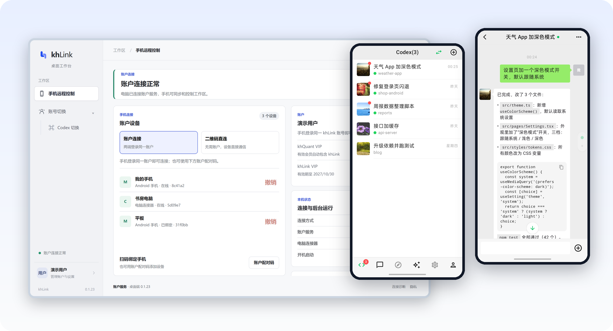
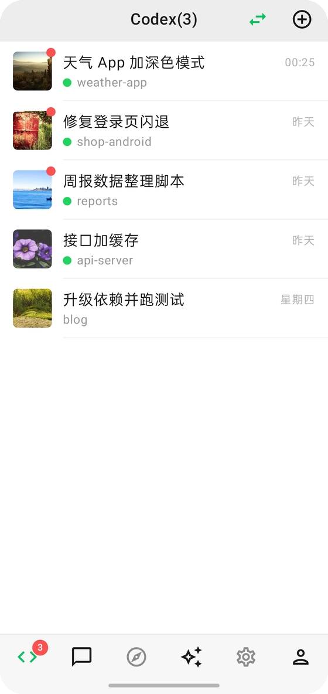
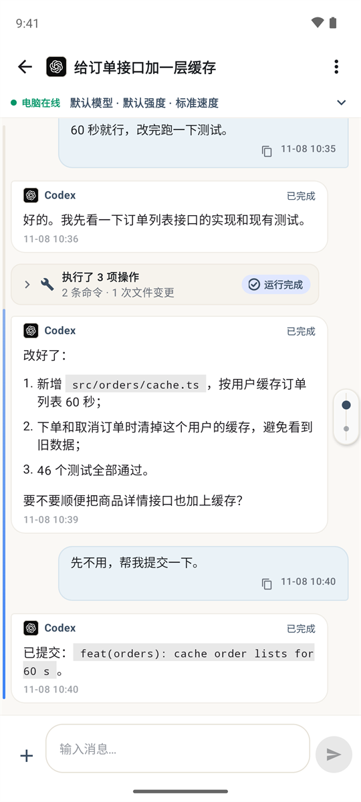
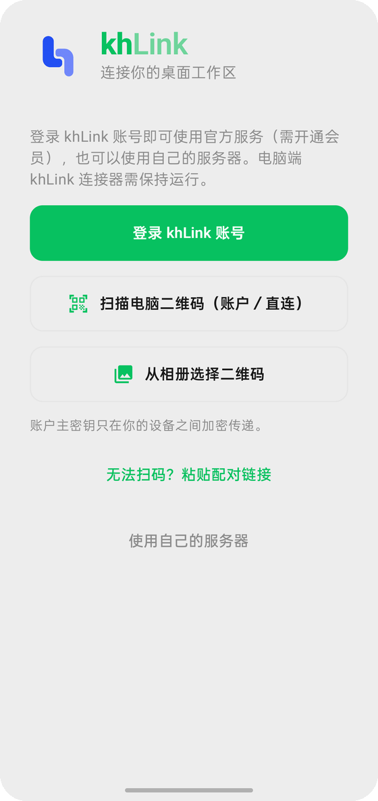
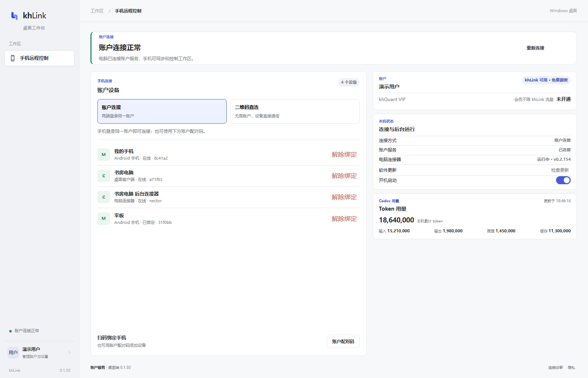
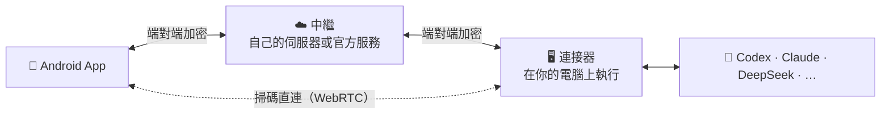

<div align="center">


# khLink

### 智慧代理在電腦上工作，你在手機上指揮。

電腦上正在執行的 Codex、Claude Code 等智慧代理工作階段，原封不動帶到 Android 手機上。<br/>
核准、回答、下新指令，人不在電腦前，工作也不停。

[](https://github.com/khscience/khlink/actions/workflows/ci.yml)
[](LICENSE)


[简体中文](README.md) · [English](README.en.md) · **繁體中文** · [日本語](README.ja.md) · [한국어](README.ko.md)

**[⬇️ 下載 khLink](https://github.com/khscience/khlink-releases/releases/latest)** · [官網](https://khsci.com/khlink/) · [使用教學](https://khsci.com/khlink/tutorial)



<sub>截圖中的帳號和工作階段都是示範資料。</sub>

</div>

---

## 完全免費，完全開源

手機 App、電腦端和中繼伺服器的原始碼全部公開（MIT）。三種連線方式功能相同，都不收費：

- **掃碼直連**：電腦上顯示一個 QR Code，手機掃一下就連上。不需要帳號，也不經過 khLink 伺服器。
- **部署到自己的伺服器**：把開源的中繼服務部署到你自己的機器上，用伺服器密碼登入，不需要帳號。
- **用我們的伺服器**：登入 khLink 帳號，裝好就用。每個帳號每月有 300 MB 免費流量，khQuant VIP 會員不限流量。khLink 不賣會員。

不論哪種方式，內容都是端對端加密，中繼伺服器只看得到密文。

## 代理一停下來，就是在等你

AI 程式設計代理一跑就是十幾分鐘，中間不時停下來：要你核准一條指令，要你在幾個方案裡挑一個，或是做完了等你下一步。人一離開電腦，它就只能乾等。

| | 代理在等什麼 | 在手機上怎麼做 |
| --- | --- | --- |
| **核准** | 要執行指令、修改檔案 | 看清楚要做什麼，再允許或拒絕 |
| **回答** | 要你在幾個方案裡挑一個 | 選項和電腦上一樣，點一下就送達 |
| **繼續** | 跑完一輪，等下一步 | 在原本的工作階段裡接著說，排隊或立即插話 |
| **查看** | 想馬上看一眼結果 | 把電腦上的檔案取到手機，直接預覽 |

## 能做什麼

**同一個工作階段。** 不是另開一個聊天視窗：在電腦上開的任務，手機上接著聊；在手機上開的，回到電腦前接著做。模型、推理強度、快速模式和計畫模式在兩邊同步。

- **即時狀態**：執行中、等你處理、已完成，在列表上一眼就看到。
- **排隊與立即傳送**：代理忙碌時送出的訊息自動排隊，也可以立即插進目前這一輪。
- **核准與提問**：代理請求核准、提出問題、要你確認計畫時，手機會通知你；選擇題和自由回答都可以，計畫可以接受、修改或拒絕。結果不確定時會先提醒你核對，不會把一條指令執行兩次。
- **檔案**：點對話裡的電腦檔案路徑，取回手機預覽。Markdown 和 HTML 能直接看，也能看原始碼；程式碼依語言上色，大檔案分段取回。登入憑證和金鑰目錄讀不到。
- **圖片與附件**：在手機上傳圖片和檔案給代理。
- **每輪用量**：回覆下方顯示這一輪用掉的 Token，也能查看各代理的額度。
- **多台電腦**：一個帳號連接多台 Windows 電腦，工作階段依電腦分開，在首頁點一下就能切換。
- **輕量模式**：大段工具輸出和截圖留在電腦上，想看再取，省下行動數據。
- **四種主題**：聊天軟體、Codex 風格、預設、極簡。新安裝 App 的引導裡就能試用，之後隨時可換。

## 截圖

<table>
  <tr>
    <td width="33%"></td>
    <td width="33%"></td>
    <td width="33%"></td>
  </tr>
  <tr>
    <td align="center">所有工作階段與即時狀態</td>
    <td align="center">程式碼、圖片、檔案都能看</td>
    <td align="center">三種連線方式任選</td>
  </tr>
</table>



## 開始使用

需要一台 Windows 10 / 11（64 位元）電腦，並裝好你要用的代理；一支 Android 7.0 以上的手機。

1. **電腦安裝 khLink**：[下載安裝檔](https://github.com/khscience/khlink-releases/releases/latest)，桌面主控台和背景連接器在同一個安裝檔裡。
2. **手機安裝 App**：從同一個頁面下載 APK，安裝時由你確認系統提示。
3. **連起來**：兩邊登入同一個 khLink 帳號，或掃一次電腦上的 QR Code。

電腦安裝檔目前還沒有程式碼簽章，Windows 顯示「Windows 已保護您的電腦」時，先用發布頁上的 SHA-256 核對檔案，再點「其他資訊 → 仍要執行」。詳細步驟見[使用教學](https://khsci.com/khlink/tutorial)。

## 三種連線方式

先用掃碼直連免費試；常在外面用、又有自己的伺服器，就自建中繼；不想管伺服器和網路，就用官方服務。三種方式是同一個 App、同一個連接器，隨時可以切換。

| | 掃碼直連 | 自己的伺服器 | 官方服務 |
| --- | :---: | :---: | :---: |
| 費用 | 免費 | 免費 | 免費，每月 300 MB 流量 |
| 需要伺服器 | 不需要 | 自己的一台 | 不需要 |
| 需要 khLink 帳號 | 不需要 | 不需要 | 需要 |
| 出門在外也能用 | ✅ 經 Cloudflare 臨時通道 | ✅ | ✅ |
| 多台裝置 | 一支手機對一台電腦 | 多支手機 | 多支手機、多台電腦 |
| 重新啟動後 | App 和連接器重新啟動會自動連回；電腦重新開機後，在外面需要重新掃碼 | 自動重新連線 | 自動重新連線 |
| 內容加密 | 端對端 | 端對端 | 端對端 |
| 適合 | 零成本試用，主要在家、辦公室使用 | 有伺服器、想完全自己掌控 | 想裝好就用 |

### 掃碼直連

1. 電腦和手機都裝好 khLink。
2. 在電腦上開啟桌面主控台，點 **二维码直连**。
3. 在手機登入頁點 **扫描电脑二维码**。

兩邊透過 WebRTC 建立加密通道，訊息、核准和檔案直接在手機和電腦之間傳送。在同一個 Wi-Fi 或手機熱點下點對點直連，最穩定；不在同一個網路時經 Cloudflare 臨時通道轉送（安裝檔已內建 cloudflared，不需要帳號）。每個 QR Code 只能用一次，五分鐘內有效。詳見 **[掃碼直連](docs/zh-CN/direct-connection.md)**。

### 部署到自己的伺服器

中繼伺服器只負責轉送加密後的訊息，用伺服器密碼登入，不需要帳號。需要一台有公開位址、已設定 HTTPS 的伺服器。

```bash
# 在伺服器上（Node.js 22，nginx 已設定 HTTPS）
git clone https://github.com/khscience/khlink.git && cd khlink
npm ci && npm run build
# 接著撰寫設定、安裝 systemd 服務、設定 nginx，見 docs/zh-CN/self-hosting.md
```

```powershell
# 在 Windows 電腦上（Node.js 22），在本儲存庫的複製目錄裡
npm ci
$env:FENGZHU_BRIDGE_PASSWORD = '<伺服器密碼>'
node fengzhu-connect\src\cli.js setup --server https://bridge.example.com/fengzhu-bridge
powershell -ExecutionPolicy Bypass -File ops\install-connector.ps1 -EnableAutoStart
```

在手機登入頁點 **使用自己的服务器**，填入位址和密碼。完整步驟見 **[自建中繼](docs/zh-CN/self-hosting.md)**。

### 用我們的伺服器

在桌面主控台和手機上登入同一個 khLink 帳號，電腦上的工作階段就出現了。一個帳號可以連接多支手機和多台電腦。

每個帳號每月有 300 MB 免費流量（依北京時間的自然月計算，只計經官方伺服器的上傳和下載，心跳不計）。用到 80% 和用完時 App 會提醒；用完後仍能登入、查看手機上已有的內容，遠端操作暫停到下個月 1 日。khQuant VIP 會員不限流量。

## 支援的智慧代理

| 智慧代理 | khLink 如何連接 |
| --- | --- |
| **OpenAI Codex** | 官方 `codex app-server`，與 Codex 桌面版共用工作階段 |
| **Claude Code** | 官方命令列及其工作階段檔案 |
| **Claude Desktop** | 官方應用程式的視窗及工作階段檔案 |
| **DeepSeek Harness** | 一個小型橋接外掛，只用來找到它在本機開啟的介面（[說明](docs/zh-CN/deepseek-harness.md)） |
| **Hermes Agent** | 電腦 WSL 中的 ACP，加上唯讀的工作階段資料庫（[說明](docs/zh-CN/hermes.md)） |
| **Pi** | Pi 自己的網頁服務（PI WEB） |
| **反重力（Antigravity）** | 官方應用程式的視窗 |

每個代理都在你的電腦上，用它自己的官方應用程式或命令列登入。khLink 用和你一樣的方式與它互動，不碰它的憑證。沒安裝的代理會被略過，之後裝上了，一分鐘內會自動連接。

## 安全

- **端對端加密**：內容在離開裝置之前就以 XChaCha20-Poly1305 加密，帳戶金鑰只存在你的手機和電腦上。
- **中繼只看得到路由資訊**：裝置與工作階段編號、時間和訊息大小。掃碼直連完全不經過中繼。
- **不碰代理的帳號**：不讀取、不複製、不傳送代理的憑證，用量算在你自己的帳號上。
- **更新附簽章驗證**：手機和電腦的更新檔都會驗證簽章，驗證不通過就不會安裝。

## 運作原理



連接器以目前使用者的排程工作在背景執行，不需要系統管理員權限。更新先從 GitHub Releases 下載，手機還會嘗試 jsDelivr，都連不上時改用 khLink 伺服器。

| 組成 | 目錄 | 技術 |
| --- | --- | --- |
| Android App | [`android/`](android) | Kotlin、Jetpack Compose |
| 連接器 | [`fengzhu-connect/`](fengzhu-connect) | Node.js 22 |
| 中繼 | [`fengzhu-server/`](fengzhu-server) | NestJS、SQLite |
| 桌面主控台 | [`kh-link-desktop/`](kh-link-desktop) | Tauri 2：登入、綁定手機、掃碼直連、連接器狀態與更新 |
| 桌面轉接器 | [`desktop-adapter/`](desktop-adapter) | Rust：讀取並操作 Claude Desktop、Codex 的視窗 |

通訊格式與加密細節見 [protocol/v1.md](protocol/v1.md)。

## 常見問題

<details>
<summary><b>khLink 要收費嗎？</b></summary>

軟體免費，原始碼依 MIT 授權公開。掃碼直連和部署到自己的伺服器都不收費。官方伺服器也免費，每個帳號每月 300 MB 流量，khQuant VIP 會員不限流量。khLink 不賣會員，三種方式功能相同。
</details>

<details>
<summary><b>300 MB 免費流量夠用嗎？用完了會怎樣？</b></summary>

平常下指令、看回覆，一個月 300 MB 一般夠用；常同步很長的對話或傳檔案會用得快一些。App 的「我」頁面能看到本月已用多少，用到 80% 和用完時都會提醒。用完後仍能登入、查看手機上已有的內容，只是遠端操作暫停到下個月 1 日（北京時間）。掃碼直連和自建伺服器不受影響。
</details>

<details>
<summary><b>電腦要一直開著嗎？</b></summary>

要。代理在電腦上執行，電腦關機或睡眠時它也會停止；手機上仍能翻看已同步的紀錄。出門前把電腦設成不自動睡眠即可。
</details>

<details>
<summary><b>能不能多支手機、多台電腦一起用？</b></summary>

用官方服務可以：同一個帳號登入的手機和電腦都能同時上線，手機上依電腦切換。自己部署的伺服器支援多支手機同時登入。掃碼直連目前是一支手機對一台電腦。
</details>

<details>
<summary><b>中繼看得到我的程式碼和對話嗎？</b></summary>

看不到。手機和電腦在內容離開裝置之前就加密了，金鑰不經過中繼。中繼看得到的是裝置、工作階段和事件的編號、時間和加密訊息的大小。掃碼直連則完全不經過中繼。
</details>

<details>
<summary><b>khLink 會使用我的代理帳號或 API Key 嗎？</b></summary>

不會。每個代理都在你的電腦上透過官方應用程式或命令列登入，khLink 不讀取、不複製、不傳送它們的憑證，用量算在你自己的帳號上。
</details>

<details>
<summary><b>電腦上一定要裝 Codex 嗎？</b></summary>

不用。只用 Claude、DeepSeek、Hermes 等其他代理也可以，khLink 會略過 Codex。之後裝了 Codex，一分鐘內會自動連接，不必重新啟動。
</details>

<details>
<summary><b>有 iPhone 版嗎？電腦支援 macOS 嗎？</b></summary>

目前還沒有。App 只有 Android 版，電腦端只支援 Windows（Hermes 在這台電腦的 WSL 中執行）。
</details>

更多問題見[使用教學](https://khsci.com/khlink/tutorial)和[疑難排解](docs/zh-CN/troubleshooting.md)。

## 從原始碼編譯

<details>
<summary>需要的環境與指令</summary>

需要 Node.js 22、JDK 17 與 Android SDK、Rust stable 與 [Tauri 2 的 Windows 相依套件](https://v2.tauri.app/start/prerequisites/)、PowerShell 5.1。

```bash
npm ci
npm test                                   # 中繼與連接器
npm run build                              # 編譯中繼
cd android && ./gradlew testDebugUnitTest assembleDebug
cd kh-link-desktop/src-tauri && cargo test
cd desktop-adapter && cargo test
```

- 正式版：見 [android/RELEASE.md](android/RELEASE.md) 與[一體化安裝檔](docs/zh-CN/combined-installer.md)。
- `fengzhu-connect/bin/` 裡是預先編譯的桌面轉接器和一個小型原生輔助函式庫。輔助函式庫的 SHA-256 寫在 `fengzhu-connect/scripts/claude-desktop-native.ps1` 中驗證，從 `fengzhu-connect/native/` 重新編譯後要一併更新這個雜湊值。
- 要發布自己的 App？請修改 Android 的 `applicationId`（`vip.fengzhu.bridge`），並刪除或替換 `android/khlink-official.properties` 中的 `updatePublicKey` 和 `updateMirrors`，桌面端修改 `kh-link-desktop/src-tauri/src/connector_update.rs` 中的 `UPDATE_PUBLIC_KEY` 和 `UPDATE_MIRROR`，否則使用者會收到裝不上的官方更新。
- 套件名稱中的 `fengzhu` 是專案早期的名字。

</details>

## 文件

| | |
| --- | --- |
| [掃碼直連](docs/zh-CN/direct-connection.md) | 不需要伺服器的 WebRTC 直連 |
| [自建中繼](docs/zh-CN/self-hosting.md) | 部署自己的中繼伺服器 |
| [桌面連線流程](docs/zh-CN/desktop-connection-flow.md) | 電腦上的登入、綁定與狀態 |
| [一個帳號多台電腦](docs/zh-CN/multi-pc.md) | 多台電腦接入同一個帳號 |
| [手機更新](docs/zh-CN/android-app-updates.md) | 附簽章驗證的 App 內更新 |
| [疑難排解](docs/zh-CN/troubleshooting.md) | 常見問題處理 |
| [協定](protocol/v1.md) | 通訊格式與加密 |

## 參與貢獻

歡迎提出 Issue 和 PR，請先看看 [CONTRIBUTING.md](CONTRIBUTING.md)。安全性問題請依 [SECURITY.md](SECURITY.md) 私下回報。

## 授權

[MIT](LICENSE)。`docs/kh-link-*.md` 中的條款只適用於官方服務與官方安裝檔。

## 致謝

khLink 由 [Linco Bridge](https://github.com/lincotalk/linco-bridge)（MIT）發展而來，保留了它的版權聲明。本專案以 [Tauri](https://tauri.app)、[NestJS](https://nestjs.com)、[Jetpack Compose](https://developer.android.com/compose)、[libsodium](https://libsodium.org) 和 [werift](https://github.com/shinyoshiaki/werift-webrtc) 打造。

<div align="center">

如果 khLink 讓你少跑了幾趟電腦前，按個 ⭐ 讓更多人看到它。

</div>
